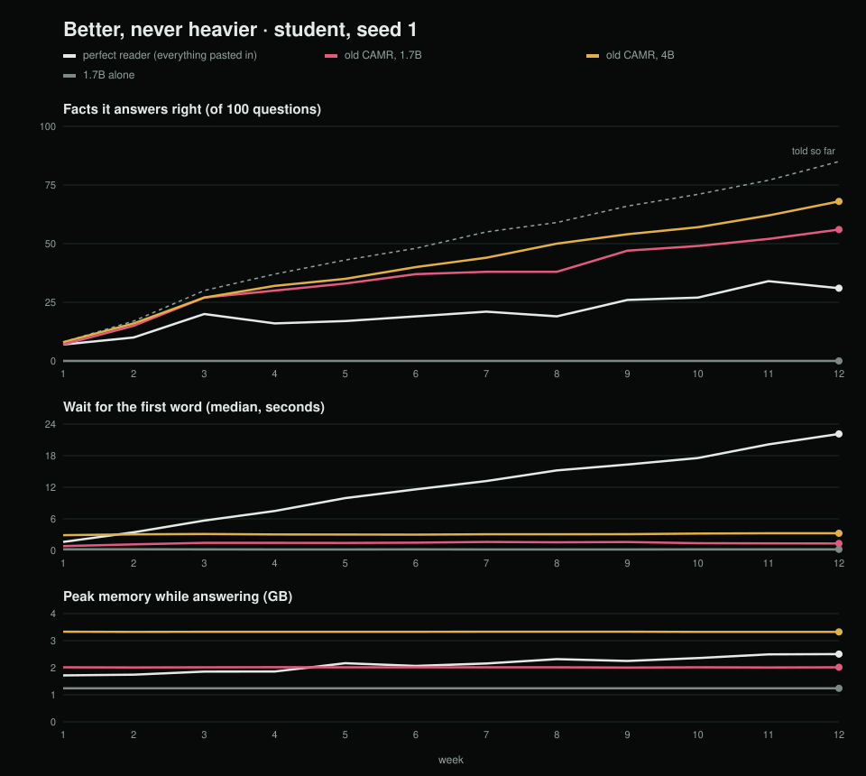
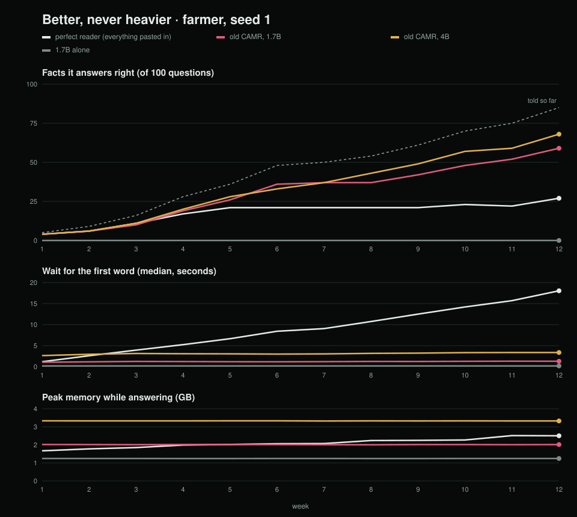
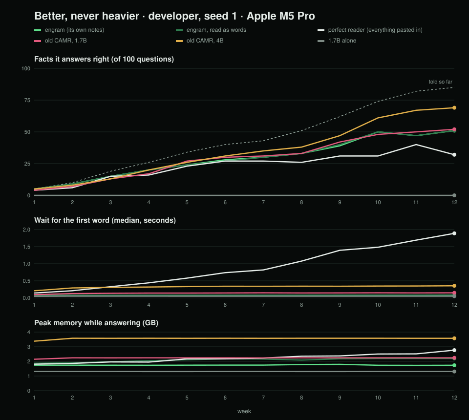

# engram

**Better, never heavier.** A small language model on a MacBook Air whose memory lives on the SSD and grows. It keeps
getting better at your life without getting slower or bigger.

The plan, with every design decision and the build order:
https://claude.ai/artifact/9ZeFGovgtQHjGfKw7CJ8AN. Technical calls are logged in [DECISIONS.md](DECISIONS.md).

## Where it is

| Step | | Status |
|---|---|---|
| 0 | The ruler: scripted lives, weekly quiz, test records, baselines | done |
| 1 | Rooms and notes | next |
| 2 | Event log and first brain view | |
| 3 | Translation layer and shorthand | |
| 4 | Sleep | |
| 5 | The full brain view | |
| 6 | The proof run | |

## The ruler

Three scripted 12-week lives (a student, a dairy-cooperative manager, a developer) and the same 100-question quiz
every week. Every run writes a dated test record to `records/`.

```sh
uv venv --python 3.12 && uv pip install -e ".[dev,baseline]"
uv pip install --no-deps -e ~/Desktop/camr-repo           # the old CAMR, for its contender
python -m engram.ruler life --persona farmer --seed 0     # read a life and its quiz
python -m engram.ruler run --persona student --seed 1 --contender camr
python -m engram.ruler chart --persona student --seed 1   # records/charts/growth-student-s1.svg
scripts/baselines.sh                                       # every contender through the three proof lives
pytest
```

Contenders: `bare` (the model alone), `perfect` (every note pasted in), `camr` (the old CAMR on the same models) and
`camr-4b` (the old CAMR with a model more than twice the size). Engram joins them in step 1.

Models (MLX, downloaded once): Qwen3-1.7B-4bit, Qwen3-4B-Instruct-2507-4bit, Qwen3-Embedding-0.6B-4bit-DWQ.

## The baselines (2 November 2026)

Week 12 of the three proof lives (seed 1), added together. By then each life has told 85 facts and asked 15
questions about things it never told.

| Contender | Knows | Honest when never told | False memories | Wait for first word | Peak RAM |
|---|---|---|---|---|---|
| 1.7B alone | 0 / 255 | 45 / 45 | 0 | 0.19 s | 1.24 GB |
| Perfect reader (everything pasted in) | 91 / 255 | 28 / 45 | 17 | 19.2 s, and climbing | 2.50 GB |
| Old CAMR, 1.7B | 169 / 255 | 16 / 45 | 29 | 1.30 s | 2.02 GB |
| Old CAMR, 4B | 205 / 255 | 35 / 45 | 10 | 3.33 s | 3.34 GB |

- **Pasting everything in fails a small model.** It knows fewer facts than the old CAMR, and its wait climbs every
  week, from 1.6 s to 22 s in the student life.
- **The old CAMR on 1.7B is fast but invents.** It answers 29 of the 45 never-told questions with something made up.
- **The 4B is the real bar.** It knows the most and invents the least, but it waits 2.5× longer and needs 1.3 GB more
  RAM.
- **Facts told across two notes are almost never answered:** at most 5 of 30 for any contender.

Engram on the 1.7B has to know more than the 4B row and invent less, while staying at the old CAMR's wait and RAM.




