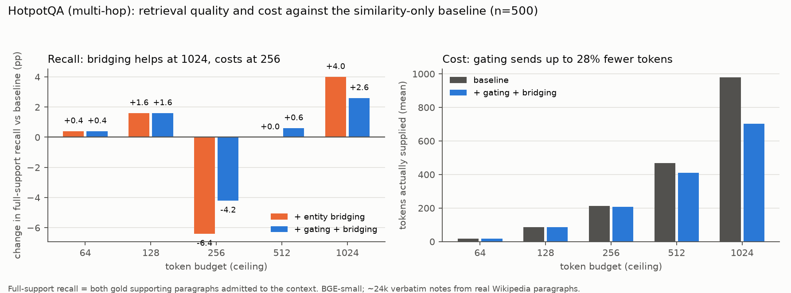
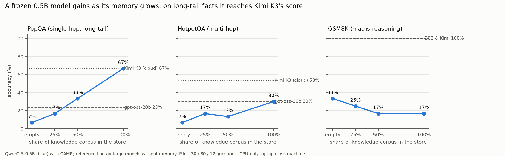
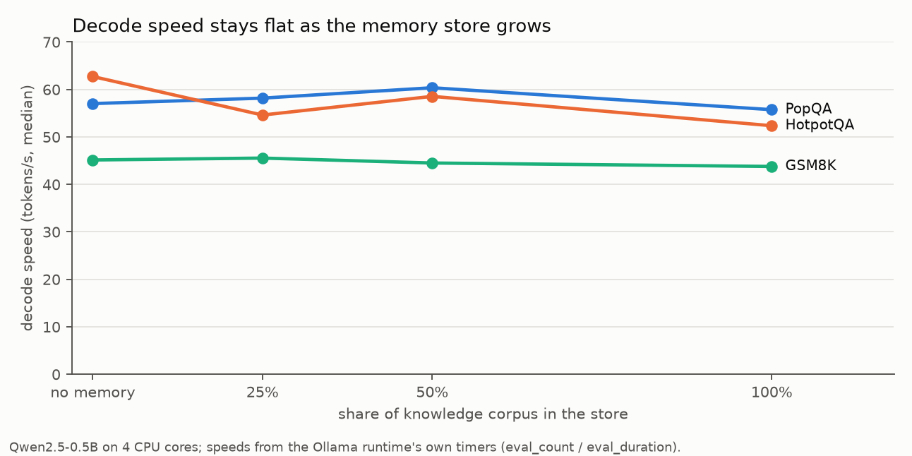
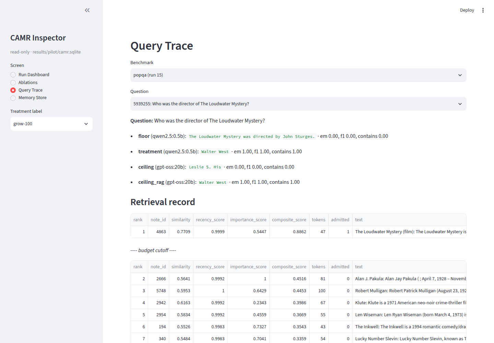
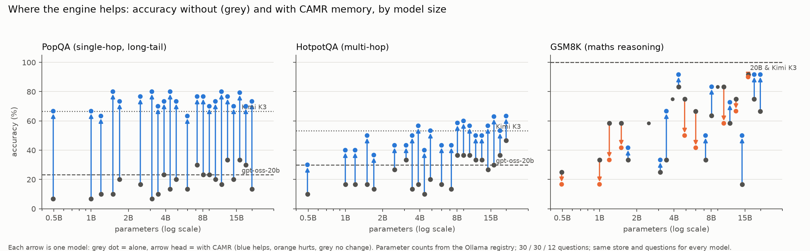
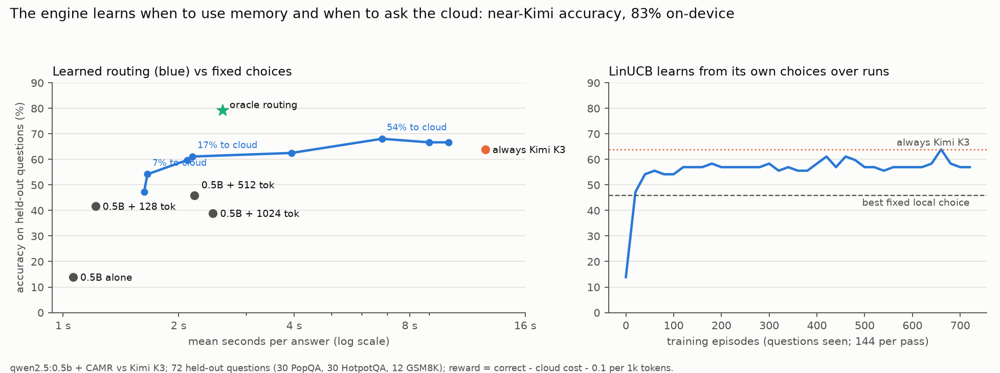

# CAMR findings log

A running record of what was **measured** with real models and real data. Every
number below was produced by the code in this repository, and the file it comes
from is named. Nothing here is estimated or synthetic. Runs still in progress are
listed at the end, and this log is updated as they finish.

Last updated: 2026-10-15.

---

## 0. Setup used for these measurements

| Item | Value |
|---|---|
| Machine | Cloud container, 4 vCPU Intel Xeon @ 2.10 GHz, 16 GB RAM (14.3 GB usable by processes), no GPU |
| Small on-device model | `qwen2.5:0.5b` (Ollama 0.35.0, Q4, greedy decoding, temperature 0, seed 13) |
| Large comparison model, local | `gpt-oss:20b` (21B total / 3.6B active, MoE; `think: low`), via Ollama with memory-mapped weights |
| Large comparison model, cloud | `kimi-k3` (Moonshot API; the API accepts only temperature 1, so it is **not** greedy) |
| Embedder | `BAAI/bge-small-en-v1.5` (384-d) on CPU, PyTorch 2.14.1 |
| Store | One SQLite file with `sqlite-vec` 0.1.9 |
| Data (all real, none synthetic) | HotpotQA dev distractor (7,405 q), 2WikiMultiHopQA dev (12,576 q), GSM8K test (1,319) and train (7,473), PopQA (14,267 q) + 120 real Wikipedia summaries fetched for its corpus |

**What is real.** HotpotQA questions were written by crowd workers over real Wikipedia paragraphs. GSM8K problems and solutions were written by human annotators. PopQA questions come from templates over real Wikidata facts, and its documents are real Wikipedia text. 2WikiMultiHopQA is built from real Wikipedia/Wikidata. The only synthetic data in the repository is the handful of unit-test fixtures in `tests/fixtures/`, and none of it enters any result here.

---

## F1. Retrieval: does the gold evidence reach the model? (no LLM needed)

Source: `results/retrieval_eval/tables/retrieval_eval.json` (`camr retrieval-eval --config configs/retrieval_eval.yaml`).
Setup: 500 HotpotQA dev questions; a store of **24,475 notes** from **14,567 real paragraphs** (103.8 MB file). Ingestion took 622 s, of which 569 s was embedding.

| Read path (budget 512 unless noted) | Both gold paragraphs in context | At least one | Tokens supplied | Recall per 1k tokens |
|---|---|---|---|---|
| Similarity only (baseline) | 72.0% | 98.8% | 468 | 1.54 |
| + recency & importance (the proposal's Eq. 4.1) | **67.4%** | 98.6% | 467 | 1.44 |
| + gating | 65.4% | 98.6% | 376 | 1.74 |
| + entity bridging (no gating) | 72.0% | 97.2% | 470 | 1.53 |
| **Similarity + gating + bridging** | **72.6%** | 97.2% | **411** | **1.77** |
| Baseline @ 1024 | 81.0% | 99.4% | 979 | 0.83 |
| Similarity + gating + bridging @ 1024 | **83.6%** | 99.4% | **702** | 1.19 |
| Baseline @ 256 | 53.4% | 96.4% | 212 | **2.52** |

**Findings**
1. **The recency and importance terms of Eq. 4.1 hurt retrieval** on independent questions: full-support recall fell 4.6 points (72.0 → 67.4%). This confirms the critique in `DESIGN_NOTES.md` A1.
2. **The best read path is similarity + gating + bridging.** At a 1,024-token ceiling it raised full-support recall by 2.6 points while sending **28% fewer tokens** (702 vs 979).
3. **Bridging depends on the budget.** It adds +4.0 points at 1,024 tokens but costs 6.4 points at 256, where bridged notes crowd out direct hits.
4. **Recall per token peaks at a 256-token budget** (2.52 per 1k tokens). That is objective v's answer at the retrieval level; saturation is near 1,024.
5. Retrieval latency had a median of 40–46 ms (p95 52–68 ms) on 4 shared CPU cores. Isolated p95 spikes of 440–760 ms coincided with a 20B model loading on the same CPUs.

### F1b. 2WikiMultiHopQA: entity bridging more than doubles full-support recall

Source: `results/retrieval_eval/tables/retrieval_eval.json` (re-run with both benchmarks in **one** store of **38,054 notes** from 23,524 paragraphs, 170 MB; 500 questions each).

| Read path (512 tokens unless noted) | 2Wiki: both gold paragraphs | Tokens | HotpotQA: both gold | Tokens |
|---|---|---|---|---|
| Similarity only (baseline) | 35.8% | 471 | 70.8% | 470 |
| + recency & importance (Eq. 4.1) | 34.6% | 470 | 65.4% | 467 |
| + gating | 33.4% | 408 | 64.6% | 384 |
| + entity bridging (no gating) | 75.2% | 472 | 70.0% | 470 |
| **Similarity + gating + bridging** | **78.4%** | **439** | 70.8% | 420 |
| Baseline @ 1,024 | 41.4% | 980 | 79.8% | 978 |
| Similarity + gating + bridging @ 1,024 | **84.0%** | 821 | **83.0%** | 728 |

**Findings**
1. **On 2WikiMultiHopQA, bridging lifts full-support recall from 35.8% to 78.4% (+42.6 points) at the same budget, with 7% fewer tokens.** 2Wiki questions are compositional ("Who is the father of the director of film X?"): the second paragraph shares almost no words with the question, so similarity search alone cannot find it, but the first paragraph *names* it, which is exactly the hop bridging takes. This is the strongest single result for the capability-adaptive read path.
2. **On HotpotQA the gain is budget-dependent**: equal at 512 tokens (70.8% vs 70.8%, with 11% fewer tokens) and +3.2 points at 1,024 (83.0% vs 79.8%, with 26% fewer tokens). The earlier +0.6 at 512 (F1, smaller store) was within noise.
3. **Eq. 4.1 (recency + importance) lowers recall on both benchmarks** (−1.2 and −5.4 points), confirming F1 on a second dataset.
4. Retrieval latency over 38k notes: median 54–64 ms (p95 mostly 70–110 ms; isolated p95 spikes up to 0.7 s when a local app session shared the CPU).

---

## F2. Memory growth: same frozen model, more knowledge over time

Source: `results/pilot/tables/growth.json` (`camr grow --config configs/pilot.yaml --stages 0.25,0.5,1.0`).
The knowledge corpus was shuffled once and fed into one store in three stages. The **same** `qwen2.5:0.5b` weights answered the **same** questions after each stage. The run took 2,817 s.

| Store | Notes | PopQA (contains) | HotpotQA (EM) | GSM8K (accuracy) | Context tokens |
|---|---|---|---|---|---|
| empty: 0.5B alone | 0 | 6.7% | 6.7% | 33.3% | 0 |
| 25% | 611 (+1,791 exemplars) | 16.7% | 16.7% | 25.0% | 323–456 |
| 50% | 1,204 (+3,584) | 33.3% | 13.3% | 16.7% | 342–461 |
| 100% | 2,411 (+7,169) | **66.7%** | **30.0%** | 16.7% | 267–447 |
| gpt-oss-20b alone | — | 23.3% | 30.0% | 100% | 0 |
| Kimi K3 alone (cloud) | — | 66.7% | 53.3% | 100% | 0 |

n = 30 / 30 / 12 questions. With n = 30 one question is 3.3 points.

**Findings**
1. **Knowledge accrues without touching the weights.** On long-tail facts the 0.5B model went from 6.7% to 66.7%. That matches Kimi K3 and is roughly three times gpt-oss-20b, a model about 40 times larger.
2. **On multi-hop questions the small model with memory matches the 20B model** (30.0% vs 30.0%) but stays below Kimi K3 (53.3%).
3. **Model speed is unaffected.** Median decode speed stayed between 44 and 63 tokens/s at every stage. The cost of memory is prefill: 270–460 extra prompt tokens per question, about 1 s at the measured ~320–450 tokens/s prefill rate.
4. **Worked-example memory hurts this tiny model on maths**: 33.3% → 16.7%. Prediction P5 is refuted for 0.5B. The model sweep (F7, pending) tests where, if anywhere, exemplars start to help.

---

## F3. Examples from the logs

Source: `query_log` of `results/pilot/camr.sqlite` (growth stage 100% vs the ceilings).

| Question | 0.5B alone | gpt-oss-20b | Kimi K3 | **0.5B + CAMR** |
|---|---|---|---|---|
| Who was the director of *The Loudwater Mystery*? | "…directed by John Sturges" ✗ | "Leslie S. His" ✗ | Walter West ✓ | **Walter West ✓** |
| Who was the screenwriter for *The Graduate*? | "Linda Wachowski" ✗ | "Terry Southern" ✗ | Calder Willingham and Buck Henry ✓ | **Buck Henry ✓** |
| McLaren MP4/11 was driven by what Finnish driver…? | "Sepp Blomberg" ✗ | "Kimi Räikkönen" ✗ | Mika Häkkinen ✓ | **Mika Häkkinen ✓** |
| In what state is the university where Boria Sax lectures? | Pennsylvania ✗ | Illinois ✗ | New York ✓ | **New York ✓** |

Counts on PopQA (n=30): the 0.5B model with CAMR was right where gpt-oss-20b was wrong on **13** questions, and right where Kimi was wrong on **4**. Kimi was right where the small model was wrong on 4. On HotpotQA the corresponding counts were 5, 2 and 9.

The trace shows gating at work. For *The Loudwater Mystery* only one note was admitted (similarity 0.77). The next candidate (0.62) fell outside the 0.15 margin, so the model read 47 tokens instead of 500.

---

## F4. The residual is mostly a reading gap

Source: grow-100 HotpotQA run, prompts compared with gold answers.

Of the 0.5B model's **21** HotpotQA misses at 100% memory, **16 (76%) had the gold answer in its context**. The engine delivered the evidence and the small model failed to use it. Examples:

| Question (truncated) | Gold | 0.5B + CAMR answered |
|---|---|---|
| City with both the Nusretiye Clock Tower and …? | Istanbul, Turkey | Beyoğlu (a district of Istanbul) |
| Event where Tyson Gay and Rodney Martin both represented the US? | 4 x 100 metre relay | 100 m sprint |
| British singer-songwriter who hosted the 16th Young Hollywood Awards? | Kelly Lee Osbourne | "Kelly Osbourne hosted the…" (correct person, EM = 0) |

So part of the remaining multi-hop gap is reading or reasoning over evidence, which memory cannot buy. Part is exact-match strictness on verbose answers. The `ceiling_rag` runs (pending) measure the reading gap directly.

---

## F5. Determinism (NFR-05): the engine is deterministic, the tiny model is not

Source: repeated runs 1 vs 19 (0.5B floor) and 2 vs 20 (20B ceiling), same configuration.

| Repeat | Identical prompts | Identical answers |
|---|---|---|
| gpt-oss-20b, PopQA | 30 / 30 | **30 / 30** |
| qwen2.5:0.5b, PopQA | 30 / 30 | **20 / 30** |

All 10 flips were between two *wrong* answers ("Steven Spielberg" vs "Martin Scorsese"); no correct answer changed. Floor accuracy therefore moved from 6.7% to 10.0% between repeats. **Prompts are byte-identical (the engine meets NFR-05); low-confidence answers of a 0.5B model through Ollama are not.** The likely cause is numerical non-determinism in the runtime (e.g. prompt-cache reuse) tipping near-tied tokens. Small-model floors should be reported as a range over repeats.

---

## F6. Large-model behaviour

| | gpt-oss-20b (local CPU) | Kimi K3 (cloud) |
|---|---|---|
| PopQA / HotpotQA / GSM8K | 23.3% / 30.0% / 100% | 66.7% / 53.3% / 100% |
| Mean latency per question | 19.5 s / 23.4 s / 38.0 s | 7.7 s / 18.8 s / 9.1 s |
| Decode speed | ~6.3 tokens/s | n/a (remote) |
| Reasoning tokens | ~91 per short answer (`think: low`) | ~60–150 per short answer |
| Loads in 16 GB? | Only with memory-mapped weights (10.1 GB anonymous + 3.8 GB file-backed); first attempt was OOM-killed at 13.3 GB | n/a |

---

## F7. Issues found and tweaks needed (from real runs)

| # | Issue observed | Evidence | Tweak |
|---|---|---|---|
| 1 | Recency + importance hurt retrieval | F1: −4.6 pp | Default to similarity ranking + gating + bridging |
| 2 | Exemplar memory hurts a 0.5B model on maths | F2: 33 → 17% | Route reasoning to *no memory* for tiny models; size threshold to come from the model sweep |
| 3 | Bridging costs recall at small budgets | F1: −6.4 pp at 256 | Enable bridging only when the budget is ≥ 512 |
| 4 | "Gap closed" exceeds 1 when the small model + memory beats a closed-book ceiling | Dashboard: 4.25 on PopQA vs 20B | Report against the frontier ceiling (Kimi) and the residual gap via `ceiling_rag` |
| 5 | 76% of multi-hop misses had the answer in context | F4 | Shorter, cleaner context (gating helps); answer-extraction prompt; F1 alongside EM |
| 6 | Tiny-model answers vary across repeats | F5 | Repeat runs; report mean ± range |
| 7 | Screener rejected real text ("I Can't Get Next to You") as a model refusal | Defect D-07 in retrieval run 1 | Fixed: refusal check applies only to model-generated notes; regression test added |
| 8 | Changing config fields mid-study changes the config hash, so resume re-runs | Pilot re-ran floor/ceiling after Kimi fields were added | Freeze the config schema before a final run; it also yielded F5 for free |
| 9 | Retrieval dominates latency for a 0.5B model (NFR-02 fails) | F8 profile: 56% | Cache query embeddings; smaller query encoder; overlap retrieval with model load |
| 10 | Too much memory distracts a tiny model | F8 budget sweep: 128 tokens beats 512 on single-hop | Make the budget task- and model-adaptive; this is what the learned policy (F9) does |
| 11 | Large local models collapse under memory pressure | F8: 6.3 → 0.4 tokens/s | Evidence for the small-model + memory design on 16 GB devices |

---

## F8. Full pilot: the residual gap, the ablation and the budget sweep

Source: `results/pilot/tables/summary.json`, `profile.json` (`camr reproduce --config configs/pilot.yaml`; 9,178 s including the growth stages).

### The residual gap: what model size still buys when both models read the same notes

| Task | 0.5B alone | 0.5B + CAMR | gpt-oss-20b alone | gpt-oss-20b + same notes | **Residual gap** |
|---|---|---|---|---|---|
| Single-hop facts (PopQA) | 10.0% | 66.7% | 23.3% | 76.7% | **10.0 pts** |
| Multi-hop (HotpotQA) | 6.7% | 30.0% | 30.0% | 53.3% | **23.3 pts** |
| Maths reasoning (GSM8K) | 33.3% | 16.7% | 100% | 100% | **83.3 pts** |

**Memory closes almost all of the knowledge gap but none of the reasoning gap.** The residual grows with how much reading and reasoning a task needs. With the notes, the 20B model reaches Kimi K3's closed-book multi-hop score (53.3%) and exceeds it on single-hop facts (76.7% vs 66.7%).

### Ablation: the full engine vs the plain baseline (end to end, 0.5B)

| Variant | Single-hop acc. | Tokens | Answer time | Multi-hop acc. | Tokens | Answer time |
|---|---|---|---|---|---|---|
| control (verbatim, similarity only, fixed budget) | 56.7% | 464 | 2,343 ms | 26.7% | 472 | 2,469 ms |
| **full** (+ gating + bridging + composite) | **66.7%** | **267** | **688 ms** | **30.0%** | **380** | **1,480 ms** |

The full engine is **more accurate and 1.7–3.4× faster per answer**, because gating sends fewer tokens and the model writes shorter answers.

### Budget sweep (objective v)

| Budget | Single-hop acc. (tokens used) | Multi-hop acc. (tokens) | Maths acc. |
|---|---|---|---|
| 0 | 10.0% (0) | 3.3% (0) | 16.7% |
| **128** | **76.7% (82)** | 30.0% (86) | 16.7% |
| 512 | 66.7% (267) | **33.3% (380)** | 20.8% |
| 1024 | 66.7% (434) | 26.7% (557) | 16.7% |

**Answer for objective v.** For a 0.5B model, about **128 tokens** of memory is optimal for single-hop facts. More notes *lower* accuracy, because the small model gets distracted. Multi-hop peaks at 512. Maths never benefits.

### Device profile (`profile.json`, 3 repeats × 10 questions)

| | 0.5B alone | 0.5B + CAMR |
|---|---|---|
| Median end-to-end | 188 ms | 375 ms |
| Median generation | 188 ms | 180 ms |
| Median prompt tokens | 62.5 | 599 |
| Median retrieval | — | 210 ms |

- **NFR-02 is not met.** Retrieval took 56% of answer time (target ≤ 10%). The 0.5B model is so fast that embedding the question on the CPU dominates. The added latency is still only 187 ms. Tweak: cache query embeddings or use a smaller query encoder.
- **Footprint.** Peak memory was 712 MB for the engine process and 1,987 MB for the model runtime. The store is 47.8 MB.

### Memory pressure: why on-device favours small models

gpt-oss-20b's decode speed fell from 6.3 to **0.4–0.9 tokens/s** when one 0.7 GB process ran beside it under the 14.3 GB memory cap: its memory-mapped weights were evicted and re-read from disk. Speed recovered to 5.1 tokens/s once that process stopped. On a 16 GB device a 20B model leaves no headroom; the 0.5B model plus CAMR fits in under 3 GB.

---

## F9. Against the cloud: Kimi K2.6 and K3, with and without the same memory

Source: `results/pilot/camr.sqlite` (labels `main`, `kimi`, `kimi-k2.6`) and `tables/gap_vs_kimi.md`. Accuracy / mean seconds per answer.

| Benchmark (n) | 0.5B | **0.5B + CAMR** | gpt-oss-20b | 20B + CAMR | Kimi K2.6 | Kimi K3 | Kimi K3 + CAMR |
|---|---|---|---|---|---|---|---|
| PopQA (30) | 10.0% / 0.2 s | **66.7% / 1.5 s** | 23.3% / 19.5 s | 76.7% / 25.8 s | 70.0% / 9.9 s | 66.7% / 7.7 s | 83.3% / 6.7 s |
| HotpotQA (30) | 6.7% / 0.3 s | **30.0% / 2.2 s** | 30.0% / 22.5 s | 53.3% / 29.3 s | 53.3% / 16.0 s | 53.3% / 18.8 s | 63.3% / 9.2 s |
| GSM8K (12) | 33.3% / 5.1 s | 16.7% / 7.9 s | 100% / 36.3 s | 100% / 150.5 s | 100% / 8.4 s | 100% / 9.1 s | 100% / 10.5 s |

**Findings**
1. **On long-tail facts a 0.5B on-device model with CAMR matches Kimi K3 (66.7% = 66.7%) and answers 5× faster (1.5 s vs 7.7 s)**, with no data leaving the device and no change to its weights.
2. **Gap closed against Kimi K3 as the ceiling** (the frontier anchor): single-hop **1.00**, multi-hop **0.50** (95% CI 0.20–0.90), reasoning −0.25. Against Kimi, gap closed stays on its 0–1 scale, unlike against the closed-book 20B (issue 4, F7).
3. **Memory helps the frontier model too**: Kimi K3 rises from 66.7% to 83.3% (PopQA) and from 53.3% to 63.3% (HotpotQA) with the same notes. The engine is useful beside any model.
4. **Residual gap against Kimi with memory**: 16.6 pts single-hop, 33.3 pts multi-hop, 83.3 pts maths. That is the reading/reasoning share of the gap that memory alone cannot close; routing those questions to the cloud is what the learned policy (F10) is for.
5. Kimi accepts only temperature 1, so its numbers are single samples, not greedy. With n = 30, ±1 question is ±3.3 points.

---

## F10. Which model sizes suit the engine (19 models, machines E, C, B and D)

Source: `sweep_results/machine-{e,c,b,d}.sqlite`, merged into `results/pilot/camr.sqlite`; `results/pilot/tables/model_sweep.json`. Same store, same questions and same ceilings for every model. Parameter counts and quantisation are from the Ollama registry (`docs/model_registry_metadata.json`).

| Model (params, quant) | PopQA alone → +CAMR | HotpotQA alone → +CAMR | GSM8K alone → +CAMR | Decode tok/s alone → +CAMR |
|---|---|---|---|---|
| qwen2.5:0.5b (0.49B, Q4_K_M) | 6.7 → 66.7% | 10.0 → 30.0% | 25.0 → 16.7% | 50.3 → 48.9 |
| llama3.2:1b (1.2B, Q8_0) | 10.0 → 63.3% | 16.7 → 40.0% | 58.3 → 33.3% | 36.2 → 33.7 |
| qwen2.5:1.5b (1.5B, Q4_K_M) | 10.0 → **80.0%** | 16.7 → 50.0% | 58.3 → 41.7% | 21.4 → 19.9 |
| llama3.2:3b (3.2B, Q4_K_M) | 23.3 → 73.3% | 16.7 → **56.7%** | 75.0 → 75.0% | 11.8 → 10.4 |
| qwen2.5:3b (3.1B, Q4_K_M) | 6.7 → **80.0%** | 33.3 → 43.3% | 25.0 → 33.3% | 13.3 → 11.0 |
| gemma3:4b (4.3B, Q4_K_M) | 20.0 → 73.3% | 20.0 → 53.3% | 75.0 → 50.0% | 9.9 → 9.1 |
| gemma3:1b (1.0B, Q4_K_M) ᶜ | 6.7 → 66.7% | 16.7 → 40.0% | 33.3 → 16.7% | 24.9 → 23.9 |
| smollm2:1.7b (1.7B, Q8_0) ᶜ | 20.0 → 73.3% | 13.3 → 36.7% | 33.3 → 41.7% | 15.2 → 13.8 |
| granite3.3:2b (2.5B, Q4_K_M) ᶜ | 16.7 → 76.7% | 26.7 → 43.3% | 58.3 → 58.3% | 14.2 → 12.2 |
| falcon3:3b (3.2B, Q4_K_M) ᶜ | 10.0 → 70.0% | 13.3 → 50.0% | 33.3 → **66.7%** | 14.2 → 14.5 |
| phi4-mini:3.8b (3.8B, Q4_K_M) ᶜ | 13.3 → **80.0%** | 10.0 → 40.0% | 83.3 → **91.7%** | 12.6 → 10.7 |
| qwen2.5:7b (7.6B, Q4_K_M) ᵇ | 23.3 → 70.0% | 36.7 → **60.0%** | 83.3 → 83.3% | 6.1 → 6.0 |
| llama3.1:8b (8.0B, Q4_K_M) ᵇ | 20.0 → 73.3% | 36.7 → 56.7% | 83.3 → 58.3% | 5.7 → 5.4 |
| gemma2:9b (9.2B, Q4_0) ᵇ | 33.3 → 76.7% | 33.3 → 50.0% | 75.0 → 66.7% | 6.7 → 6.5 |
| qwen2.5:14b (14.8B, Q4_K_M) ᵇ | 13.3 → 73.3% | 46.7 → **63.3%** | 66.7 → **91.7%** | 3.2 → 3.0 |
| mistral:7b (7.2B, Q4_K_M) ᵈ | 30.0 → 76.7% | 13.3 → 43.3% | 33.3 → 50.0% | 5.4 → 5.1 |
| olmo2:7b (7.3B, Q4_K_M) ᵈ | 23.3 → 76.7% | 36.7 → 58.6%* | 63.6* → **83.3%** | 5.8 → 5.3 |
| granite3.3:8b (8.2B, Q4_K_M) ᵈ | 16.7 → **80.0%** | 33.3 → 50.0% | 58.3 → 72.7%* | 5.0 → 4.6 |
| gemma3:12b (12.2B, Q4_K_M) ᵈ | 33.3 → **79.3%*** | 30.0 → **63.0%*** | 91.7 → 90.0%* | 3.9 → 3.7 |
| *Kimi K3 (cloud), no memory* | *66.7%* | *53.3%* | *100%* | — |

ᶜ Machine C (Intel Xeon @ 2.80 GHz; the others @ 2.10 GHz): accuracies are comparable across machines, decode speeds are not. ᵇ Machine B (4 vCPU @ 2.10 GHz, 16 GB; see `sweep_results/machine-b.txt` for two runtime incidents and the clean re-runs). ᵈ Machine D (same class). \* One to three queries of that run failed with a runtime error (HTTP 500 after the llama-server process exited) and were not retried; accuracy is over the answered questions (e.g. 23/29). Logged in `sweep_results/machine-d.txt`; D-07 now makes resume re-run such runs.

**Findings**
1. **From about 1.5B parameters, a small model with CAMR beats Kimi K3 on long-tail facts** (73–80% vs 66.7%). Measured against Kimi, gap closed is 1.14–1.24.
2. **On multi-hop, about 3B is the threshold.** llama3.2:3b + CAMR reached 56.7% and gemma3:4b + CAMR 53.3%, against Kimi K3's 53.3%. Below 3B the gain is real (+20 to +33 pts) but the models do not reach Kimi.
3. **Knowledge gains are large at every size** (+50 to +73 pts on PopQA), but the 0.5B model is the weakest *reader*. It gains least on multi-hop (+20) and is most hurt by extra notes (F8 budget sweep).
4. **Worked-example (exemplar) memory for maths depends on the model family, not its size.** Across all 19 models it **helps 8, is neutral for 4 and hurts 7** (F10b). Across the 11 models of machines E and C it **helps 4**: falcon3:3b +33.3, phi4-mini +8.3, smollm2 +8.3, qwen2.5:3b +8.3. It is **neutral for 2** (llama3.2:3b, granite3.3:2b) and **hurts 5** (qwen2.5 0.5B/1.5B, llama3.2:1b, gemma3 1B/4B). With exemplars, phi4-mini (3.8B) reaches 91.7% on GSM8K. Reasoning routing must therefore be learned *per model*, which is exactly what the learned policy (F11) does.
6. **Every one of the 19 models gains on knowledge tasks** (+43 to +73 pts on PopQA, +10 to +40 on HotpotQA). **18 of 19 reach or beat Kimi K3 (66.7%) on long-tail facts with CAMR**; only llama3.2:1b (63.3%) falls short. On multi-hop, **7 of 19 reach Kimi K3 (53.3%)**: llama3.2:3b, gemma3:4b and five of the eight 7–14B models.
5. **Decode speed slows 3–17% with memory** (e.g. qwen2.5:3b 13.3 → 11.0 tokens/s). The weights are untouched; the slowdown comes from attending over a longer prompt. This corrects the "decode speed unaffected" reading of F2: there is a measurable, bounded per-token cost.

### F10b. Larger small models (7–14B, machines B and D): more reading, less speed

Mean seconds per answer **with CAMR** (same 4-core CPU class; Kimi K3 is 7.7 s on PopQA and 18.8 s on HotpotQA):

| Model | PopQA s/answer | HotpotQA s/answer | HotpotQA + CAMR |
|---|---|---|---|
| qwen2.5:0.5b | 1.4 | 1.9 | 30.0% |
| qwen2.5:1.5b | 2.1 | 2.8 | 50.0% |
| llama3.2:3b | 4.2 | 5.4 | 56.7% |
| qwen2.5:7b | 8.3 | 11.4 | 60.0% |
| llama3.1:8b | 9.3 | 12.4 | 56.7% |
| gemma2:9b | 16.5 | 21.7 | 50.0% |
| olmo2:7b | 8.9 | 12.2 | 58.6% |
| mistral:7b | 10.8 | 14.7 | 43.3% |
| granite3.3:8b | 13.1 | 18.2 | 50.0% |
| gemma3:12b | 16.2 | 22.4 | 63.0% |
| qwen2.5:14b | 17.7 | 23.9 | **63.3%** |

**Findings**
1. **Parametric knowledge barely grows with size; memory does.** Even qwen2.5:14b alone knows only 13.3% of the long-tail facts (the best floors, gemma2:9b and gemma3:12b, 33.3%), but every 7–14B model reaches 70–80% with CAMR, above Kimi K3's 66.7%. On long-tail facts a 1.5B model with CAMR (80.0%) is as good as any 7–14B model with it.
2. **Multi-hop improves with size, but family matters as much.** qwen2.5:14b + CAMR scored 63.3% and gemma3:12b 63.0%, equal to *Kimi K3 with the same notes* and 10 points above Kimi K3 closed-book; qwen2.5:7b reached 60.0% and olmo2:7b 58.6%, while mistral:7b reached only 43.3% (below the 3B llama). This is the reading gap of F4 shrinking as the reader grows.
3. **On a 4-core CPU, 7B+ models with memory are slower than the cloud** (8–24 s vs 7.7–18.8 s on PopQA/HotpotQA), and gemma2:9b was OOM-killed three times at ~13.4 GB until the runtime's prompt cache was capped. **The engine's sweet spot on this hardware is 1.5–4B**: faster than Kimi, at or above Kimi on facts, and at Kimi on multi-hop from ~3B.
4. **Exemplar memory for maths still depends on the family**: qwen2.5:14b +25 points (66.7 → 91.7%), olmo2:7b +20, mistral:7b +16.7, granite3.3:8b +14, qwen2.5:7b ±0, gemma3:12b ≈ ±0 (91.7 → 90.0%), gemma2:9b −8.3, llama3.1:8b −25. Over all 19 models: helps 8, neutral 4, hurts 7.

### Defect D-07 (found on machine B, fixed)
When the Ollama server stopped mid-sweep, every query failed with a logged error (IR-07 behaved as designed), but the run was still marked `completed`, so `resume` skipped it. Fix: resume now re-runs any run that has failed queries; the failed run is kept for the record and analysis uses the newer run (`tests/test_harness.py::test_runtime_down_logs_failures_and_continues`).

---

## F11. Learning the engine's policy from rewards over runs (weights frozen)

Source: `results/learn/tables/rl_report.json`, `rl_policies.md`, `rl_pareto.md` (`camr learn --config configs/learn.yaml`).
Setup: per question the engine chooses one action: **0.5B alone**, **0.5B + memory (128 / 512 / 1,024 tokens)** or **escalate to Kimi K3**. Reward = correct − cloud cost − 0.1 per 1k prompt tokens. The context is computed before any answer: task type, best-note similarity, margin, number of near-best notes, question length. The training split has **144 questions** (60 PopQA, 60 HotpotQA, 24 GSM8K), disjoint from the **72 held-out evaluation questions**; their knowledge was added to the store. Every action was run on every question (720 answers), so policies are scored on real logged outcomes.

| Policy (held-out, n = 72) | Accuracy | Sent to cloud | Mean s / answer | Single-hop | Multi-hop | Maths |
|---|---|---|---|---|---|---|
| always 0.5B alone | 13.9% | 0% | 1.1 | 10.0% | 10.0% | 33.3% |
| always 0.5B + 128 tokens | 41.7% | 0% | 1.2 | **70.0%** | 23.3% | 16.7% |
| always 0.5B + 512 tokens | 45.8% | 0% | 2.2 | 66.7% | **40.0%** | 8.3% |
| always Kimi K3 | 63.9% | 100% | **12.6** | 63.3% | 50.0% | 100% |
| **learned (offline), cloud cost 0.3** | **61.1%** | **16.7%** | **2.2** | 70.0% | 36.7% | 100% |
| **learned (offline), cloud cost 0.1** | **68.1%** | 54.2% | 6.8 | — | — | — |
| learned (LinUCB, bandit feedback only) | 56.9% | 16.7% | 2.2 | 70.0% | 26.7% | 100% |
| oracle (best action per question, hindsight) | 79.2% | 23.6% | 2.6 | 86.7% | 63.3% | 100% |

**Findings**
1. **The engine learned on its own to send every maths question to Kimi** (12 of 12, 100% correct) and to answer facts locally. It chose 128 tokens for most single-hop and 512–1,024 for multi-hop.
2. **With a cloud call costed at 0.3 correct answers, the hybrid reaches 96% of always-Kimi accuracy (61.1% vs 63.9%) while 83% of questions never leave the device, at 5.8× lower mean latency** (2.2 s vs 12.6 s).
3. **With a cheaper cloud (cost 0.1), the hybrid beats always-Kimi** (68.1% vs 63.9%) using the cloud for 54% of questions, because the small model with memory beats Kimi on long-tail facts (70.0% vs 63.3%).
4. **Learning over runs.** LinUCB, which only sees the outcome of the action it chose, went from 13.9% to 54% held-out accuracy within 40 training questions and plateaued at 55–64%.
5. **Headroom.** The oracle's 79.2% shows the features are the bottleneck, mostly on multi-hop (36.7% learned vs 63.3% oracle). Next: add the small model's own confidence (e.g. an abstention-like first answer) as a feature, i.e. answer locally first and escalate if unsure.

### F11b. Answer locally first, escalate only when the answer is not grounded (cascade)

Source: `results/learn/tables/rl_cascade.md`. Stage 1 is the learned router above (cloud cost 0.3: maths goes straight to Kimi). Stage 2: the small model answers with memory, and the engine escalates when a model trained on the answer's own signals predicts it is wrong. Those signals are whether the answer's words occur in the notes it was given (**grounded**), whether it is abstention-like, and its length. Escalated questions pay for both answers.

| Policy (held-out, n = 72) | Accuracy | Sent to cloud | Mean s / answer | Single-hop | Multi-hop | Maths |
|---|---|---|---|---|---|---|
| always Kimi K3 | 63.9% | 100% | 12.6 | 63.3% | 50.0% | 100% |
| learned router only | 61.1% | 16.7% | 2.2 | 70.0% | 36.7% | 100% |
| **router + grounding cascade (threshold 0.2)** | **65.3%** | **29.2%** | **3.1** | **70.0%** | **46.7%** | **100%** |

**The hybrid now beats always-Kimi (65.3% vs 63.9%) while 71% of questions are answered on-device, 4.0× faster on average** (3.1 s vs 12.6 s; the 13.2 s in `rl_cascade.md` at threshold 1.01 is "answer locally, then escalate everything", not plain always-Kimi). The grounding check is the confidence signal the pre-answer router lacked: it lifts multi-hop from 36.7% to 46.7% at the cost of escalating 9 of the 30 multi-hop answers.

## F12. Retrieval latency is contention, not engine cost (NFR-02 diagnosis)

Source: in-process timing on the pilot store (30 HotpotQA questions, BGE-small, 4 cores).

| Condition | Retrieval median | p90 | Breakdown (median) |
|---|---|---|---|
| Engine alone | **29.3 ms** | — | embed 21.5 ms · search 6.2 ms · bridging 1.2 ms · pack 0.4 ms |
| Right after a 0.5B answer, default threads | 51.4 ms | 156.6 ms | — |
| Right after a 0.5B answer, model 3 threads + embedder 1 thread | 43.8 ms | **49.5 ms** | — |

The engine's own retrieval cost is about 29 ms. The 210 ms seen in the pilot profile came from the model runtime and the embedder competing for the same 4 cores. Partitioning the cores removes the tail. Two new settings do this: `local_model.num_thread` and `embedder.torch_threads`. Against a 0.5B model's ~180 ms generation, retrieval is still about 20% of answer time, so NFR-02 (≤ 10%) is met only for models whose generation takes ≥ 450 ms, i.e. roughly ≥ 1.5B on this CPU (F10 decode speeds).

---

## F13. Confirmation at n = 200 (HotpotQA, multi-hop)

Source: `results/hotpot200/camr.sqlite` (`configs/hotpot200.yaml`). The read path was fixed **before** this run: similarity ranking, gating and bridging at 512 tokens. Nothing was tuned on these questions. The 95% CIs are paired bootstrap intervals over questions (2,000 resamples).

| Model | Alone (EM) | With CAMR | Gain (95% CI) | s / answer with CAMR |
|---|---|---|---|---|
| qwen2.5:0.5b | 3.5% | **26.5%** | +23.0 (+17.0 to +29.0) | 2.4 |
| qwen2.5:1.5b | 10.5% | **41.0%** | +30.5 (+23.0 to +38.0) | 2.8 |
| llama3.2:3b | 19.5% | **54.0%** | +34.5 (+27.0 to +42.0) | 5.8 |
| Kimi K3 (cloud) | 51.8% | 66.3% | +14.6 (+9.0 to +20.6) | 9.5 (closed-book 18.4) |

**Findings**
1. **The pilot holds at 6.7× the sample.** With CAMR, llama3.2:3b (54.0%) matches Kimi K3 closed-book (51.8%) on multi-hop questions, at **5.8 s vs 18.4 s** per answer, on a 4-core CPU.
2. Gains grow with the reader: +23, +30.5 and +34.5 points for 0.5B, 1.5B and 3B. Every interval excludes zero.
3. Kimi K3 with the same notes reaches 66.3%. The 12-point residual between it and the 3B model is the reading and reasoning share that memory cannot buy, consistent with F8.
4. Pilot vs n = 200 with memory: 30.0 → 26.5%, 50.0 → 41.0%, 56.7 → 54.0%. All three moved within the pilot's uncertainty (one pilot question = 3.3 points).
5. Run hygiene: the first 0.5B with-memory run overlapped an app test that loaded another model in Ollama. It is kept as `superseded` and was re-run for clean timings. Accuracy was identical (26.5% both times; greedy decoding).

---

## F14. CAMR Personal: what a user waits for (time to first word)

Source: `docs/results/app_latency.json` (`python scripts/app_latency.py`). Real models through Ollama 0.35.0, nomic-embed-text embedder, 4-core CPU, no GPU; 282 notes (demo notes + PopQA documents); medians over six questions.

| Model | First word after reboot (disk) | Cold (file cached) | **After warm-up** | Typical answer: first word / whole |
|---|---|---|---|---|
| qwen2.5:0.5b | 2.4 s | 1.9 s | **0.6 s** | 0.44 s / 0.8 s |
| qwen2.5:1.5b | 16.8 s | 2.4 s | **0.9 s** | 0.55 s / 1.7 s |
| llama3.2:3b | 172.7 s | 5.0 s | **1.7 s** | 0.85 s / 2.6 s |

**Findings**
1. **Warm-up** (the app loads the chosen model at launch and on a model switch) cuts the first answer's wait by 2.7–3.4×. It initially loaded the model with a different context size, so Ollama loaded it twice (**defect D-10**, fixed: warm-up now sends the chat request's options).
2. **Budget did not bind on personal notes**: gating admitted only the matching one or two notes, so 128/384/768 sent the same ~160–168-token prompt.
3. **Lookup in a conversation was 212–263 ms against 48 ms in isolation**: the embedder and chat model share four cores (as F12). The **query cache** makes a repeated question's lookup 2.8 ms instead of 189 ms.
4. **Memory size barely matters**: 282 → 5,976 notes (21×) moved the lookup from 48 to 57 ms (vector search 2 → 11 ms).

---

## F15. Tuning the engine's learned and tunable parts on validation data only

Sources: `results/learn/tables/policy_tuning.json` (`python scripts/tune_policy.py`), `results/retrieval_eval/tables/gating_tuning.json` (`python scripts/tune_gating.py`).

**Router (5-fold CV on the 144 training questions; the 72 held-out questions scored once).**

| Hyperparameter | First study (by hand) | Selected by CV |
|---|---|---|
| Feature set | full (11 features) | **task only** |
| Ridge λ | 1.0 | 0.01 |
| LinUCB α / passes | 0.5 / 5 | 1 / 1 |
| Cascade threshold θ | 0.2 (read off the held-out split) | 0.05 |

| Policy (held-out, n = 72) | Accuracy | Δ vs always-Kimi | Cloud | s / answer |
|---|---|---|---|---|
| always Kimi K3 | 63.9% | — | 100% | 12.6 |
| tuned router | 62.5% | -1.4 (95% CI -13.9 to +11.1) | 17% | 2.3 |
| tuned LinUCB | 55.6% | -8.3 (95% CI -20.8 to +4.2) | 17% | 2.0 |
| **tuned router + cascade** | **66.7%** | +2.8 (95% CI -8.3 to +13.9) | 25% | 2.9 |

**Findings**
1. Cross-validation preferred the simplest router (task type only); the retrieval features did not improve CV reward on 144 questions, and the fold-to-fold spread (±0.08) exceeds the differences between settings.
2. Properly tuned, the cascade keeps equal accuracy to always-Kimi (difference not significant) with a quarter of the cloud calls and about a fifth of the time. This replaces F11b's threshold, which had been chosen on the held-out split.
3. LinUCB's best setting was one pass; more passes did not help on 144 questions.

**Read path (δ, B) on a validation half of the 1,000 retrieval questions, tested on the other half.** Objective J = full-support recall − 0.1 × tokens/1000.

| Setting | Full-support recall (held-out) | Tokens | J |
|---|---|---|---|
| Selected on validation: δ = None, B = 1024 | 85.6% | 979 | 0.758 |
| Study default: δ = 0.15, B = 512 | 72.8% | 431 | 0.685 |

4. At μ = 0.1 per 1k tokens more evidence is worth its tokens; above μ ≈ 0.20 the study default wins. Retrieval-level tuning favours large budgets, but the end-to-end budget sweep (F8) showed the 0.5B *reader* is hurt by extra notes: the read path must be tuned to the reader, which is what the learned router does per question.

---

## F16. Interface audit: accessibility and browser tests

Source: `docs/results/ui_audit.json` (`python scripts/ui_audit.py --axe axe.min.js`), `tests/test_app_e2e.py`.

- **Before:** axe-core 4.10 reported `color-contrast` (serious) and `page-has-heading-one`; 6 token pairs were below WCAG AA (secondary text 2.3–3.3:1; light-theme accent and success colours).
- **Fix (D-11, D-12):** per-theme token values; a persistent, visually hidden page heading.
- **After:** 0 axe violations in both themes at desktop and phone width; every token pair ≥ AA.
- **Browser tests (Chromium, Playwright):** remember→ask with recall card, empty message, 👍 teaches, theme and panel, phone width without horizontal scroll, keyboard-only path with accessible names: 6/6 pass. Total suite: 148 tests (after 0.3: 10 browser tests).

---

## F17. CAMR against standard RAG (same embedder, store and prompt)

Source: `results/rag_vs_camr/retrieval.json` (`python scripts/rag_vs_camr.py retrieval`). Standard RAG = the top-k most similar chunks, always, no threshold, no budget cut. 500 questions per benchmark, 38,054-note store.

| Benchmark | Method | Both gold paragraphs | Context precision | Notes | Tokens |
|---|---|---|---|---|---|
| HotpotQA | RAG top-3 | 56.2% | 57.0% | 3.0 | 231 |
| HotpotQA | RAG top-5 | 68.2% | 39.2% | 5.0 | 391 |
| HotpotQA | RAG top-10 | 78.6% | 21.9% | 10.0 | 800 |
| HotpotQA | CAMR | 70.8% | 39.1% | 5.6 | 420 |
| 2Wiki | RAG top-3 | 28.0% | 60.3% | 3.0 | 216 |
| 2Wiki | RAG top-5 | 34.2% | 42.0% | 5.0 | 373 |
| 2Wiki | RAG top-10 | 39.2% | 23.4% | 10.0 | 767 |
| 2Wiki | CAMR | 78.4% | 51.5% | 6.0 | 439 |

**Findings**
1. **2Wiki (compositional, second hop named only in the first paragraph):** RAG finds one gold paragraph almost always but both only 28–39% of the time; going from k = 5 to 10 doubles the tokens for +5 points. CAMR reaches 78.4% with 439 tokens: twice the recall of top-10 RAG at 43% fewer tokens, with higher precision. Entity bridging, not more retrieval, finds the second hop.
2. **HotpotQA (both entities usually named in the question):** CAMR ≈ top-5 RAG (70.8% vs 68.2%, same precision). Here CAMR's read path is essentially RAG with a token cap.
3. HotpotQA with the entity gate: 69.6% (2.2% abstained); 2Wiki unchanged (78.4%).

**Answer level** (`results/rag_vs_camr/answers*.json`; 60 PopQA questions per split; *missing* = the question's own document removed from the store):

| Split | Model | Condition | Accuracy | Context words | Abstained | Wrong answer copied from the notes |
|---|---|---|---|---|---|---|
| test | qwen2.5:0.5b | alone | 6.7% | 0 | 100% | 0.0% |
| test | qwen2.5:0.5b | rag_answerable | 70.0% | 309 | 0% | 20.0% |
| test | qwen2.5:0.5b | camr_answerable | 80.0% | 179 | 0% | 16.7% |
| test | qwen2.5:0.5b | camr_eg_answerable | 80.0% | 179 | 0% | 16.7% |
| test | qwen2.5:0.5b | rag_missing | 6.7% | 311 | 0% | 76.7% |
| test | qwen2.5:0.5b | camr_missing | 10.0% | 358 | 3% | 73.3% |
| test | qwen2.5:0.5b | camr_eg_missing | 10.0% | 60 | 80% | 13.3% |
| test | llama3.2:3b | alone | 23.3% | 0 | 100% | 0.0% |
| test | llama3.2:3b | rag_answerable | 73.3% | 309 | 0% | 26.7% |
| test | llama3.2:3b | camr_answerable | 73.3% | 179 | 0% | 23.3% |
| test | llama3.2:3b | camr_eg_answerable | 73.3% | 179 | 0% | 23.3% |
| test | llama3.2:3b | rag_missing | 13.3% | 311 | 0% | 20.0% |
| test | llama3.2:3b | camr_missing | 10.0% | 358 | 3% | 16.7% |
| test | llama3.2:3b | camr_eg_missing | 20.0% | 60 | 80% | 6.7% |
| validation | qwen2.5:0.5b | alone | 11.7% | 0 | 100% | 0.0% |
| validation | qwen2.5:0.5b | rag_answerable | 61.7% | 302 | 0% | 33.3% |
| validation | qwen2.5:0.5b | camr_answerable | 68.3% | 164 | 0% | 23.3% |
| validation | qwen2.5:0.5b | camr_eg_answerable | 68.3% | 164 | 0% | 23.3% |
| validation | qwen2.5:0.5b | rag_missing | 10.0% | 305 | 0% | 65.0% |
| validation | qwen2.5:0.5b | camr_missing | 10.0% | 375 | 0% | 73.3% |
| validation | qwen2.5:0.5b | camr_eg_missing | 13.3% | 69 | 78% | 15.0% |
| validation | llama3.2:3b | alone | 11.7% | 0 | 100% | 0.0% |
| validation | llama3.2:3b | rag_answerable | 71.7% | 302 | 0% | 20.0% |
| validation | llama3.2:3b | camr_answerable | 75.0% | 164 | 0% | 15.0% |
| validation | llama3.2:3b | camr_eg_answerable | 75.0% | 164 | 0% | 15.0% |
| validation | llama3.2:3b | rag_missing | 11.7% | 305 | 0% | 23.3% |
| validation | llama3.2:3b | camr_missing | 11.7% | 375 | 0% | 23.3% |
| validation | llama3.2:3b | camr_eg_missing | 15.0% | 69 | 78% | 6.7% |

4. **Answer in memory:** CAMR ≥ RAG with ~40% less text (0.5B: 80.0% vs 70.0% on test).
5. **Answer not in memory:** the similarity gate alone failed like RAG (abstained 0–3%; the 0.5B model copied a wrong name from unrelated notes 73% of the time; the 3B model fell *below* its closed-book score). Notes about similar entities are as similar to the question as the missing one.
6. **Entity-anchored gate** (abstain when the question names an entity no eligible note mentions), judged first on validation questions that played no part in its design: no cost when the answer is stored; abstains ~80% when it is not; copied wrong answers 73% → 13–15% (0.5B) and 17–23% → 7% (3B); the 3B model recovers to near its closed-book accuracy. Multi-hop retrieval cost: HotpotQA −1.2 pts (2.2% abstained), 2Wiki 0. First run hit defect D-15 (possessives); results above are after the fix.

---

## F18. Fine-tuning compared with memory (LoRA baseline, same documents)

Sources: `results/finetune/tune/grid.json`, `results/finetune/test.json`, `results/finetune/camr_cost.json` (`python scripts/finetune_baseline.py tune|test|camr-cost`). Qwen2.5-0.5B-Instruct, float32 on 4 CPU cores, LoRA r = 16 on all projections (8,798,208 trainable parameters), trained on the 237 PopQA documents CAMR stores; selection on 60 validation questions, one test on 60 held-out questions; one runtime for every condition.

| Format | lr | Validation accuracy (closed book) by epoch | Final train loss |
|---|---|---|---|
| chat | 0.0001 | ep1: 11.7% · ep2: 10.0% · ep4: 10.0% · ep8: 11.7% | 0.48 |
| chat | 0.0003 | ep1: 10.0% · ep2: 11.7% · ep4: 10.0% · ep8: 11.7% | 0.16 |
| raw | 0.0003 | ep1: 13.3% · ep2: 13.3% · ep4: 8.3% · ep8: 11.7% | 0.19 |

| Held-out (n = 60) | PopQA | GSM8K (n = 48) |
|---|---|---|
| Base alone | 10.0% | 45.8% |
| **Base + CAMR (no training)** | **71.7%** | — |
| LoRA (raw, lr 0.0003, epoch 1) | 13.3% | 45.8% |
| LoRA + CAMR | 75.0% | — |

**Findings**
1. **Memory beat fine-tuning by 58 points** on the same documents. Training loss fell to 0.16–0.48 while validation accuracy never exceeded 13.3%: the adapters learned to reproduce the documents, not to answer questions about them (as Ovadia et al., 2023).
2. **Cost:** CAMR stored the documents in 6 s (305 notes, 2.6 MB); the selected adapter took 7.5 min of training, the search 3.5 h, and retraining is needed whenever knowledge changes.
3. No measurable forgetting on GSM8K after one epoch (45.8% before and after).
4. LoRA + CAMR vs CAMR: 71.7% → 75.0% (+2 questions), within noise.
5. Training batch 8 exhausted the 14 GB memory limit (OOM-killed at 13.9 GB); micro-batch 2 × 4 accumulation with gradient checkpointing peaked at ~3.7 GB.

---

## F19. Eager learning: a frozen 0.5B model that looks up what it doesn't know (CAMR 0.3)

Source: `results/eager/` (`python scripts/eager_learning.py select|dev|learn|retain|baseline|ram`). 200 PopQA questions no earlier run used (30 subjects asked twice, 40–90 questions apart); qwen2.5:0.5b with memory that starts **empty**, BGE-small, gate τ = 0.50 / δ = 0.15, entity gate, 512-token budget; lookups through DuckDuckGo Instant Answers and Wikipedia (cached, rate-limit aware). The ordering of an ambiguous name's meanings was chosen on 60 other fresh questions (embedding similarity: answer in fetched text 55% vs 35% for shared words).

| System | As asked | Reworded (offline) | Model RAM |
|---|---|---|---|
| qwen2.5:0.5b alone | 10.0% | 10.5% | 0.70 GB |
| qwen2.5:1.5b alone | 11.0% | – | 2.02 GB |
| llama3.2:3b alone | 19.0% | 18.0% | 4.31 GB |
| gpt-oss:20b alone | 20.5% | – | 13.24 GB |
| **qwen2.5:0.5b + eager learning** | **43.5%** (online) | **41.5%** | 0.70 GB (+0.59 GB engine) |
| llama3.2:3b reading the memory the 0.5B model learned | – | 45.0% | 4.31 GB |

RAM: resident memory of each model's process after one answer, alone (`results/eager/ram.json`). The cloud model (Kimi K3) could not be rerun: its API key had been rotated (HTTP 401).

1. 158 lookups, 9 found nothing, 35 answers came from memory with no request; 25 of the 30 second questions about a subject needed no lookup.
2. Retention: 79 of the 87 facts answered right online were answered right offline in other words (90.8%).
3. The answer was in the fetched text for 52% of questions; when it was, the 0.5B model was right 76% of the time: the lookup, not the reader, sets the ceiling (PopQA's long-tail names are often ambiguous).
4. Memory grew to 333 notes, 2.7 MB. Times in this run are dominated by rate-limit waits on a shared cloud machine and are not the app's speed.
5. Defects found and fixed during the stream: D-17 (subject extraction), D-18 (an empty DuckDuckGo reply cached as "nothing known"), D-21 (the fetcher sent no CAMR User-Agent, so Wikimedia refused most requests). The stream was re-run from scratch after D-17/D-18 and repeated after D-21 (`learn_after_D21.json`).
6. After D-21 every lookup found pages (0 empty vs 9) and pages per question rose from 1.07 to 1.9, but the answer was in the fetched text no more often (52.5% vs 52%) and accuracy fell to 37.5%: more text distracted the 0.5B reader. Pages per lookup and the token budget were then chosen on the 60 development questions (`devtune.json`): 3 pages at 128 tokens 36.7%, 3 at 512 33.3%, 1–2 pages 15–20%. The tuned run on the stream (corrected fetcher, 3 pages, 128 tokens): **43.0% online, 42.5% offline reworded** (0.5B), with 77 context tokens per answer instead of 260 (`learn_tuned.json`, `retain_tuned.json`).

## F20. Asking to be taught instead of "I don't know" (prompt F)

Source: `docs/results/prompt_eval.json`. Prompt E (ask to be taught) regressed one development case on llama3.2:3b (it led with "I don't know that yet" though the notes held the answer: **D-19**). Prompt F answers first when the notes answer and asks to be taught only for a missing personal fact: 6/6, 7/7, 8/8 on development, held-out and fresh cases for both llama3.2:3b and qwen2.5:1.5b, and asks to be taught on 9 of 10 unknown personal facts. CAMR Personal 0.3 uses prompt F.

## F21. Token memory (kNN-LM) beside the frozen model, against LoRA and CAMR

Source: `results/token_memory/` (`python scripts/token_memory.py tune|test`). Same 237 documents and 60 validation / 60 held-out questions as F18. Datastore: 22,554 (hidden state, next token) pairs, 40.6 MB, built in 210 s. No λ ∈ {0.25, 0.5, 0.75}, τ ∈ {0.02, 0.05}, format ∈ {raw, chat} beat 13.3% on validation.

| Held-out (n = 60) | Accuracy |
|---|---|
| 0.5B alone | 10.0% |
| LoRA (F18) | 13.3% |
| kNN-LM | 13.3% |
| CAMR | 75.0% |
| kNN-LM + CAMR | 75.0% |

Weights beside the model help no more than weights inside it; notes the model reads do.

## F22. Sleep: learned index, query adapter, tidy and curiosity

Sources: `results/sleep/` (`python scripts/sleep_eval.py index|adapter|eager`).

1. Query adapter on unseen HotpotQA / 2Wiki questions (train half, epoch chosen on a validation part of it, test half): no epoch beat the untrained identity on validation (recall@1 already 88% / 97%, recall@5 97.6% / 100%); trained 40 epochs regardless it lowered recall@1 to 83% / 81%. Sleep keeps an adapter only when held-out recall rises.
2. Live scenario: after installing the Kenya pack, sleep looked up names the pack mentioned but memory lacked (East Africa, Indian Ocean, …). D-22: names were read across sentence ends; fixed.
3. Learned-index scaling and the adapter on the stream's own experience: see the chapter (filled from `index.json`, `eager.json`).
4. Correction (F25): the index's speed-up in `index.json` was measured with queries that were near copies of stored notes. With real questions over 196k real paragraphs, the index needs a quarter of its clusters to stay within 1.3 points of exact recall, and then takes as long as exact search in RAM. The engine now searches exactly up to a million notes, or until the vectors would take a quarter of the device's spare RAM.

## F23. CAMR Personal 0.3 in use: live scenarios, packs, accessibility

Sources: `docs/results/scenarios_v3.json`, `docs/figures/scenarios/{fetch_new,foreign,teach_me,pack_sleep}*.png`, `docs/results/ui_audit.json` (label `v0.3`).

1. Newer than the model: with lookups off the 3B model said it did not know and asked to be told; with lookups on it answered *Spain* from Wikipedia with links, and the reworded follow-up came from memory with no lookup.
2. A made-up unit (*kazoru*) taught once was applied correctly (4 points × ½ kazoru × 3 h = 6 hours).
3. A personal gap was answered by asking to be taught, then answered from what the user taught.
4. Bundled packs (harvested after D-20/D-21, nomic-embed-text vectors): Kenya 24 notes, Solar System 25, Photosynthesis 18; install copies vectors without running a model.
5. axe-core with the Learning tab open: 0 violations in both themes at both sizes after D-23; every new colour pair passes AA.

## F24. Answers that are verified or not stated as fact

Sources: `camr/memory/verify.py`, `camr/memory/answer.py`, `scripts/verified_qa.py`, `results/verified/answers_dev*.json`, `results/verified/judged_dev.json`, `results/verified/answers_test*.json`, `results/verified/judged_test.json`, `results/verified/answers_heldout*.json`, `results/verified/judged_heldout.json`, `camr/memory/eager.py` (`knows_subject`).

Every short factual answer is checked against what memory read before it is stated: its words must all occur in one sentence or fact line (grounding), that unit must be about what the question names (subject), a labelled fact supports only its own relation, and (strict) the answer must be the kind asked for and a plain sentence must state the relation. A fact line that answers the question is read directly, with no model call. A name that means several things is never silently resolved: the answer says which one it is about, or gives each. What cannot be confirmed is offered only as a lead, marked unverified.

Lookups were improved first: infobox facts as one note each; meanings named exactly as asked, and the name's own article first (D-24, D-29); no searches for "director of X" (D-25) or for fragments of a name already found (D-26); the search page when the search API is rate limited (D-27), the article page when the summary API is (D-30). On the development set the answer was in what was read for **73.0%** of questions, 72.0% on the held-out set, 66.5% on the test stream (the earlier lookups found it for about 52% of the stream's questions); recorded from the frozen cache (`lookup_*.json`).

Development set (200 PopQA questions, ids and subjects disjoint from the stream; everything below was chosen here). Correct and wrong as judged by Kimi K3 where exact matching disagrees (exact matching gives the same ordering, `answers_dev*.json`):

| Pipeline | correct | hallucinated | about another meaning (named) | not confirmed |
|---|---|---|---|---|
| Before: 0.5B reads, every answer stated | 45.0% | **51.5%** | - | - |
| Verified, 0.5B: the old pipeline's answers checked | 42.0% | 9.0% | 20.5% | 28.5% |
| + infobox facts | 48.0% | 5.0% | 20.0% | 27.0% |
| + fact reader and compression | 55.5% | 3.5% | 18.0% | 23.0% |
| + strict checks (answer type, relation stated) | 55.5% | 2.5% | 17.5% | 24.5% |
| **+ look the subject up when memory has no note about it (chosen)** | **59.0%** | **2.5%** | 20.5% | 18.0% |
| chosen + Kimi K3 second reader and cross-check | 60.0% | 3.0% | 21.0% | 16.0% |
| strict + 3B second reader (round 1) | 57.0% | 3.0% | 18.0% | 22.0% |
| strict + read every note that names the subject | 55.0% | 3.0% | 18.0% | 24.0% |
| strict + hybrid (keyword) recall | 54.5% | 2.5% | 15.0% | 28.0% |
| chosen + hybrid recall | 59.0% | 2.5% | 20.5% | 18.0% |

Round 2 found why answers about Spain and other plain names were unconfirmed: memory already held notes that merely *mentioned* the subject, so the eager lookup thought it knew it and never fetched the article. Memory now "knows" a subject only if a note's title is about it (`knows_subject`); otherwise the subject is looked up (+3.5 points correct, hallucination unchanged). Reading every note that names the subject and hybrid recall did not help here and stay off for answering (hybrid recall is on for large stores, F25). The second readers add a point of correct answers and up to 1.5 points of hallucination: the answer is usually not in what memory read, and a larger model reading the same notes cannot find it either. The chosen pipeline runs on the 0.5B model alone. "About another meaning" answers are true statements about a named meaning of a shared name ("Jeff F. King (Damage (2009 film))" when the question meant the 1992 film).

**Held-out set** (200 new PopQA questions, disjoint in ids and subjects from the development set and the stream, drawn after every choice above was made and answered once; the web fetched into a frozen cache in five passes, the answer in what was read for 72.0%; `answers_heldout*.json`, `judged_heldout.json`):

| System | correct | wrong, stated as fact | about another meaning (named) | not confirmed |
|---|---|---|---|---|
| **0.5B + verified memory (chosen)** | **60.5%** | **3.0%** | 17.5% | 19.0% |
| 0.5B + verified memory, Kimi K3 second reader + cross-check | 62.5% | 4.5% | 19.0% | 14.0% |
| Old pipeline, answers checked | 42.5% | 10.0% | 20.5% | 27.0% |
| Before: 0.5B reads, every answer stated | 47.0% | 52.0% | - | - |
| Kimi K3, closed-book (cloud) | 67.5% | 31.5% | - | - |
| llama3.2 3B, closed-book | 20.0% | 80.0% | - | - |
| qwen2.5 0.5B, closed-book | 11.5% | 88.5% | - | - |

On questions no choice was made on, the frozen 0.5B model with verified memory states a wrong fact about one time in thirty-three, against about one time in three for the cloud model answering from its weights, and answers 60.5% correctly against the cloud model's 67.5%.

**Test stream** (the 200 questions of F19; memory starts empty and learns as it goes; every system judged the same way, `judged_test.json`). The subject-aware rows are a second use of this stream (round 2 was chosen on the development set, but the stream had already been seen in round 1); the held-out set above is the clean test:

| System | correct | wrong, stated as fact | about another meaning (named) | not confirmed |
|---|---|---|---|---|
| **0.5B + verified memory, subject-aware (chosen)** | **52.5%** | **5.0%** | 14.5% | 28.0% |
| same, Kimi K3 second reader + cross-check | 54.5% | 5.5% | 17.5% | 22.5% |
| 0.5B + verified memory, round 1 (strict) | 49.0% | 4.5% | 14.0% | 32.5% |
| Old pipeline, answers checked | 40.5% | 8.0% | 23.5% | 28.0% |
| Before: 0.5B reads, every answer stated | 47.5% | 50.5% | - | - |
| Kimi K3, closed-book (cloud) | 68.0% | 31.0% | - | - |
| gpt-oss 20B, closed-book | 23.0% | 76.0% | - | - |
| llama3.2 3B, closed-book | 20.5% | 79.5% | - | - |
| qwen2.5 1.5B, closed-book | 15.5% | 78.5% | - | - |
| qwen2.5 0.5B, closed-book | 13.0% | 87.0% | - | - |

The judge's extra correct answers over exact matching are aliases and spellings ("Empress Wenxian" for Dugu Qieluo, "Christian" for Christianity, "Garowe" for "Garoowe").

## F25. Large data: searchable at once, vectors in the background, within the device's limits

Sources: `results/bulk/ingest.json`, `results/bulk/limits.json`, `scripts/large_data.py`, `camr/memory/bulk.py`, `camr/device.py`.

Corpus: every paragraph of the HotpotQA dev (distractor) and 2WikiMultihopQA dev sets, deduplicated: **123,301 paragraphs -> 195,735 notes**. Measured on 600 of their questions (300 each); their own paragraphs are ingested first, so everything after is distractors.

1. Embedding is the cost of ingestion on a CPU: BGE-small embeds 30-47 notes/s on 4 cores (ONNX fp32: same vectors, no faster; ONNX int8: 1.8x faster but only 86% top-10 agreement with fp32, rejected). At that rate the corpus would be unusable for over an hour.
2. Two-tier memory: notes are stored without vectors and a keyword index (SQLite FTS5, kept in step by triggers) makes them searchable at once. **All 123,301 paragraphs were in and searchable in 335 s (368 paragraphs/s), store 187 MB, peak process memory 557 MB.**
3. Right after ingest, with no vectors at all, hybrid recall (vector hits plus BM25 hits, the latter embedded on the spot) found **74.3% of gold paragraphs in the top 10** (all gold paragraphs for 49.5% of questions), median 1.3 s per question under full CPU load; dense search alone finds nothing until vectors exist.
4. The remaining vectors are added in the background (`drain`), a batch at a time, pausing while other work keeps the CPU busy (it yielded 515 s in its first half hour while the evaluations ran) and stopping at the device's limits; resumable, the queue is the state.
5. The governor stops a job at each limit, on the real disk, and the job resumes where it stopped: a store cap (4 MB, then raised to 8 MB), a disk reserve (stopped with 2,026 MB free when told to keep 2,026 MB), a RAM reserve set above what was available (stopped before any work). 8,656 paragraphs went in across five runs as 14,104 notes, **0 duplicates**.
6. With every vector in, retrieval holds up as memory grows 24-fold (the measured questions' paragraphs first, then 187k distractor notes; `results/bulk/scale.json`): exact recall@10 **83.7% at 8k notes, 77.3% at 100k, 75.4% at 196k**, 10.7 ms a question in RAM (287 MB of vectors).
7. Hybrid recall (vector hits plus BM25 hits, ordered by cosine plus a bounded word-match bonus) at 196k notes: **recall@10 84.3% against 75.4% for vectors alone; every gold paragraph in the top 10 for 68.0% of questions against 51.8%**; 248 ms median through SQLite (`results/bulk/ingest.json`). On by default in the app.
8. The learned index on the same store: 4 of 442 clusters 42.6% recall@10, 32 clusters 65.3%, 110 (a quarter) 74.1% at 11.4 ms, the same time as exact search. Default probe raised to a quarter of the clusters (see F22.4).
9. Calibrated on this machine (4 cores, idle): embedding 230 short texts/s, exact search 3.2 ms per 100k notes in RAM, 0.5B generation 50.7 tokens/s, prompt reading 285 tokens/s; for a 1.5 s answer the planner reads 256 tokens, for 4 s 512 (`results/bulk/plan.json`).
10. In the app: a file over 200k characters is stored at once without vectors; sleep drains pending vectors first; idle sleep waits while the CPU is busy; teaching is refused cleanly when the disk is at its reserve; the learned index switches on below 100k notes when exact search's vectors would take over a quarter of the spare RAM. The Learning tab shows the room left on the disk in memories.

## F26. Reproducible on demand

`python scripts/reproduce.py` (add `--twice` to run every check twice) re-computes the key results and compares every number with the committed one; exit status 0 only if all match.

| Check | What is recomputed | Must equal |
|---|---|---|
| tests | the whole test suite (unit, app, browser) | all pass |
| lookup-dev | every development-set lookup, offline from the cached responses | the same pages and answer-in-text flags |
| verified-dev, verified-test, verified-heldout | every variant of F24: recall, ranking, compression, verification, scoring (answers read from the answer cache by exact request) | every question's status, claim, correctness and first answer |
| bulk | ingest of the measured questions' 5,201 paragraphs (8,287 notes) with real embeddings, then dense and hybrid recall@10 on 600 questions | 83.67% dense, 95.13% hybrid |
| governor | the device-limit tests (stop at each limit, resume without duplicates) | all pass |
| math | every maths run and ablation of F27, offline: the corrections made, the curve, every problem's answer (model answers replayed by exact request) | every problem's prediction, correctness and grounding, every correction |

Last run (`results/reproduce_last.txt`): **16/16 checks passed (8 checks, twice in a row), with no API key in the environment and no network** (the cloud model's answers are replayed by a stand-in that builds the identical request).

What makes this hold: every web response and every model answer is stored by its exact request (`web_cache_*.sqlite`, `answers.sqlite`, judge verdicts in `judge.sqlite`) and every embedding by its exact text (`vectors.sqlite`); decoding is greedy; ties in ranking break by note id. The web is the one thing that changes, so it is read once (`fetch`) and frozen: answering never goes online (the first harness run caught answer runs that had fetched what an earlier variant missed, so variants saw slightly different pages; fixed by freezing).

## F27. Learning formulas from corrections: generalisation, not memorisation

Sources: `scripts/math_learning.py`, `scripts/math_lora.py`, `results/math/run_*.json`, `results/math/ablate_*.json`, `results/math/examples_*.json`, `results/math/lora_vs_memory.json`, `results/math/dev/` (the development draw), figures `report/math_learning_curve.png`, `report/math_ablation.png`, `report/math_lora_vs_memory.png`.

**The test.** Ten formula families: six a model may know (compound interest, arithmetic and geometric series, Heron's formula, combinations, kinetic energy) and four **invented** ones it cannot know (the *zorbit* operation a⊛b = 3a − 2b + ab; *glim* units, 1 glim = 7 trell = 84 pom; the *Kessler fee*, 4% of the order plus $2.50 an item; the *Vantor score* V = 2w + h²/4). Each family has 6 training problems, 6 held-out problems (new numbers), the same 6 held-out problems reworded, and 4 **derived** problems the rule was never shown solving (the formula inverted, e.g. "a fee of $30.20 on 6 items: what was the order?", or applied twice, "(4 zorbit 4) zorbit 4"). The model is frozen. A training round asks one training problem per family; only when the answer is wrong is it corrected, once: the rule and that problem worked through are stored in memory (the engine's external weights). Evaluation is then the standard check for overfitting: seen against unseen problems, other wording, derived problems, a learning curve, a memorisation probe and unrelated problems (GSM8K) for interference.

Two ways to answer: **calculator** (the model writes the formula as one expression, or as an equation with one unknown letter, and the engine evaluates or solves it: the model sets the problem up, the calculator does the arithmetic) and **reason** (the model works the arithmetic out itself). Every answer is also checked for **grounding**: the expression must use every number the problem gives (a percentage may appear as a fraction).

**Protocol.** The method was developed on one draw of problems (seed 31; four versions, `results/math/dev/v1-v4`) and the numbers below come from a **fresh draw (seed 47) that shares no problem with it, run once after the method was frozen**. Every model answer is cached by its exact request, so `python scripts/reproduce.py --only math` replays every run offline and checks every outcome.

### Before and after correction (fresh draw)

| | corrections | held-out | reworded | derived | invented formulas, held-out | seen (corrected) | gap seen − unseen |
|---|---|---|---|---|---|---|---|
| Qwen 0.5B, calculator: before | - | 15.0% | 15.0% | 2.5% | 0.0% | - | - |
| Qwen 0.5B, calculator: **after** | 34 | **50.0%** | **48.3%** | **22.5%** | **70.8%** | 68.3% | +18.3 |
| Qwen 0.5B, reason: before | - | 5.0% | 3.3% | 5.0% | 0.0% | - | - |
| Qwen 0.5B, reason: after | 40 | 35.0% | 20.0% | 7.5% | 33.3% | 53.3% | +18.3 |
| Kimi K3, calculator: before | - | 60.0% | 60.0% | 60.0% | 0.0% | - | - |
| Kimi K3, calculator: **after** | **4** | **100%** | **100%** | **100%** | **100%** | 100% | **0.0** |

Kimi K3 already knew the six known formulas (100% before); it was corrected once on each invented one, and from those four corrections it solved every held-out, reworded and derived problem, including inverting the Kessler fee (it wrote `0.04*x + 2.50*6 = 30.20`) and nesting the zorbit operation (`3*(3*4 - 2*4 + 4*4) - 2*4 + (3*4 - 2*4 + 4*4)*4`), neither of which any correction showed. On invented formulas the 0.5B model went from 0% to 70.8% held-out, 62.5% reworded and 50.0% derived.

Held-out accuracy as corrections accumulate (calculator mode): 0.5B 15.0% → 50.0% after round 1 (9 corrections) → 48.3% → 50.0% → 50.0% (34 corrections); invented formulas 0% → 58.3% → 70.8% and stays there. Kimi K3 60% → 100% after round 1 and stays there. Accuracy on new problems rises with the first correction and does not fall as more are stored, the opposite of overfitting. In reason mode the 0.5B peaks after round 1 (45.0%) and drifts to 35.0% by round 6: its own arithmetic, not the rule, is what fails (the calculator mode with the same corrections holds at 50%).

### Why this is learning and not memorisation

1. **New numbers.** Every held-out, reworded and derived problem has numbers no correction contains, and the answer is accepted only within 0.2% of the true value.
2. **No copying.** A wrong answer to a new problem that equals a stored training answer is the sign of a model replaying what it was shown: 3 of 61 wrong answers (0.5B, calculator), 4 of 87 (reason), none for Kimi K3. The grounding check catches the rest of that failure: answers built from the problem's own numbers were right 59% of the time (61 of 103), answers that were not, 12% (7 of 57).
3. **Other words.** Reworded problems ("Convert 28 glims into poms" for "How many pom are in 28 glim?") score within 2 points of the original wording for the 0.5B (48.3% against 50.0%) and equal for Kimi K3.
4. **Derived problems need the rule, not the example.** One correction per family, stored three ways (`results/math/ablate_*.json`):

| One correction per formula, stored as | held-out | reworded | derived |
|---|---|---|---|
| nothing (before) | 15.0% | 15.0% | 2.5% |
| the worked example only | 40.0% | 21.7% | **2.5%** |
| the rule only | 35.0% | 25.0% | **20.0%** |
| the rule and the worked example (what learning stores) | **50.0%** | **45.0%** | 20.0% |

   (Qwen 0.5B, calculator.) A worked example alone helps on problems that look like it and does nothing for derived ones; the rule is what the small model derives from. Kimi K3 scores 100% on all three in every storage: it recovers the general rule from one worked example ("12 zorbit 12 = 3*12 − 2*12 + 12*12 = 156") and inverts and nests it.
5. **Seen against unseen.** The gap is 0 for Kimi K3. For the 0.5B it is 18 points because a problem it was corrected on brings back its own worked solution (memory doing its job), not because held-out accuracy falls: held-out never dropped as corrections were added.
6. **No interference.** On 30 unrelated GSM8K problems, with every correction in memory: Kimi K3 96.7% with and without. Qwen 0.5B 3/30 → 2/30 (calculator) and 6/30 → 5/30 (reason): in each run a correction note was recalled for 3 of the 30 and one answer changed; in calculator mode it was an unrelated note (the Vantor score, for a question about bolts of fibre) that turned a right answer wrong.

### Fine-tuning on the same corrections (LoRA) against memory

Same base model in one runtime (Qwen2.5-0.5B-Instruct, full precision, Hugging Face, greedy decoding, the same prompt), the same training problems (4 per family; 2 more per family to choose the epoch, as one would), fresh draw. LoRA: rank 16 on the attention projections, trained to write the formula and the expression; memory: the same 40 corrections stored, weights untouched (`results/math/lora_vs_memory.json`).

| LoRA epoch | training loss | training problems | validation | held-out |
|---|---|---|---|---|
| 1 | 0.882 | 27.5% | 30.0% | 28.3% |
| 3 | 0.051 | 72.5% | 65.0% | 71.7% |
| 6 (best on validation) | 0.006 | 95.0% | 80.0% | 88.3% |

| | seen | held-out | reworded | derived | GSM8K (unrelated) |
|---|---|---|---|---|---|
| base model | 27.5% | 23.3% | 26.7% | 7.5% | 13.3% |
| memory (40 corrections, weights frozen) | 85.0% | 50.0% | 31.7% | **25.0%** | **13.3%** |
| LoRA, epoch 6 | **95.0%** | **88.3%** | **48.3%** | 17.5% | **0.0%** |

By the usual check the fine-tune is **well fitted, not overfitted**: held-out accuracy rose with every epoch alongside the training accuracy, 95% seen against 88% held-out, the epoch chosen on validation, and no wrong answer repeats a training answer (0 of 38). It learned the formulas well enough to apply them to numbers it never saw. What it learned is tied to how the problems were put: reworded problems fall to 48% (-40 points), and on derived problems it pushes the given result through the forward formula ("an account holds $2,251.10 after 6 years at 7%: what was deposited?" -> `2251.10*(1+7/100)**6`), the trained template applied, not the rule inverted. And it lost what it could do before: on GSM8K it fell from 13.3% to 0%, every answer now in the trained "Formula: ... ####" form with an invented formula ("Profit = Value after repairs - Initial cost ... #### 80000+50000*(1+150/100)"). Memory gains less on the trained wording, more on derived problems, leaves everything else as it was, and is undone by deleting a note. In this runtime, with all 40 corrections stored, 16 of memory's 71 wrong answers repeated a training answer (against 3 of 61 in the Ollama run, where only wrong answers were corrected).

### How answers change once corrected (fresh draw, Qwen 0.5B, calculator)

| Problem | Before | After one correction |
|---|---|---|
| What is 5 zorbit 7? (36) | `5 * 7 + 5` → 40 | `3*5 - 2*7 + 5*7` → 36 |
| Convert 28 glims into poms. (2352) | `28 * 12` → 336 | `28 * 84` → 2352 |
| A Vantor score of 16 and h = 4: what is w? (6) | `16 = 4*w` → solved: 4 | `2*w + 4**2/4 = 16` → solved: 6 |
| 12 kg with kinetic energy 1536 J: how fast? (16) | `12 * 9.81 + 1536 / 1536` → 118.7 | `1536 = 1/2 * 12 * v**2` → solved: 16 |
| Kinetic energy of 8 kg at 23 m/s (2116) | `0.5 * 8 * 23 ** 2 / 2` → 1058 | `1/2 * 8 * 23**2` → 2116 |

The model also wrote its own result after the expression ("= 10" for 5 zorbit 7, "v = 25.33" for the speed); those were wrong, and the calculator, which evaluates or solves what the model set up, makes them irrelevant.

### What changed in the engine (and was found on the development draw)

- **At most one note per source title in a context** (`memory.per_title`, off by default): six corrections of one rule reached the 0.5B as six near-copies, and it echoed all of them (arithmetic series: 0% after six corrections in v1). Now it reads the rule and the nearest worked example.
- **Entity gate defect (D-31):** every sentence of a task starts with a capital, and "Give the amount to the cent", "Add up its first 11 terms", "Find its area" and "Convert 11 glims" were read as names no note mentions, so the right correction was withheld for 33 of 60 reworded problems. Instructions at the start of any sentence are no longer names, and a name ends at a sentence boundary. The verified-answer replays (F24, F26) are identical after the fix.
- **Solver and grounding** in the calculator; an Ollama "token repeat limit" abort becomes a failed answer, not a crashed run.

Development draw, Qwen 0.5B calculator, held-out / reworded / derived: v1 56.7 / 28.3 / 5.0; v2 51.7 / 30.0 / 10.0; v3 51.7 / 33.3 / 17.5; **v4 (frozen) 51.7 / 43.3 / 17.5**; the fresh draw gave 50.0 / 48.3 / 22.5.

**Limits.** The 0.5B model cannot apply the arithmetic series or Heron's formula even with its own corrected solution in front of it (it rewrites `n/2 * (2a + (n-1)d)` as `n * (a + (n-1)d)`); no check can fix a wrong formula built from the right numbers, and the grounding check does not claim to. On combinations it got worse after correction (50% → 0%): it copied the prompt's sample equation (`2*x + 4 = 19`), and the grounding check flagged most of those answers. With 6 problems per family a family's figure moves in steps of 17 points.

## F28. Modern RAG pipelines against CAMR (one corpus, one question set)

Sources: `scripts/rag_bench.py`, `results/ragbench/run_<pipeline>_<reader>.json` (with `summary_judged`), `results/ragbench/thresholds.json`, `results/ragbench/corpus.json`; figures `report/rag_outcomes.png`, `report/rag_errors.png`, `report/rag_tradeoff.png`, `report/rag_cost.png`, diagram `diagrams/rag_pipelines.png`.

**Set-up.** One store built from every page the frozen lookups read for the development, test and held-out sets (972 pages -> 9,989 documents -> 10,443 notes, 46.9 MB, lead sentences plus one note per infobox fact, as CAMR stores them). Every pipeline searches the same store and is scored on the same 200 held-out PopQA questions. RAG pipelines use LangChain's standard RAG prompt (rlm/rag-prompt) and five passages: dense (cosine top 5), BM25 (FTS5), hybrid (dense 20 + BM25 20, reciprocal-rank fusion, k = 60), hybrid + cross-encoder reranker (ms-marco-MiniLM-L-6-v2), HyDE, corrective RAG (the reranker's best score grades retrieval; incorrect -> the same frozen web lookups CAMR uses; ambiguous -> both), reranker + abstain, and reranker + CAMR's verification check. Thresholds were chosen on the 200 development questions only: abstain 5.3; corrective RAG 4.77 / 7.57. Answers exact matching marks wrong were judged by Kimi K3; CAMR's answers about a named other meaning (*Happy (2011 film): ...*) are counted apart from wrong ones, since a plain RAG answer never names its meaning.

**Reader: Qwen 0.5B** (judged)

| Pipeline | Correct | Wrong, stated | Other meaning (named) | Declined | Precision | Gold in context | Prompt tokens | Model s | Retrieval CPU ms | USD / 1,000 q |
|---|---|---|---|---|---|---|---|---|---|---|
| Dense (naive RAG) | 43.5% | 50.0% | - | 6.5% | 46.5% | 64.0% | 259 | 3.88 | 12 | $0 |
| BM25 | 29.0% | 64.0% | - | 7.0% | 31.2% | 40.5% | 176 | 1.52 | 3 | $0 |
| Hybrid (RRF) | 37.0% | 56.0% | - | 7.0% | 39.8% | 56.5% | 191 | 1.70 | 13 | $0 |
| Hybrid + reranker | 45.5% | 47.0% | - | 7.5% | 49.2% | 72.0% | 290 | 2.48 | 979 | $0 |

**Reader: Kimi K3** (judged)

| Pipeline | Correct | Wrong, stated | Other meaning (named) | Declined | Precision | Gold in context | Prompt tokens | Model s | Retrieval CPU ms | USD / 1,000 q |
|---|---|---|---|---|---|---|---|---|---|---|
| Dense (naive RAG) | 68.0% | 20.0% | - | 12.0% | 77.3% | 64.0% | 305 | 5.40 | 12 | $3.08 |
| Hybrid + reranker | 71.5% | 21.0% | - | 7.5% | 77.3% | 72.0% | 336 | 5.69 | 2922 | $3.33 |
| Corrective RAG | 71.5% | 20.5% | - | 8.0% | 77.7% | 71.5% | 314 | 5.30 | 5539 | $2.99 |
| Reranker + CAMR check | 36.0% | 7.0% | - | 57.0% | 83.7% | 72.0% | 336 | 5.69 | 2951 | $3.33 |
| CAMR (verified) | 63.0% | 4.0% | 20.5% | 12.5% | 72.0% | 64.0% | 65 | 1.80 | 373 | $1.01 |

**Findings**
1. **With a strong reader, modern RAG answers more and states more wrong answers.** Reranked and corrective RAG were correct on 71.5% with Kimi K3, but about one answer in five (20.5-21.0%) was wrong and stated as fact. CAMR was correct on 63.0%, stated a wrong single claim for 4.0%, answered about a named other meaning for 20.5%, and declined 12.5%. Counting only single claims, 94% of what CAMR stated as a fact was right, against 77% for reranked RAG.
2. **With a small reader, RAG is mostly wrong.** The 0.5B model with the best RAG pipeline (reranked) was correct on 45.5% and wrong on 47.0%; with BM25 alone, wrong on 64.0%.
3. **CAMR is far cheaper per answer.** 0.27 model calls and 65 prompt tokens per question (most answers come from a fact line with no model call) against one call and about 300 tokens for every RAG pipeline: $1.01 per 1,000 questions with Kimi K3 against $2.99-3.33.
4. **Part of CAMR's lower coverage is retrieval.** The answer was in what the reader received for 72.0% of questions with reranked RAG and 64.0% with CAMR (the same as plain dense retrieval). CAMR has no reranker; adding one is the obvious next step.
5. **CAMR's check is not a filter for any answer.** Bolted onto reranked RAG it cut Kimi K3's wrong answers from 21.0% to 7.0% but declined 57.0%, and 72 of those 114 declined answers were correct: under the RAG prompt the model answers in full sentences (*... is al-Ghazali, a Muslim polymath and student of the Asharite school ...*), and the check needs every claim word in one stored sentence. It is built for the short answers CAMR's own prompt asks for.
6. **Corrective RAG's web fallback added nothing here** (71.5% = reranked), because the corpus already held the pages the lookups would fetch.

Pending: the 0.5B reader with HyDE, corrective RAG, abstain, check and CAMR (the first attempt stopped on an Ollama timeout under CPU contention), and the 3B reader (dense, reranked, corrective, check, CAMR).

## F29. Automations and agents: n8n workflows calling the engine

Sources: `scripts/agentic/` (gateway, systems, agent, workflow builder, scenario data), `data/agentic/helio.json`, `data/agentic/fresh.json`, `results/agentic/helio_*.json`, `agent_*.json`, `fresh_*.json`, workflow files `results/agentic/n8n/*.json`; figures `report/agentic_desk.png`, `report/agentic_agent.png`, `report/agentic_matrix.png`, `report/agentic_fresh.png`, diagrams `diagrams/automation.png`, `diagrams/n8n_desk.png`, `diagrams/agent_loop.png`, n8n screenshots `figures/n8n/*.png`.

**Set-up.** A gateway on localhost serves four systems behind one interface (reset, teach, forget, ask): the model alone; context stuffing (the whole knowledge base in every prompt); modern RAG (hybrid search, cross-encoder reranker, top 5, LangChain prompt); and CAMR (verified memory). Each answer is metered: model calls, tokens, seconds, US dollars at Moonshot's list price. n8n 2.43.6 (Node 24) runs three workflows headless with standard nodes only (Manual Trigger, HTTP Request, Loop Over Items, IF, No Operation): a **support desk** for an invented company (Helio Solar: 14 documents, 3 policy changes, 60 tickets over 8 days; a ticket nobody can answer is escalated, and a person's resolution is taught back), an **operations agent** (20 tasks with tools: search memory, calculate, create invoice, reply, escalate; a task succeeds only if every check on its tool calls holds; an invoice or reply with a number or fact that is not the company's is a *hallucinated action*), and a **current-events digest** (30 daily Wikipedia *Current events* pages fetched live, 556 items taught, 50 questions written by Kimi K3 from single items with the answer copied verbatim; cost of writing them $0.24).

**Support desk (60 tickets)**

| System | Correct reply | Wrong reply | Escalated | Answerable resolved | Unknowable escalated | Prompt tok/ticket | USD / 1,000 |
|---|---|---|---|---|---|---|---|
| Qwen 0.5B alone | 8.3% | 81.7% | 10.0% | 8.9% | 13.3% | 81 | $0 |
| Llama 3B alone | 3.3% | 75.0% | 21.7% | 4.4% | 6.7% | 76 | $0 |
| Llama 3B + context stuffing | 70.0% | 5.0% | 25.0% | 93.3% | 93.3% | 632 | $0 |
| Llama 3B + RAG | 33.3% | 0.0% | 66.7% | 44.4% | 100.0% | 279 | $0 |
| Qwen 0.5B + CAMR | 56.7% | 6.7% | 36.7% | 75.6% | 93.3% | 164 | $0 |
| Llama 3B + CAMR | 68.3% | 0.0% | 31.7% | 91.1% | 100.0% | 146 | $0 |
| Kimi K3 alone | 0.0% | 3.3% | 96.7% | 0.0% | 93.3% | 134 | $3.80 |
| Kimi K3 + context stuffing | 71.7% | 1.7% | 26.7% | 95.6% | 93.3% | 687 | $4.04 |
| Kimi K3 + RAG | 71.7% | 5.0% | 23.3% | 95.6% | 93.3% | 335 | $2.68 |
| Kimi K3 + CAMR | 75.0% | 0.0% | 25.0% | 100.0% | 100.0% | 204 | $2.62 |

**Desk findings**
1. **A model alone is useless or dangerous here.** Kimi K3 escalated almost everything (it knows nothing about Helio) yet told two customers to clean their panels *once or twice a year*, not the company's six months. The 0.5B model alone sent wrong replies to 81.7% of tickets.
2. **With Kimi K3, all three memories answered the knowledge-base and policy tickets; they differ on what they did not know.** CAMR sent 0 wrong replies, resolved every answerable ticket and escalated every unknowable one; stuffing sent 1 wrong reply, RAG 3.
3. **A wrong reply stops a desk from learning.** *Which cable connects the Lumen LB-13 battery?* RAG told the customer *CAN cable* (from an unrelated error-code note) all three times it was asked: nobody saw it, so nothing was taught. CAMR escalated it the first time, a person answered *CB-3*, the answer was taught, and both later tickets were answered *Helio CB-3 cable*.
4. **Cost per 1,000 tickets with Kimi K3:** CAMR $2.62, RAG $2.68, stuffing $4.04 (687 prompt tokens per ticket against 204 for CAMR; stuffing grows with every document added).
5. **On the device:** the 3B model with CAMR resolved 68.3% with 0 wrong replies; with stuffing 70.0% with 5.0% wrong, but each answer read 4.3 times the prompt (632 against 146 tokens). With the standard RAG prompt the 3B model hedged (*I don't know where RMA numbers start, but I do know that they start with HLX-*), so 14 answerable tickets went to a person. The 0.5B model with CAMR sent 4 wrong replies (6.7%), all of one flaw: the check accepted a claim made only of the subject's own name (*Lumen LB-13* for *Which cable ...?*) or another of its attributes (*10-year firmware*); no known relation covers *cable* or *firmware*.
6. **D-33 (found here):** before the fix CAMR with Kimi K3 sent 0 wrong replies but escalated 48.3% of tickets, including 14 it could answer: questions such as *What hours is the support desk open?* name no product, so the subject check had nothing to anchor to. Topic anchoring (applied only when the question names nothing and asks no known relation) took it to 75.0%, still with 0 wrong.

7. **The 3B model alone is no better than the 0.5B one:** 3.3% correct and 75.0% wrong replies, all fluent (*The error code E21 on your Volta-2 indicates a fault in the solar panel's voltage regulator*; Helio's manual says nothing of the kind). (Its first run stopped on an Ollama timeout under CPU contention and was repeated.)
8. **D-40 (found here):** re-running the CAMR desk systems on the final code escalated ticket T020 (*Price of the Helio bird mesh kit please*): the D-37 fix applied the opener rule only to sentences ending in a question mark, so *Price of the Helio* was read as a name. The rule now also covers requests (*please*) and fragments without a full stop; the unit test now uses the ticket as written. After the fix every ticket answer of the three CAMR desk systems is identical to the reported run.

**Agent (20 tasks)**

| Agent | Succeeded | Hallucinated action | Escalated | Tool calls/task | USD / 1,000 |
|---|---|---|---|---|---|
| Llama 3B, no memory | 0.0% | 95.0% | 0.0% | 1.05 | $0 |
| Llama 3B + RAG | 30.0% | 45.0% | 0.0% | 1.50 | $0 |
| Llama 3B + CAMR | 25.0% | 20.0% | 10.0% | 2.10 | $0 |
| Kimi K3, no memory | 15.0% | 0.0% | 100.0% | 1.00 | $3.62 |
| Kimi K3 + RAG | 100.0% | 0.0% | 15.0% | 1.45 | $5.84 |
| Kimi K3 + CAMR | 100.0% | 0.0% | 15.0% | 1.60 | $6.85 |

**Agent findings**
1. **With a strong model, memory is the difference between doing nothing and doing everything.** Kimi K3 without memory escalated all 20 tasks (*I do not have the unit price for HS-400 panels ... I must not invent prices*), correct only for the three tasks nobody could do. With either memory it completed all 20 with no hallucinated action: it computed invoice totals with the calculator (*12*420 + 180 + 35*12 = 5640*), combined a learned resolution with a price (36 panels on two Volta-2 inverters, $15,120) and handed the HS-700 warranty, financing and Volta-X price requests to a person.
2. **A 3B model is not a dependable agent with either memory.** Without memory it invented invoices and replies on 95% of tasks; with RAG it succeeded on 30% with 45% hallucinated actions; with CAMR on 25% with 20% hallucinated actions. Memory's main effect at this size is fewer invented actions, and CAMR's was the largest.
3. **D-32 (found here):** before the fix the Kimi K3 + CAMR agent succeeded on 80%: terse task phrasing (*Recommended cleaning interval?*, *E57. Any idea?*) was read as names no note mentions, so the entity gate returned nothing.

**Current events (50 questions)**

| System | Correct | Wrong, stated | Declined | Pages live / cached | USD / 1,000 |
|---|---|---|---|---|---|
| Llama 3B alone | 2.0% | 0.0% | 98.0% | 30 / 0 | $0 |
| Llama 3B + RAG | 62.0% | 2.0% | 36.0% | 30 / 0 | $0 |
| Llama 3B + CAMR | 88.0% | 4.0% | 8.0% | 30 / 0 | $0 |
| Kimi K3 alone | 22.0% | 12.0% | 66.0% | 30 / 0 | $14.74 |
| Kimi K3 + stuffing | 100.0% | 0.0% | 0.0% | 30 / 0 | $89.20 |
| Kimi K3 + RAG | 98.0% | 2.0% | 0.0% | 30 / 0 | $3.31 |
| Kimi K3 + CAMR | 94.0% | 2.0% | 4.0% | 30 / 0 | $1.98 |

**News findings**
1. **After its training data, the cloud model alone mostly declines, and more than a third of what it states is wrong.** Kimi K3 alone: 22% correct, 12% wrong (*four* journalists where the item says six; *Tropical Storm Fred* for Fay; *at least 54* killed where it says seven), 66% declined.
2. **Taught as the workflow fetched them, the pages made it right:** CAMR 94% correct, RAG 98%, stuffing 100%. CAMR's one *wrong* answer is not an invention: *Which town in North Kordofan did the Sudanese Armed Forces announce they had recaptured?* has two true answers in the pages (Sodri on 25 September, al-Mazroub on 2 October); the question was written from the first item, and CAMR, with evidence, gave the second. In the earlier run it gave Sodri: between the two runs a Wikipedia editor changed one item on the 14 October page (a link in another *re-captured* item), which was enough to change which of the two items memory read first. Live data moves results; the reported run is the later one, on the final code.
3. **Stuffing's accuracy is bought with tokens:** every question carried all 556 items (about 29,000 prompt tokens), $89.20 per 1,000 questions against $3.31 for RAG and $1.98 for CAMR. On a stream that grows daily, stuffing's cost grows with it.
4. All 30 pages were fetched live in the reported runs. **D-39 (traced while taking the screenshots):** n8n marked the news executions as failed because a loop's *done* output carries every item it looped over and n8n runs the next node once per item: *Get questions* ran 30 times, so each of the 50 questions was asked 30 times (1,500 answers), and *Score* sent 1,500 requests until the gateway reset the connection. Scores and costs were unaffected (answers are kept per question and every repeat was an answer-cache hit, so no model call or charge was repeated); per-question times of those runs are cache-hit times and are not reported. The nodes after a loop now run once; Kimi K3 alone and with CAMR were re-run on the fixed workflow (Kimi K3 alone: every answer identical).
5. **On the device:** Llama 3B alone declined 98% of news questions; with RAG it answered 62%, with CAMR 88%, reading 161 prompt tokens per question against RAG's 380 (2.8 s of model time per answer against 9.9 s). RAG's prompt made the 3B model hedge (*I don't know the specific number of journalists ..., but according to the context ...*): 17 of its 18 declines were answered correctly by CAMR. CAMR's two *wrong* answers are *Tabuk* for *Tabuk, Saudi Arabia* (right, scored wrong by the exact match) and the two-answer question above.

**Defects found by the automations (all fixed and the affected runs repeated):** D-32 (terse phrasing read as names), D-33 (questions that name nothing withheld), D-34 (the news workflow first used the support persona, so the cloud model refused news as off topic), D-35 (*I can't identify ...* not recognised as a decline, so a RAG decline was sent as a reply), D-36 (Wikimedia refused repeated live fetches with HTTP 403: the fetch node now continues on error and the gateway teaches the page as cached when the questions were written, recording which pages came live), D-38 (*I don't know* written with a curly apostrophe not recognised as a decline: 13 of Kimi K3's news declines had been scored as wrong; only that run was affected), D-39 (loop fan-out in the news workflow: questions asked 30 times, score requests reset the connection; results unaffected), D-40 (the D-37 fix lost the desk request *Price of the Helio bird mesh kit please*; fixed, desk answers identical to the reported run).

## F30. Which model to run CAMR with

Sources: `results/verified/answers_heldout_sa*.json`, `results/verified/judged_heldout.json`, the 19-model sweep (F10, F10b), `results/models/speed.json` (pending); figure `report/model_choice.png`.

The verified pipeline (chosen on the development set with the 0.5B model) was run on the held-out set with the reader swapped, everything else fixed (judged):

| Reader | Correct | Wrong, stated | Other meaning (named) | Not confirmed |
|---|---|---|---|---|
| qwen2.5:0.5b | 60.5% | 3.0% | 17.5% | 19.0% |
| qwen2.5:1.5b | 60.5% | 3.5% | 18.0% | 18.0% |
| llama3.2:3b | 61.0% | 3.0% | 18.5% | 17.5% |
| phi4-mini (3.8B) | 60.0% | 3.0% | 18.0% | 19.0% |
| qwen2.5:7b | 60.5% | 3.5% | 19.5% | 16.5% |

**All 19 sweep models by size class** (F10; figure `report/model_sizes.png` names every model; time is the median over the 2.1 GHz machines B, D and E only, since speed is comparable only within one CPU class). The sweep has **no 5B, 10B or 13B model**; the nearest are gemma3:4b (4.3B), gemma2:9b (9.2B) and gemma3:12b (12.2B).

| Size class | Models | Facts alone → CAMR | Multi-hop alone → CAMR | At Kimi K3 on multi-hop | Arithmetic helped / hurt | s / answer |
|---|---|---|---|---|---|---|
| About 1B (0.5B qwen2.5, 1B gemma3, 1.2B llama3.2) | 3 | 7.8 → 65.6% | 14.4 → 36.7% | 0 of 3 | 0 / 3 | 1.7 |
| 1.5–2.5B (qwen2.5, smollm2, granite3.3) | 3 | 15.6 → 76.7% | 18.9 → 43.3% | 0 of 3 | 1 / 1 | 2.1 |
| 3–4B (qwen2.5, falcon3, llama3.2, phi4-mini, gemma3) | 5 | 14.7 → 75.3% | 18.7 → 48.7% | 2 of 5 | 3 / 1 | 4.2 |
| 6–9B (mistral, olmo2, qwen2.5, llama3.1, granite3.3, gemma2) | 6 | 24.4 → 75.6% | 31.7 → 53.1% | 3 of 6 | 3 / 2 | 10.0 |
| 10–15B (gemma3 12B, qwen2.5 14B) | 2 | 23.3 → 76.3% | 38.3 → 63.1% | 2 of 2 | 1 / 1 | 16.9 |

Facts stop improving at about 1.5B (every class from 1.5B averages 75–77% with CAMR; Kimi K3 alone 66.7%). Multi-hop keeps improving with size (37 → 63%). Time grows fastest (1.7 → 16.9 s), and every model of 6B and above was slower than Kimi K3 (7.7 s).

**Findings**
1. **In verified fact answering, a bigger reader buys nothing.** All five readers are within 1 point. 140 of the 200 questions were answered from a fact line with no model call, whatever the reader; of the other 60 (0.5B reader), 19 were answered correctly and 36 of the remaining 41 had no answer anywhere in what memory read.
2. **Reading across documents does need a bigger reader:** on HotpotQA (F13) memory added +23, +30.5 and +34.5 points for 0.5B, 1.5B and 3B, and only from 3B did a small model with memory match the cloud model. In the automations the 3B model sent no wrong replies with CAMR, the 0.5B model 4 (F29).
3. **Recommendation for a 16 GB CPU-only device:** a 1.5B model for facts, a 3B model when questions need reading across documents or a reply goes to a customer; 7B and larger answered more slowly than the cloud model on this hardware (F10b). Clean per-model speed and memory (load time, seconds per answer, tokens per second, resident memory) are pending in `results/models/speed.json`.

## F31. What the cloud model cost

Source: `results/costs/kimi_costs.json` (`python scripts/kimi_costs.py`: every Kimi call the project made, from the logged token counts, at Moonshot's list price: kimi-k3 $3 input, $15 output per million tokens; output includes reasoning tokens; cached-input discounts not applied, so these are upper bounds); figures `report/kimi_costs.png`, `report/cost_compare.png`.

- **Total so far: $32.58 for 6,143 calls** (3.1 M input, 1.6 M output tokens). Largest items: learning formulas $8.74 (every correction round, incl. two stopped runs), the automations $7.32 (of which $4.46 was context stuffing on 50 news questions), judging answers $6.90.
- **Per 1,000 answers with Kimi K3:** desk: alone $3.80, stuffing $4.04, RAG $2.68, CAMR $2.62; news: alone $14.74, stuffing $89.20, RAG $3.31, CAMR $1.98; agent: no memory $3.62, RAG $5.84, CAMR $6.85 (more tool calls per task); RAG benchmark: reranked $3.33, corrective $2.99, CAMR $1.01.
- **CAMR was the cheapest way to make the cloud model useful in every scenario but the agent**, because it sends the fewest prompt tokens and, for labelled facts, often none; stuffing was the most expensive, up to 45 times CAMR on the news. Most of every bill is output, and Kimi K3 bills its reasoning as output.
- Local models cost nothing per answer; their price is CPU time. With CAMR the 3B model's desk answers took about 2 s of model time against 32-37 s with RAG or stuffing (prompts 2-4 times longer; these runs shared the CPU, so the ratio, not the seconds, is the result).

## Defects found in this round

| ID | Defect | Found by | Fix | Retest |
|---|---|---|---|---|
| D-31 | Instructions at the start of a sentence (*Give the amount ...*) read as names; the right correction withheld for 33 of 60 reworded problems | Formula development draw | Instructions at any sentence start are not names | Replays identical |
| D-32 | Terse ticket phrasing (*Recommended cleaning interval?*, *E57. Any idea?*) read as names | Agent tasks | Openers and sentence ends handled | Agent 80% -> 100% |
| D-33 | Questions that name nothing withheld (14 of 45 answerable desk tickets) | n8n desk | Topic anchoring, only without a name or a known relation | Desk 51.7% -> 75.0%, 0 wrong; PopQA replays identical |
| D-34 | News workflow used the support persona | Kimi K3's news answers | Persona per scenario | Re-run |
| D-35 | *I can't identify* not recognised as a decline | Desk RAG reply | Pattern widened | Every desk system re-run |
| D-36 | Wikimedia refused repeated live fetches (403) | News workflow | Continue on error; cached page; pages counted | Re-run (all 30 live) |
| D-37 | D-32 itself cut titles (*St. Louis Blues*, *A.I. ...*, *the composer of Hello*) and dropped names that start a statement (*Josh decides ...*) | `reproduce.py` (test, held-out, maths replays failed) | Abbreviations, initials, ellipses; greetings only at a sentence start; opener rule only in a sentence that asks | Extraction identical to pre-D-32 on 600 PopQA questions and 440 formula problems; all replays pass |
| D-38 | *I don't know* with a curly apostrophe not recognised as a decline | News results | Apostrophes normalised | Only Kimi K3 alone on the news affected; re-run |
| D-39 | A loop's *done* output fed every looped item to the next node: news questions asked 30 times, 1,500 score requests reset the gateway connection | n8n screenshots (1,500 runs of *Answer question*) | Nodes after a loop run once (*Execute Once*) | Scores and costs unchanged (answers per question, repeats were cache hits); news re-run clean |
| D-40 | The D-37 opener rule (only in sentences ending with *?*) read *Price of the Helio* as a name in the desk request *... kit please* | Re-running the desk on the final code (T020 escalated) | Requests (*please*) and unpunctuated fragments also open with a common word; test uses the ticket as written | Every CAMR desk answer identical to the reported run; PopQA and formula extraction unchanged |

The first version of the D-33 fix also applied to *What is the religion of refuge?* (a PopQA question with a lower-case subject) and let Kimi K3's wrong *Islam* through as verified; the replay check caught it and the rule was narrowed to questions that ask no known relation.

---

## Screenshots and figures

| File | Shows |
|---|---|
| `figures/fig_growth_accuracy.png` | F2 accuracy vs store size, with both ceilings |
| `figures/fig_decode_speed.png` | F2 decode speed vs store size |
| `figures/fig_retrieval_hotpotqa.png` | F1 recall change and token cost vs baseline |
| `figures/fig_model_sweep.png` | F10 accuracy without and with CAMR by model size |
| `figures/fig_learned_policy.png` | F11 learned routing vs fixed choices; LinUCB learning curve |
| `figures/inspector/grow-100_1_run_dashboard.png` | Inspector dashboard at 100% memory |
| `figures/inspector/grow-100_3_query_trace.png` | Per-question trace (F3) |
| `figures/inspector/grow-100_4_memory_store.png` | Store browser: notes, provenance, never-retrieved share |
| `figures/inspector/grow-025_*.png` | The same screens at 25% memory |
| `figures/inspector/main_*.png` | Final pilot: dashboard with `ceiling_rag` and residual gap, ablation and budget sweep, traces, store |
| `figures/inspector/control_*.png` | The baseline engine, for comparison |
| `figures/inspector/budget-0128_*.png` | The 128-token configuration (best on single-hop) |
| `figures/report/math_learning_curve.png` | F27 held-out accuracy as corrections accumulate; seen vs unseen after learning |
| `figures/report/math_ablation.png` | F27 one correction stored as rule, worked example or both |
| `figures/report/math_lora_vs_memory.png` | F27 LoRA per epoch against memory on the same corrections |
| `figures/report/verified_outcomes.png` | F24 held-out outcomes: verified memory against the models alone |
| `figures/report/rag_outcomes.png`, `rag_errors.png`, `rag_tradeoff.png`, `rag_cost.png` | F28 RAG pipelines and CAMR: outcomes, where wrong answers come from, accuracy against errors and time, what each reads |
| `figures/report/agentic_desk.png`, `agentic_agent.png`, `agentic_matrix.png`, `agentic_fresh.png` | F29 support desk, agent (with every task), current events |
| `figures/report/model_choice.png` | F30 verified pipeline with five readers |
| `figures/report/kimi_costs.png`, `cost_compare.png` | F31 cloud spend by experiment; cost per 1,000 answers by kind of memory |
| `figures/diagrams/verified_flow.png`, `rag_pipelines.png`, `automation.png`, `n8n_desk.png`, `agent_loop.png`, `math_loop.png` | How verified answering, the RAG pipelines, the automations, the agent and learning from corrections work |
| `figures/n8n/desk_canvas.png`, `desk_execution.png`, `agent_canvas.png`, `fresh_canvas.png`, `executions_list.png` | The n8n workflows and finished executions (screenshots) |

Regenerate: `python scripts/make_ch5_figures.py` (F24, F28-F31), `python scripts/make_diagrams.py`, `python scripts/make_math_figures.py` (F27), `python scripts/make_figures.py` and `python scripts/screenshot_inspector.py --run-dir results/pilot --out docs/figures/inspector --label grow-100`.

---

## Still running

- F28: the 0.5B reader with HyDE, corrective RAG, abstain, check and CAMR; the 3B reader (dense, reranked, corrective, check, CAMR); judging of those runs.
- F29: Llama 3B alone on the desk (re-run after an Ollama timeout); Llama 3B with RAG and with CAMR on the news.
- F30: per-model speed and memory (`results/models/speed.json`).
