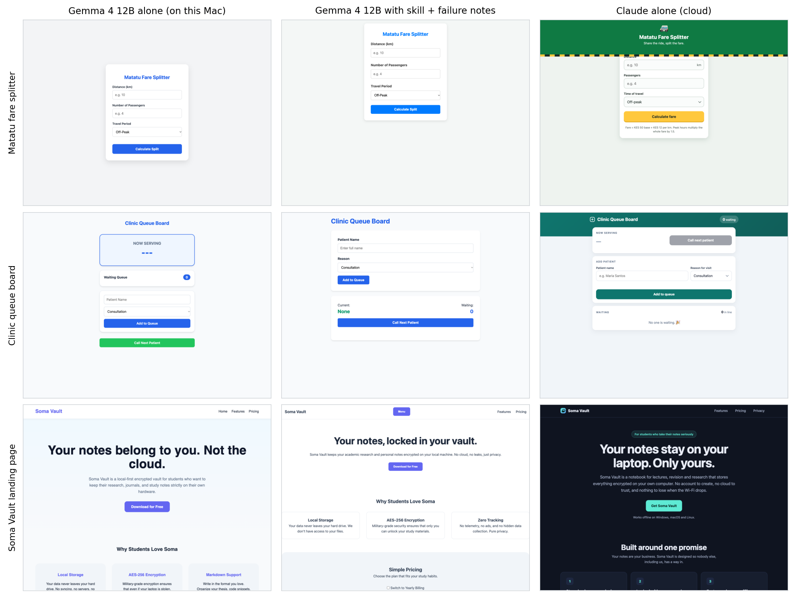

# Further results

Tables and trials that support Section 5.5 of the report but are not needed to follow it.

The tables below support Section 5.5, and the two trials at the end of this page lie outside the specific objectives. Table R1 gives the small model, Table R2 the main model by subject, and Table R3 the paired tests. Table R4 and Table R5 give what the engine decided, Table R6 where the wrong answers came from, and Table R7 one question of each kind. Every answer is saved in the repository under trials/results/gap-1, and the full record of the 212 automated tests is in unit-tests-evaluation-2.log in the same folder.

**Table A3.1: Answers right by set-up and task type, Qwen3.5 4B**

| Set-up | Knowledge, one fact | Knowledge, several facts | Reasoning |
|---|---|---|---|
| Model alone | 5 of 75 (7%) | 1 of 45 (2%) | 46 of 50 (92%) |
| Plain retrieval | 66 of 75 (88%) | 31 of 45 (69%) | 9 of 50 (18%) |
| Vector database (Chroma) | 54 of 75 (72%) | 21 of 45 (47%) | 1 of 50 (2%) |
| Burrow engine | 64 of 75 (85%) | 27 of 45 (60%) | 49 of 50 (98%) |
| Cloud model alone | 31 of 75 (41%) | 9 of 45 (20%) | 49 of 50 (98%) |
| Cloud model with Burrow | 71 of 75 (95%) | 38 of 45 (84%) | 49 of 50 (98%) |

**Table A3.2: Answers right by subject, Gemma 4 12B and the cloud model**

| Subject | Alone | Plain retrieval | Chroma | Engine | Cloud alone | Cloud with Burrow |
|---|---|---|---|---|---|---|
| Kenyan law | 8 of 40 (20%) | 29 of 40 (72%) | 17 of 40 (42%) | 31 of 40 (78%) | 19 of 40 (48%) | 33 of 40 (82%) |
| 2026 software | 0 of 40 (0%) | 32 of 40 (80%) | 34 of 40 (85%) | 36 of 40 (90%) | 14 of 40 (35%) | 39 of 40 (98%) |
| Private project | 1 of 40 (2%) | 33 of 40 (82%) | 24 of 40 (60%) | 35 of 40 (88%) | 7 of 40 (18%) | 37 of 40 (92%) |
| Arithmetic reasoning | 47 of 50 (94%) | 7 of 50 (14%) | 42 of 50 (84%) | 48 of 50 (96%) | 49 of 50 (98%) | 49 of 50 (98%) |

**Table R3: Paired comparisons by exact sign test**

| Model | Comparison | Questions | First right only | Second right only | p |
|---|---|---|---|---|---|
| Gemma 4 12B | Burrow engine against model alone | Knowledge | 95 | 2 | < 0.001 |
| Gemma 4 12B | Burrow engine against model alone | Reasoning | 1 | 0 | 1.000 |
| Gemma 4 12B | Burrow engine against plain retrieval | Knowledge | 10 | 2 | 0.039 |
| Gemma 4 12B | Burrow engine against plain retrieval | Reasoning | 41 | 0 | < 0.001 |
| Gemma 4 12B | Burrow engine against vector database (chroma) | Knowledge | 34 | 7 | < 0.001 |
| Gemma 4 12B | Burrow engine against vector database (chroma) | Reasoning | 6 | 0 | 0.031 |
| Gemma 4 12B | Burrow engine against engine without skills | Knowledge | 0 | 1 | 1.000 |
| Gemma 4 12B | Burrow engine against engine without skills | Reasoning | 3 | 1 | 0.625 |
| Gemma 4 12B | Burrow engine against engine without the check | Knowledge | 0 | 0 | 1.000 |
| Gemma 4 12B | Burrow engine against engine without the check | Reasoning | 0 | 1 | 1.000 |
| Qwen3.5 4B | Burrow engine against model alone | Knowledge | 86 | 1 | < 0.001 |
| Qwen3.5 4B | Burrow engine against model alone | Reasoning | 3 | 0 | 0.250 |
| Qwen3.5 4B | Burrow engine against plain retrieval | Knowledge | 1 | 7 | 0.070 |
| Qwen3.5 4B | Burrow engine against plain retrieval | Reasoning | 40 | 0 | < 0.001 |
| Qwen3.5 4B | Burrow engine against vector database (chroma) | Knowledge | 29 | 13 | 0.020 |
| Qwen3.5 4B | Burrow engine against vector database (chroma) | Reasoning | 48 | 0 | < 0.001 |

**Table A3.4: What the engine decided, Gemma 4 12B**

| Questions | Decision | Count |
|---|---|---|
| Knowledge | Search | 92 |
| Knowledge | Search, then links | 28 |
| Reasoning | Vault left out | 50 |

**Table A3.5: The method handed to the model, Gemma 4 12B**

| Skill | Questions |
|---|---|
| Answer from documents | 92 |
| Work a calculation | 36 |
| Explain code | 28 |
| none | 14 |

**Table R6: Wrong knowledge answers, by whether the files holding the answer were shown to the model**

| Model | Set-up | Wrong answers | A needed file was not shown | Every needed file was shown |
|---|---|---|---|---|
| Gemma 4 12B | Plain retrieval | 26 | 15 | 11 |
| Gemma 4 12B | Vector database (Chroma) | 45 | 25 | 20 |
| Gemma 4 12B | Burrow engine | 18 | 8 | 10 |
| Qwen3.5 4B | Plain retrieval | 23 | 13 | 10 |
| Qwen3.5 4B | Vector database (Chroma) | 45 | 25 | 20 |
| Qwen3.5 4B | Burrow engine | 29 | 14 | 15 |
| Claude | Cloud model with Burrow | 11 | 4 | 7 |

**Table R7: One question of each kind with its answer key**

| Kind | Question | Key |
|---|---|---|
| Law, one fact | Under Kenya's Data Protection Act, 2019, within how many hours of becoming aware of a personal data breach that poses a real risk of harm must a data controller notify the Data Commissioner? | seventy-two or 72 |
| Software, several facts | Across SQLite 3.53.0 and 3.54.0 (both released in 2026), which three new options were added to the sqlite3_limit() interface? | SQLITE_LIMIT_PARSER_DEPTH; SQLITE_LIMIT_SCHEMA; SQLITE_LIMIT_TRIGGER_STEPS |
| Private project, one fact | In the Burrow project, which named technique merges the word-search ranking with the embedding ranking, and why was it chosen over combining the two scores directly? | reciprocal rank fusion or RRF |
| Reasoning | The basketball team went to the steakhouse to eat dinner.  The first player ate a 6-ounce steak.  The second player ate beef tips, containing 8 beef tips, each an ounce in size.  The third player ate a one-pound steak.  And the fourth and fifth players ordered vegetarian meals.  In total, how many ounces of meat were consumed by the team? | 30 |

Before the engine's five steps were built, retrieval alone was tested at tag evaluation-1. On 101 real bug fixes from four public repositories, following links reached a changed file on 72 and plain search on 59 (p = 0.002). On three held-back synthetic projects worked by simulated developer agents, memory did not measurably help the small model write working code. The simulated agents were programs, and no person took part. Those results are saved under trials/results and led to the engine described in this report.

### A Coding Trial Against the Cloud Model

A small trial asked whether the on-device model can build something beside the cloud model. Three briefs for a single-file website were given to Gemma 4 12B and to Claude: a matatu fare splitter, a clinic queue board that survives a reload, and a landing page with a phone menu and a pricing toggle. Each page was scored in a real browser with the same fixed checks, 42 in all. Figure R1 shows the pages.

*Figure R1: The same three briefs built by Gemma 4 12B alone, by Gemma with a skill and a note of known failures, and by Claude alone*

Claude passed all 42 checks in every set-up. Gemma alone passed 41. With the brief the engine prepared, which carried a web-building skill, Gemma passed 39, because one page had a script error. With the skill and a note of known failures handed over directly, it passed 41, and that run had no such error. The engine had left the note out, because it judged each brief to be a task to work out. The trial is three briefs run once, so it is a demonstration and not a measurement.

### A Further Evaluation of Session Memory

A third evaluation, planned in advance like the second and run on a frozen binary, tested features added after the objectives were met. It used Qwen3 4B, a different model from the Qwen3.5 4B of Chapter 5, and its own 40 knowledge questions, half of the Evaluation 2 set split by a fixed seed, so its counts are not comparable with Table 5.5. None of the four features improved on its baseline. Table R8 shows that a pasted transcript carried a conversation further than the Ledger's handoff. Table R9 shows that notes Claude left on the other half of the questions added one answer to Burrow's 28 of 40. Table R10 shows that the line telling the model how much the vault holds did not change how often it declined, and Table R11 that four tools did no better than twelve. The plan, the frozen binary, every answer and the analysis are in the repository under trials/ledger and docs/report/evaluation-plan-3.md.

**Table R8: A model that lost its memory carries on a conversation: answers right of 15 and median prompt tokens**

| Given to model B | Qwen3 4B to Gemma, right | Tokens | Gemma to Qwen3 4B, right | Tokens |
|---|---|---|---|---|
| Nothing | 0 of 15 | 15,481 | 0 of 15 | 1,836 |
| The transcript pasted in | 11 of 15 | 6,330 | 7 of 15 | 2,381 |
| Today's session tools | 3 of 15 | 3,028 | 3 of 15 | 3,675 |
| The Ledger (burrow_resume) | 6 of 15 | 1,779 | 5 of 15 | 1,882 |

**Table R9: Half B of the knowledge questions, with and without notes Claude left on half A**

| Set-up | One fact | Several facts | All |
|---|---|---|---|
| Qwen3 4B alone | 1 of 22 | 0 of 18 | 1 of 40 |
| Qwen3 4B with Burrow | 17 of 22 | 11 of 18 | 28 of 40 |
| Qwen3 4B with Burrow and Claude's notes | 18 of 22 | 11 of 18 | 29 of 40 |
| Claude alone | 14 of 22 | 5 of 18 | 19 of 40 |

**Table R10: Qwen3 4B on 30 questions the vault cannot answer and 30 it can**

| Search results | Said the vault does not hold it | Answerable, right | Answerable, wrongly declined |
|---|---|---|---|
| Without it | 26 of 30 | 26 of 30 | 2 of 30 |
| With the trust line | 26 of 30 | 25 of 30 | 2 of 30 |

**Table R11: Four tools against twelve, 16 knowledge questions per model**

| Model | Four tools, right | Twelve tools, right | Only four / only twelve right | p (sign test) |
|---|---|---|---|---|
| Qwen3 4B | 11 of 16 | 14 of 16 | 0 / 3 | 0.250 |
| Gemma 4 12B | 16 of 16 | 16 of 16 | 0 / 0 | 1.000 |

