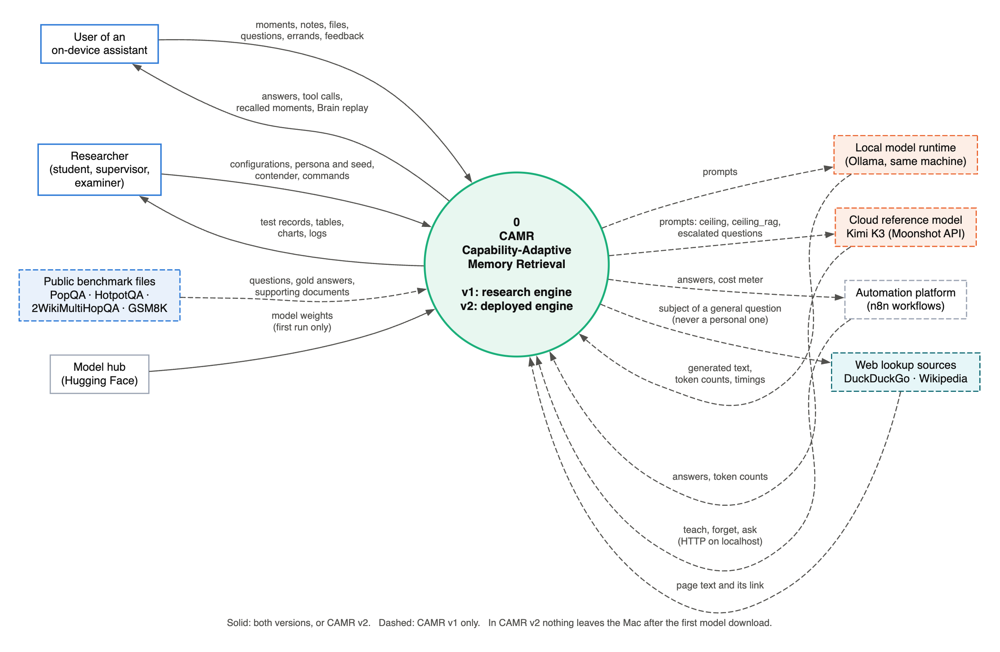
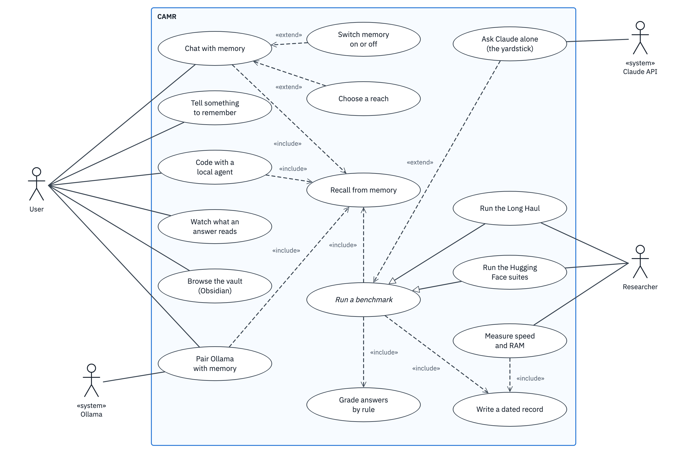
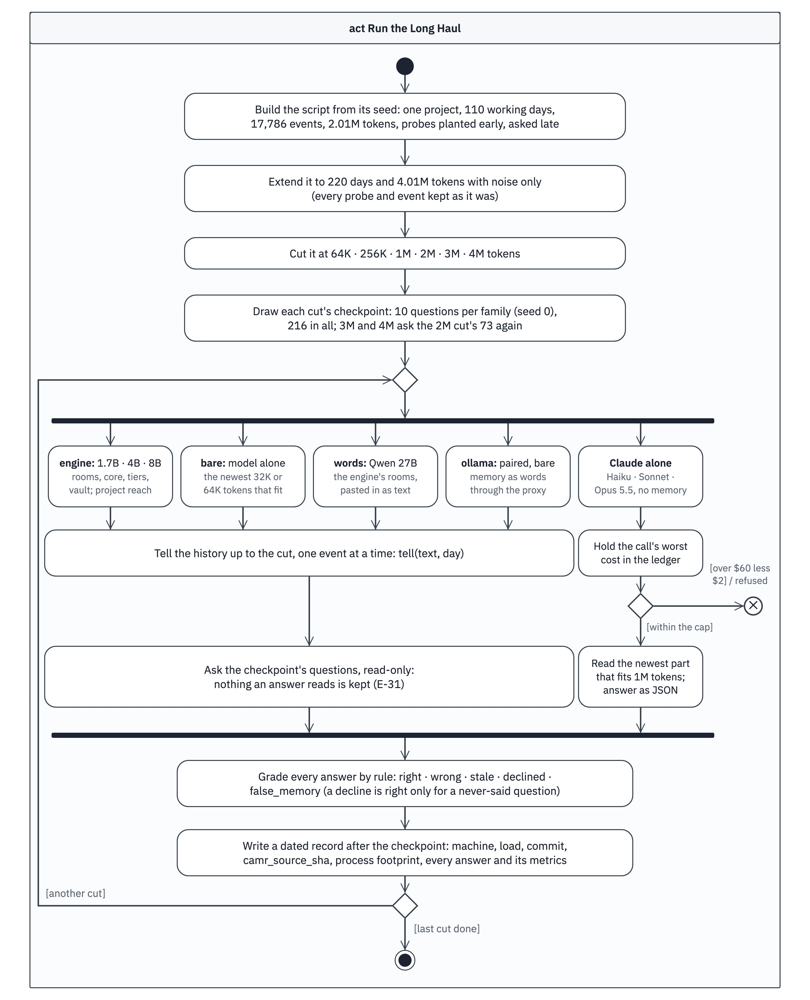
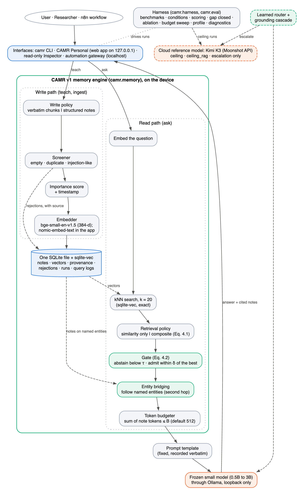
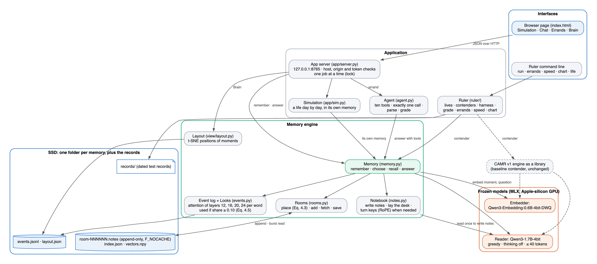
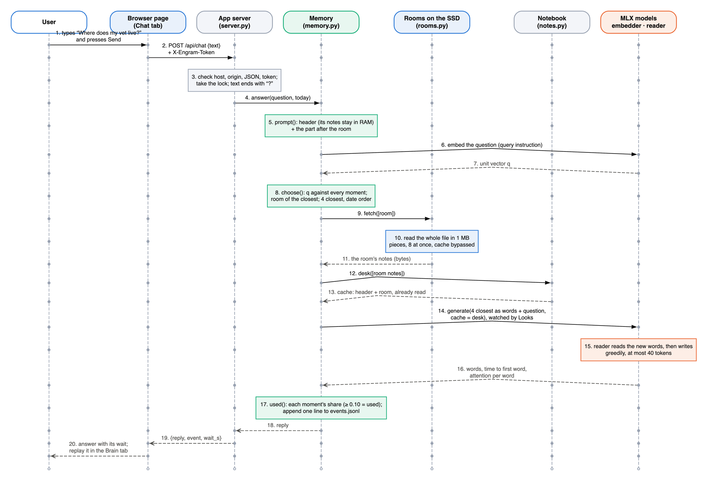
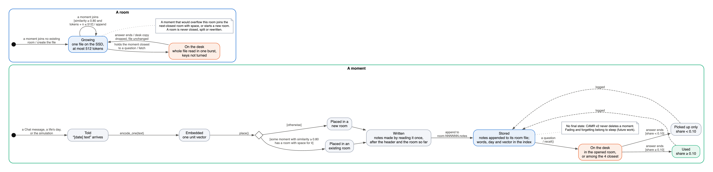
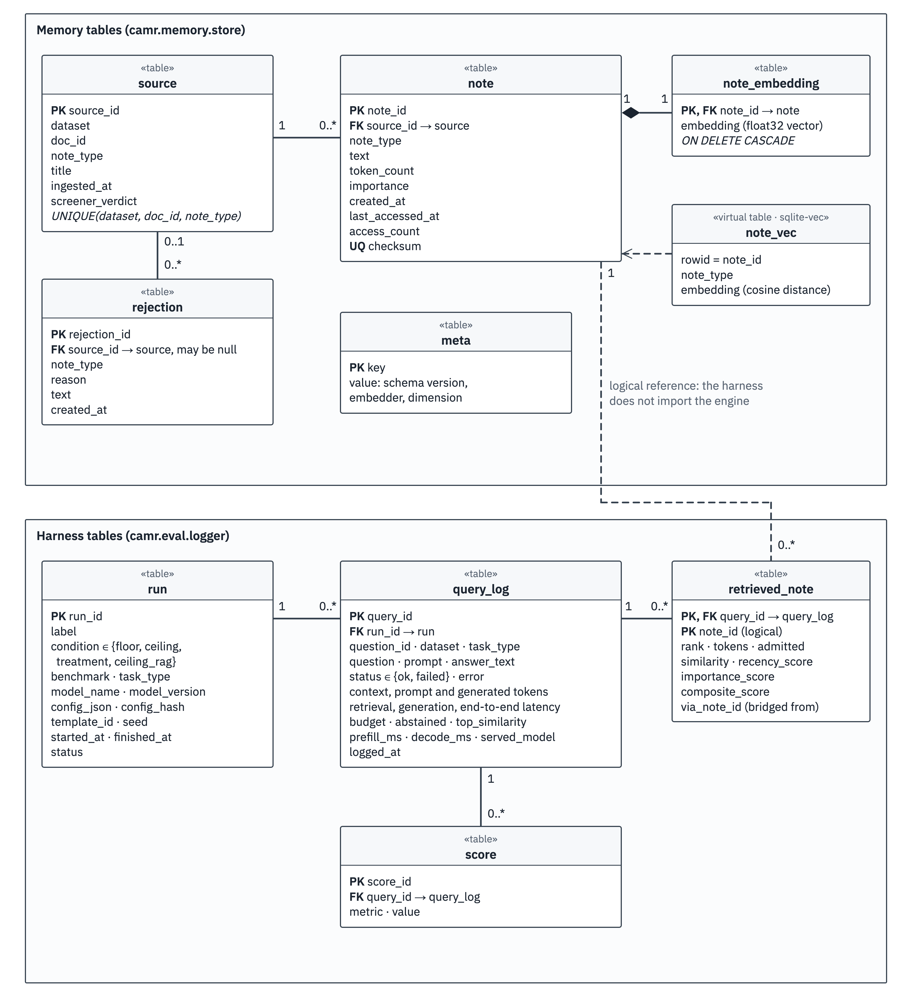
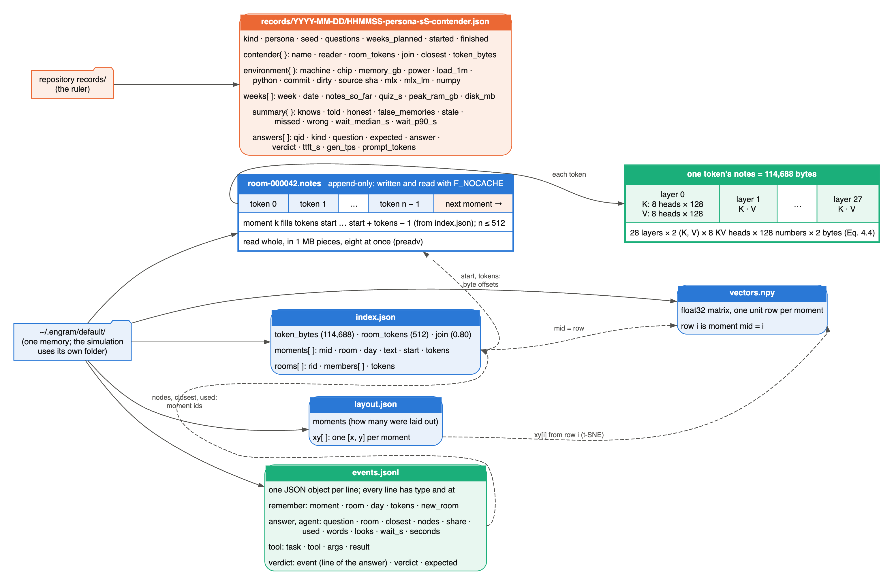
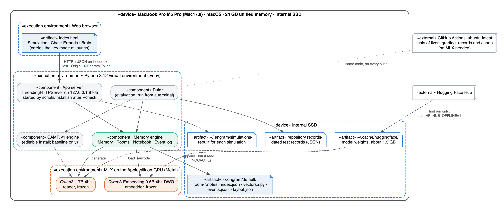

# Chapter 4: System Analysis and Design

## 4.1 Introduction

Chapter 3 adopted a pragmatist philosophy that combines design science research with controlled experimentation (Hevner et al., 2004; Peffers et al., 2007), and an incremental approach in which the measurement apparatus is built before the artefact it measures. This chapter applies that paradigm to CAMR (Capability-Adaptive Memory Retrieval). CAMR is an AI artefact judged by experiment, not a transactional information system, so the chapter uses a justified hybrid of views: a structured-analysis context diagram for the boundary; UML use case, sequence, state and deployment diagrams for actors, interactions, life cycles and hardware; and data-pipeline and storage views for the experiments and the memory. All diagrams are Graphviz sources (Gansner & North, 2000), so they can be regenerated and checked against the code.

CAMR was built as one system in two versions. CAMR v1, the research engine, stores text notes in an embedded database beside a frozen small model and was evaluated on public benchmarks. CAMR v2, the deployed engine, was built afterwards for Apple-silicon Macs. For every remembered moment it keeps the notes that the frozen model writes inside its layers while reading (its key–value cache), stores them on the SSD in rooms of related moments, and was evaluated on scripted twelve-week lives with CAMR v1 as its main baseline (Table 4.1). The chapter describes what was built; Section 4.5 records where this departs from the proposal.

Section 4.2 states and traces the requirements. Section 4.3 presents the analysis diagrams: the context diagram (Figure 4.1), the use case diagram (Figure 4.2) and the evaluation pipeline (Figure 4.3). Section 4.4 presents the design diagrams: the architectures of v1 (Figure 4.4) and v2 (Figure 4.5), a sequence diagram of one question (Figure 4.6), a state diagram of a moment and its room (Figure 4.7), the v1 schema (Figure 4.8), the v2 file design (Figure 4.9) and the deployment on the Mac (Figure 4.10). Section 4.5 justifies the changes from the proposal and Section 4.6 summarises.

Table 4.1: The two versions of CAMR

| Aspect | CAMR v1: research engine | CAMR v2: deployed engine |
|---|---|---|
| Repository | `~/Desktop/camr-repo` | `~/Developer/engram` |
| Frozen reader | 0.5B–3B models through Ollama; 22 models up to 14.8B in the size sweep | Qwen3-1.7B-4bit through MLX (Yang et al., 2025; Hannun et al., 2023); Qwen3-4B for one baseline |
| Embedder | bge-small-en-v1.5 (Xiao et al., 2024); nomic-embed-text in CAMR Personal | Qwen3-Embedding-0.6B (Zhang et al., 2025) |
| A memory is | A text note with embedding, importance, timestamps and provenance | A dated moment: its words, embedding and the reader's keys and values at every layer |
| Store | One SQLite file with sqlite-vec | One append-only file per room on the SSD, a JSON index, a NumPy vector file |
| Read path | kNN, gate, entity bridging, token budget | One room, plus the four closest moments as words |
| Cloud model | Kimi K3 (Moonshot API): ceiling and escalation | None |
| Evaluation | PopQA, HotpotQA, 2WikiMultiHopQA, GSM8K; gap closed | Three scripted lives; weekly quiz; errands; time to first word |
| Interfaces | CLI, CAMR Personal web app, read-only inspector, n8n gateway | One local page (Simulation, Chat, Errands, Brain); ruler CLI |
| Machines | CPU-only, mainly 4-vCPU 16 GB containers | MacBook Air M4 16 GB, then MacBook Pro M5 Pro 24 GB |

## 4.2 System Requirements

The system requirements identified for this project are presented in the following subsections. They were derived by working backwards from the objectives (Section 1.3.2) and the measurements the evaluation needs (Section 3.4), then revised against what building both versions showed. Following ISO/IEC/IEEE 29148:2018, each has an identifier, states one thing, and names its source and verification method.

- **Priority:** MoSCoW (Must, Should, Could).
- **Source:** objective (i–v); version; and where the requirement or threshold is recorded: the proposal (P §), the v2 decision log `DECISIONS.md` (E-nn), the v1 findings log `docs/FINDINGS.md` (Fnn), the v1 design notes (DN) or the code.
- **Verification:** inspection (I), demonstration (D), automated test (T), measurement (M) or user acceptance (U). TC-nn are the v1 README's test cases; v2 tests are named by file.

No threshold was invented. Every number comes from the proposal, a design constant in the code, or a pass mark written in `DECISIONS.md` before the run that tested it (E-19); otherwise the requirement is a comparison or a demonstrable behaviour. The stakeholders are the user, who needs private, offline and honest answers; the researcher, who needs reproducible measurements; and the supervisor and examiners, who need traceable evidence.

### 4.2.1 Functional Requirements

The functional requirements fall into six modules:

- **v1 write path (FR-01–FR-03).** The researcher, or a CAMR Personal user, supplies documents; each becomes screened, scored, embedded notes. A rejected note is logged with its reason, not dropped.
- **v1 read path (FR-04–FR-09).** A question's nearest notes are ranked, gated and bridged, then packed into the frozen model's prompt. If nothing passes the gate, the model answers with an empty notes section, so abstention is logged.
- **v1 harness (FR-10–FR-13).** A failed query is logged as failed and excluded from scoring; pairing uses only questions answered in every condition; the gap is flagged as undefined when the ceiling barely exceeds the floor (DN A3).
- **v2 memory (FR-14–FR-19).** The user (Chat) or the ruler (one day of a life) supplies dated moments. A message ending in "?" is answered and anything else remembered. An empty memory has no room, so the reader answers from its header; a folder written for another model is refused.
- **v2 agent and app (FR-20–FR-22).** An errand produces one tool call; a reply with no readable call counts as declining. Server errors reach the page as messages.
- **v2 ruler (FR-23–FR-25).** Given a persona, seed and contender, the ruler feeds the life, quizzes weekly and writes a record after every week, so a stopped run keeps the weeks it finished.

Table 4.2: Functional requirements catalogue

| ID | Requirement | Priority | Source | Verification |
|---|---|---|---|---|
| FR-01 | The system shall turn each document into notes under a configurable write policy (verbatim or structured). | Must | ii; v1; P §3.5.5 | T (TC-01) |
| FR-02 | The system shall reject empty, duplicate and instruction-like notes and record each rejection with its source. | Must | ii; v1; P §3.3 | T (TC-02) |
| FR-03 | The system shall commit each note with its timestamp, importance, embedding and source in one transaction. | Must | ii, iii; v1; P §3.5.1 | T (TC-03) |
| FR-04 | The system shall retrieve the k notes most similar to a question (k = 20 by default). | Must | ii; v1; P §3.5.1 | T (TC-04) |
| FR-05 | The system shall rank candidates by similarity alone or by the composite score of Equation 4.1, as configured. | Must | ii; v1; P §3.5.1 | T (TC-05) |
| FR-06 | The system shall abstain or admit candidates by the gate of Equation 4.2. | Must | ii; v1; F1, F3 | T (`test_bridging.py`) |
| FR-07 | The system shall add notes about entities named in admitted notes, without a model call. | Should | ii; v1; DN G | T (`test_bridging.py`), M (F1b) |
| FR-08 | The system shall pack admitted notes into a token budget B and never exceed it. | Must | ii, v; v1; P §3.5.1 | T (TC-06) |
| FR-09 | The system shall answer through a frozen local model whose runner exposes only generation. | Must | iii; v1; P §3.5.1 | T (TC-07) |
| FR-10 | The system shall draw one fixed sample per benchmark and reuse it in every condition. | Must | iv; v1; P §3.2.2 | T (TC-09) |
| FR-11 | The system shall run the floor, ceiling and treatment conditions, and optionally ceiling_rag, on that sample. | Must | iv; v1; P §3.2.3 | T (TC-18) |
| FR-12 | The system shall score answers with each benchmark's metric and compute the gap closed (Equation 3.1) with a paired bootstrap interval. | Must | iv; v1; P §3.5.2–3.5.4 | T (TC-10, TC-13) |
| FR-13 | The system shall run the component ablation and the token-budget sweep from one configuration. | Must | v; v1; P §3.5.5 | T (TC-12), M (F8) |
| FR-14 | The system shall remember a moment by having the frozen reader read it once, with its room's earlier moments in view, and saving the keys and values of every layer. | Must | ii; v2; E-15 | T (`test_notes.py`), M (E-20) |
| FR-15 | The system shall place each new moment in a room by Equation 4.3. | Must | ii; v2; E-18 | T (`test_rooms.py`) |
| FR-16 | The system shall append a moment's notes to its room's file and keep its words, day and embedding in an index. | Must | ii, iii; v2; `rooms.py` | T (`test_rooms.py`) |
| FR-17 | For each question, the system shall lay on the desk the one room holding the moment closest to the question, already read. | Must | ii; v2; E-16 | M (E-16, E-20) |
| FR-18 | The system shall re-read the four moments closest to the question as words, in date order, after the room. | Must | ii, v; v2; E-16, E-18 | M (E-18) |
| FR-19 | The system shall log each remember, answer, errand, tool call and verdict as one line, with each written word's attention over the moments on the desk. | Must | ii; v2; E-21 | T (`test_events.py`) |
| FR-20 | The system shall do an errand with exactly one call to one of ten tools, with arguments from memory. | Should | iv; v2; E-23 | T (`test_agent.py`), M (E-25) |
| FR-21 | The system shall replay a logged answer or errand word by word, marking moments used and only picked up. | Should | ii; v2; E-24 | D |
| FR-22 | The system shall reopen a saved memory where it left off. | Must | iii; v2; E-24 | T (`test_rooms.py`) |
| FR-23 | The system shall generate each scripted life deterministically from its persona and seed. | Must | iv; v2; E-05 | T (`test_life.py`) |
| FR-24 | The system shall quiz each contender weekly with the same 100 questions and grade each answer by rule into one of six verdicts. | Must | iv; v2; E-07–E-09 | T (`test_grade.py`, `test_harness.py`) |
| FR-25 | The system shall write a dated test record per run, naming the machine, the code and every answer. | Must | iv; v2; E-12, E-17 | T (`test_harness.py`), I |

### 4.2.2 Non-Functional Requirements

The non-functional requirements use the ISO/IEC 25010:2023 characteristics relevant here (performance efficiency, reliability, security, maintainability, flexibility, interaction capability) and add model quality, robustness and explainability for the AI components. Requirements measured as not met are kept as written so that Chapters 5 and 6 report them honestly.

Table 4.3: Non-functional requirements catalogue

| ID | Category | Requirement | Priority | Source | Verification |
|---|---|---|---|---|---|
| NFR-01 | Performance: time | With 2,000 words in the room on the desk, read from the SSD with the cache bypassed, the median time to first word over five tries shall be under 0.5 s. | Must | iii, v; v2; E-19 mark 1 | M (`ruler speed`) |
| NFR-02 | Performance: time | At 2,000 words, answering from notes shall be at least 10 times sooner than reading the same desk as words. | Should | iii; v2; E-19 mark 3 | M (`ruler speed`) |
| NFR-03 | Performance: capacity | Over a life's twelve weeks, the median wait and the peak RAM shall not climb while the notes on the SSD grow. | Must | iii, iv; v2; E-20 | M (records) |
| NFR-04 | Performance: resources | A full room shall fit the per-question read allowance of 256 MiB. | Must | iii; v2; `memory.py` | I (the constructor refuses otherwise) |
| NFR-05 | Performance: time | Recording the event log shall slow writing by no more than 5%. | Must | ii; v2; E-21 | M |
| NFR-06 | Performance: time | Retrieval shall take at most 10% of answer time on the target device. | Should | iii, v; v1; P §3.4; F8 | M (`camr profile`) |
| NFR-07 | Model quality | Notes shall know at least 95% as many facts as the same desk read as words, with at most 3 extra false memories of 45. | Must | ii, iv; v2; E-19 mark 2 | M |
| NFR-08 | Robustness: honesty | Answers about things never told shall be counted as false memories, separately from facts known. | Must | iv; v2; E-08 | T (`test_grade.py`) |
| NFR-09 | Reliability | One v1 configuration shall build byte-identical prompts on repeated runs. | Must | iv; v1; P §3.5.6 | T (TC-19), M (F5) |
| NFR-10 | Reliability | v2 shall decode greedily, thinking off, at most 40 tokens, and grade by rule, so re-runs give the same verdicts. | Must | iv; v2; E-07, E-10 | I, T |
| NFR-11 | Security: confidentiality | Floor and treatment runs shall open no external connection. | Must | iii; v1; P §3.4 | T (TC-20) |
| NFR-12 | Security: integrity | The v2 server shall listen on 127.0.0.1 only and serve an API request only if it names the local host, comes from its own origin and carries the key made at launch. | Must | iii; v2; E-24 | I, D |
| NFR-13 | Security: privacy | All v2 inference and memory shall stay on the Mac once the models are downloaded. | Must | iii; v2; P §1.6 | I |
| NFR-14 | Maintainability | The v1 memory package shall not import the harness, evaluation, CLI or inspector. | Should | ii; v1; DN C | T (`test_architecture.py`) |
| NFR-15 | Maintainability: testability | Every reported number shall be regenerable from records: v1 with one command, v2 from records carrying a code fingerprint. | Must | iv; both; P §3.7.2; E-12 | T (TC-18), M (F26) |
| NFR-16 | Flexibility: installability | One command shall install CAMR v2 on an Apple-silicon Mac, download its models once and pass a health check. | Should | iii; v2; `install.sh` | D (`app --check`) |
| NFR-17 | Flexibility: adaptability | The v2 lives, grading, records and charts shall run without MLX, so they are tested on Linux on every push. | Should | iv; v2; `tests.yml` | T (GitHub Actions) |
| NFR-18 | Interaction capability | CAMR Personal shall show no axe-core violations and meet WCAG AA contrast in both themes. | Should | user; v1; F16 | T (UI audit) |
| NFR-19 | Explainability | v2 shall identify the moments each answer leaned on; in right single-fact answers the most-attended moment should hold the answer. | Should | ii; v2; E-21 | M |

Two were measured as not met. NFR-02's factor of 10 came from measurements on the MacBook Air; the M5 Pro reads text about eight times faster (about 6,600 against 800 tokens per second, E-17), so the head start at 2,000 words was 4.6 times (E-20). NFR-06 failed for the 0.5B model, where retrieval was 56% of answer time (F8); the engine's own cost was 29.3 ms and the rest was contention for four CPU cores, so the target holds only from about 1.5B (F12). NFR-18 is verified for CAMR Personal only; the v2 page has not yet been audited.

### 4.2.3 Data Requirements

Neither version trains the language model, so the train, validation and test separation applies to engine settings. In v1, settings were tuned on validation questions and confirmed once on held-out ones (F13, F15), and GSM8K's training split supplies only worked examples. In v2, the development lives (seed 0) were used to re-choose CAMR v1's threshold for the new embedder (0.65, E-04) and to tune room size (E-18); the proof lives (seed 1) were run only after the pass marks were written (E-19).

v1 uses real data only (Yang et al., 2018; Ho et al., 2020; Mallen et al., 2023; Cobbe et al., 2021), with Wikipedia summaries as PopQA's corpus (F0). v2 uses scripted synthetic lives by design: a memory that grows over weeks cannot be tested on a public question set, while a scripted life knows its right answer on every day, including after a fact changes. The lives are deliberately messy (typos, Swahili asides, changed minds, relative dates) and use Kenyan names and places, which suits the intended users but limits the results to three personas. A LongMemEval loader (Wu et al., 2024) was built and tested, but no v2 result on it is reported. CAMR Personal can forget a note; v2 keeps every moment, and a user clears it by deleting the folder. No personal data enters any evaluation.

Table 4.4: Data requirements catalogue

| ID | Requirement | Priority | Source | Verification |
|---|---|---|---|---|
| DR-01 | v1 shall use the official PopQA, HotpotQA (dev distractor), 2WikiMultiHopQA (dev) and GSM8K (test; train for worked examples only) files. | Must | iv; v1; P §3.2.1 | I |
| DR-02 | v1 memory shall come only from supporting and distractor documents; a document containing an evaluation question verbatim shall be refused. | Must | iv; v1; P §3.2.2 | T (TC-21) |
| DR-03 | PopQA shall be given an explicit corpus, and its loader shall fail without one. | Must | iv; v1; DN A4 | T (TC-21) |
| DR-04 | Each v1 sample shall be persisted with its seed (13) and source-file hash, independent of file order. | Must | iv; v1; DN B | T (TC-09) |
| DR-05 | Every tuned v1 setting shall be chosen on validation questions and confirmed on unseen ones. | Must | iv, v; v1; F13, F15 | I, M |
| DR-06 | Each v2 life shall hold 84 days, about 330 notes and 100 questions (45 single, 15 changing, 10 two-note, 15 dates, 15 never told). | Must | iv; v2; E-05 | T (`test_life.py`) |
| DR-07 | Seed-0 lives shall serve only development and calibration; seed-1 lives only the proof. | Must | iv; v2; E-04, E-05, E-19 | I (records) |
| DR-08 | Each v2 moment shall be stored as dated text, an embedding and notes in a token-major layout (Section 4.4.6). | Must | ii; v2; `rooms.py` | T (`test_rooms.py`) |
| DR-09 | v2 room files shall only grow, and a memory written for one model shall not open with another. | Must | ii; v2; `rooms.py` | I, T |
| DR-10 | Every v2 record shall name the machine, chip, memory, power, load, library versions, commit and a hash of the code. | Must | iv; v2; E-12, E-17 | I, T |
| DR-11 | Personal memory shall stay in a folder on the user's machine (`~/.engram/default`, `~/.camr/`). | Must | iii; both; P §1.6 | I |

### 4.2.4 Interface and Integration Requirements

The interfaces are kept narrow so that each can be tested: v1's model runner exposes generation only, every outside call in v1 has a specified failure behaviour, and the v2 page reaches the engine only through a small JSON API.

Table 4.5: Interface and integration requirements catalogue

| ID | Requirement | Priority | Source | Verification |
|---|---|---|---|---|
| IR-01 | v1 shall reach local models only through Ollama on the loopback address. | Must | iii; v1; DN D | T (TC-07) |
| IR-02 | v1 shall call the cloud model under one pinned, logged identifier with the study's retry policy, logging refusals as failures. | Must | iv; v1; P §3.6.3 | T (TC-08) |
| IR-03 | v1 shall continue a run when the local runtime is down, logging each failed query. | Must | iv; v1 | T (TC-22) |
| IR-04 | v1 shall run the whole experimental pipeline from one command. | Must | iv; v1; P §3.4 | T (TC-18) |
| IR-05 | CAMR Personal shall serve its page and API on 127.0.0.1, stream answers as server-sent events and reject other hosts and origins. | Should | iii; v1; `APP.md` | T (`test_app_server.py`) |
| IR-06 | v1 shall offer teach, forget and ask through a localhost gateway for n8n workflows. | Could | iv; v1; F29 | D (F29) |
| IR-07 | The v1 inspector shall open the store read-only. | Should | v1; DN C | T (TC-15) |
| IR-08 | v2 shall load its models through MLX and refuse a reader without plain RoPE positions. | Must | iii; v2; E-02 | I |
| IR-09 | The v2 page shall use only JSON over HTTP: GET `/api/state`, `/api/brain`, `/api/sim/state`, `/api/sim/brain`; POST `/api/chat`, `/api/errand`, `/api/life`, `/api/quiz`, `/api/sim/start`, `/api/sim/stop`. | Must | v2; E-24 | I, D |
| IR-10 | The v2 server shall return failures as JSON (403, 404, or 500 with the error) instead of dropping the connection. | Should | v2; `server.py` | I |
| IR-11 | v2 shall offer tools as JSON-schema functions through the chat template and parse the call from the reply. | Must | iv; v2; E-23 | T (`test_agent.py`) |
| IR-12 | v2 shall read and write rooms with `F_NOCACHE`, in 1 MB pieces eight at a time. | Must | iii; v2; E-14 | T (`test_rooms.py`), I |
| IR-13 | The v2 page shall offer Simulation, Chat, Errands and Brain tabs; in Chat a message ending in "?" is answered and any other is remembered. | Must | v2; E-24 | D, U |

### 4.2.5 Requirements Traceability

Table 4.6 traces each objective to its requirements, design elements and evidence. Objective i is met mainly by Chapter 2, but it also shaped the system: the reviewed techniques were built as switchable policies so their applicability could be measured.

Table 4.6: Traceability matrix

| Objective | Requirements | Design elements | Verification evidence |
|---|---|---|---|
| i. Gaps and techniques | FR-05–FR-07, DR-01 | Retrieval policies (Fig. 4.4); contenders (Fig. 4.3) | F1 (Equation 4.1 lowered full-support recall from 72.0% to 67.4%); E-15, E-16 |
| ii. Design (v1) | FR-01–FR-08 | Write and read paths (Fig. 4.4); schema (Fig. 4.8) | TC-01–TC-06; `test_bridging.py`; F1, F1b |
| ii. Design (v2) | FR-14–FR-19, DR-08, DR-09, NFR-07, NFR-19 | Memory, Rooms, Notebook, Event log (Figs. 4.5–4.7, 4.9) | `test_notes.py`, `test_rooms.py`, `test_events.py`; E-16, E-18, E-20, E-21 |
| iii. Develop on device (v1) | FR-09, NFR-06, NFR-11, IR-01 | One SQLite file; Ollama on loopback | TC-07, TC-20; F8, F12 |
| iii. Develop on device (v2) | NFR-01, NFR-03, NFR-04, NFR-12, NFR-13, NFR-16, IR-08, IR-12 | Room files (Fig. 4.9); deployment (Fig. 4.10) | `records/speed/2026-11-03-student.json`; E-14, E-17, E-20 |
| iv. Evaluate (v1) | FR-10–FR-12, DR-01–DR-05, IR-02–IR-04, NFR-09, NFR-15 | v1 pipeline (Fig. 4.3); `run`, `query_log` (Fig. 4.8) | TC-09–TC-13, TC-18, TC-19, TC-21; F8, F9, F13 |
| iv. Evaluate (v2) | FR-20, FR-23–FR-25, DR-06, DR-07, DR-10, NFR-08, NFR-10, NFR-17 | v2 pipeline (Fig. 4.3); test records (Fig. 4.9) | `test_life.py`, `test_grade.py`, `test_harness.py`, `test_agent.py`; `records/2026-11-03/`; E-20, E-25 |
| v. Token budget (v1) | FR-08, FR-13 | Budgeter; budget sweep | TC-06, TC-12; F1 (recall per token peaked at 256 tokens); F8 (128 best for single-hop, 512 for multi-hop) |
| v. Token budget (v2) | FR-15, FR-18 | 512-token rooms, join 0.80, four closest moments | E-18 (164 of 255 facts; larger rooms knew fewer) |

## 4.3 System Analysis Diagrams

### 4.3.1 Context Diagram

The context diagram treats CAMR as one process and shows only what crosses its boundary. It fixes the scope of Section 1.6, in which the model and the memory run on the user's device, and shows which flows leave it (NFR-11, NFR-13, DR-11). Both versions share the boundary; flows that exist only in v1 are dashed.

Figure 4.1: Context diagram of CAMR, showing both versions

In v2, the user's moments and questions flow into CAMR and their answers flow back, and nothing continues to an outside party. Apart from the one-time model download, every flow beyond the device belongs to v1. The cloud model receives prompts only in the ceiling conditions and on escalation. CAMR Personal's web lookup sends only the subject of a general question, never a personal one. n8n calls a localhost gateway. After the first download, models are read from the local cache with `HF_HUB_OFFLINE=1`. Ollama is outside the boundary because v1 calls it as a separate program over loopback (IR-01); in v2 the models run inside CAMR's process through MLX. The diagram therefore shows v2 as a closed system on the Mac, the privacy property the problem statement asks for.

### 4.3.2 Use Case Diagram

The use case diagram shows who uses CAMR and for what. Its actors are people and external systems only: the User, the Researcher, and two systems used by v1, the automation platform (n8n) and the cloud reference model. Rooms, the embedder and the event log are internal parts, not actors. Version-specific use cases are marked v1 or v2.

Figure 4.2: Use case diagram of CAMR

"Recall from memory" is included by every use case that answers anything: asking, errands, quizzing a life, running a contender and running benchmark conditions. One read path serves chat, agentic work and evaluation, so what is measured is what the user gets. The researcher's use cases include grading by rule and writing a record, so no run finishes without evidence (FR-24, FR-25). Escalation extends asking only in v1, where a router or grounding check may send a question to the cloud (F11b, F15); v2 has no such extension, consistent with Figure 4.1. Inspecting what an answer leaned on is a user's use case, not only a research tool: it serves NFR-19 and shows a user when an answer rested on the wrong moment.

### 4.3.3 Evaluation and Data Pipeline

The study's contribution is a measurement, so the pipeline that produces each number is analysed as carefully as the engine. Figure 4.3 shows both pipelines and addresses objectives iv and v and DR-01 to DR-07 and DR-10.

Figure 4.3: The evaluation and data pipelines of CAMR v1 and CAMR v2

Both pipelines have fixed data, a separation guard, one record per answer, and analysis drawn only from records. They differ in what is held constant. In v1 the questions are fixed and the conditions vary the model and the memory, so the gap closed (Equation 3.1) can be computed per task type. In v2 the embedder, and except for one baseline the reader, are the same for every contender (E-02), so differences between contenders are differences between memories. Because the life unfolds over time, the weekly quiz measures growth against what has been told so far, and false memories are counted separately so that declining cannot raise a score (E-08). The CAMR v1 contender is the v1 engine itself, configured as CAMR Personal configured it (E-03), with only its threshold re-chosen on development lives (E-04).

## 4.4 System Design Diagrams

### 4.4.1 Architecture of CAMR v1

CAMR v1 has a write path and a read path that meet at one SQLite file. Ranking follows Park et al. (2023), with similarity and importance min-max normalised over the candidates so that the terms share a scale (DN A2), and recency counted in question steps by a logical clock so that rankings do not depend on machine speed (DN A1). The gate then decides how much of the ranked list the model sees.

$$\text{score}(n) = w_s\,\hat{s}(n) + w_r\,\gamma^{\Delta t(n)} + w_i\,\hat{\imath}(n)$$

Equation 4.1: Composite score of note n (defaults w_s = 0.60, w_r = 0.15, w_i = 0.25, γ = 0.99; similarity only sets w_s = 1, w_r = w_i = 0).

$$n \text{ is admitted} \iff s_{\max} \ge \tau \ \text{ and } \ s(n) \ge s_{\max} - \delta$$

Equation 4.2: The gate, where s_max is the best candidate's similarity (defaults τ = 0.50, δ = 0.15).

Figure 4.4: Architecture of CAMR v1, the research engine

The engine package does not depend on the harness, CLI or inspector (NFR-14), so the same engine runs under the harness, CAMR Personal and the n8n gateway. One file for notes, vectors, provenance and logs is what lets every table be regenerated from logs (NFR-15). The gate and entity bridging, in green, make the read path capability-adaptive: on 2WikiMultiHopQA, bridging raised the share of questions with both gold paragraphs in context from 35.8% to 78.4% with 7% fewer tokens (F1b). The composite score lowered that share (F1), so similarity became the default ranking (Section 4.5). The model is reached only through a loopback runner and the cloud only in ceiling conditions or on escalation, so NFR-11 holds by construction.

### 4.4.2 Architecture of CAMR v2

CAMR v2 changes what a memory is. Instead of text the model must re-read for every question, each moment is kept as the notes the model wrote while reading it: the keys and values of every layer, which a transformer normally discards after a prompt. Laid in front of the model, they let it continue as if it had just read the moment. Notes are large (Equation 4.4), so they live on the SSD in rooms of related moments that can be written as one continuous page and fetched in one read. A moment joins a room by Equation 4.3.

$$\text{room}(m) = \text{room}\Big(\underset{k\,:\ s_{mk} \ge J,\ T_{\text{room}(k)} + t_m \le T_{\max}}{\arg\max}\ s_{mk}\Big), \ \text{ else a new room}$$

Equation 4.3: Room placement of moment m with t_m tokens, where s_mk is its similarity to moment k and T a room's tokens (J = 0.80, T_max = 512; E-18).

$$b_{\text{token}} = L \times 2 \times H_{kv} \times d_h \times 2 \text{ bytes} = 28 \times 2 \times 8 \times 128 \times 2 = 114{,}688 \text{ bytes}$$

Equation 4.4: Notes per token for Qwen3-1.7B (L layers, H_kv key–value heads, head size d_h, 16 bits). A full room of 512 tokens is 58.7 MB, inside the 256 MiB allowance (NFR-04).

Figure 4.5: Architecture of CAMR v2, the deployed engine

Each engine part has one job. Rooms owns the files and index and knows nothing about models. Notebook turns tokens into notes and notes into a desk, and is the only part that touches the reader's cache. The event log watches attention without changing it. Memory composes them into remember, choose, recall and answer, and the app, agent, simulation and ruler all call the same `Memory.answer`, so the measured read path is the one the user meets.

Two measurements on the MacBook Air shaped the design. Moments written alone and laid side by side lost the thread: with 30 unrelated moments beside the right one, the reader found 2 of 46 facts from such notes against 32 from the words (E-15). So a room is written as one page, each moment read with the room's earlier moments in view. And one room plus the four closest moments as words knew 158 facts, against 120 for the room alone and 135 for the moments alone (E-16). A single room sits where it was written, so its keys need no turning; re-applying the rotary position encoding (Su et al., 2024) is needed only for several rooms, which `notes.turn` supports and `test_notes.py` checks.

### 4.4.3 Sequence Diagram: One Question Answered by CAMR v2

Figure 4.6 follows one question, "Where does my vet live?", from the Chat tab to the answer. Lanes run left to right and time downwards; solid arrows are calls, dashed arrows returns, and boxes work inside a lane, all numbered in order. It realises FR-17 to FR-19 and shows where the wait of NFR-01 and NFR-03 is spent.

Figure 4.6: Sequence diagram of one question answered by CAMR v2

The order of steps keeps the wait short. Memory is chosen and fetched in one burst (steps 6 to 13) before the reader writes anything, so SSD reads never compete with writing. The header's notes are made once and kept in RAM, and the room arrives already read, so at question time the reader reads only the four closest moments, the date line and the question (step 14). The server's lock gives the model one job at a time, so chat, errands and the simulation never use the reader at once. Watching four of 28 layers cost 0.6% of writing speed, inside the 5% limit (E-21). In the ruler's runs on the proof lives, the same read path gave a median wait for the first word of 0.064 to 0.072 s in every week of every life (E-20).

### 4.4.4 State Diagram of a Moment and Its Room

A moment and its room have coupled life cycles: placing a moment changes its room, and a question moves a room onto the desk. Figure 4.7 shows both; its guards are Equation 4.3 and the rule for "used" in Equation 4.5.

$$\text{share}_j = \frac{\sum_w a_{wj}}{\sum_w \sum_k a_{wk}}, \qquad j \text{ is used} \iff \text{share}_j \ge 0.10$$

Equation 4.5: Share of the desk's attention drawn by moment j over an answer, where a_wj is the attention from written word w to j's tokens, averaged over every head of layers 12, 16, 20 and 24 (E-21).

Figure 4.7: State diagram of a moment and of its room in CAMR v2

A moment has no final state: once stored it moves only between Stored and On the desk, and "used" describes its part in one answer, recorded in the event log. The memory is therefore append-only and auditable, but a changed fact is held as two moments that the reader must tell apart, which the quiz's "stale" verdict measures. A room is never closed; a moment that would overflow it joins the next-closest room with space or starts a new one, so the desk never exceeds one room of 512 tokens plus four moments, however large the memory grows (NFR-03). The attention record is meaningful: in 47 right single-fact answers, the most-attended moment held the answer every time, against 12% by chance (E-21).

### 4.4.5 Logical Schema of the CAMR v1 Store

CAMR v1 uses an embedded relational database, so a logical schema is the right view. Figure 4.8 shows the tables defined in `camr/memory/store.py` and `camr/eval/logger.py` with their keys and cardinalities (FR-02, FR-03, FR-13, NFR-15).

Figure 4.8: Logical schema of the CAMR v1 store

The integrity rules carry the study's guarantees. Checksums are unique, and a source is unique per dataset, document and note type, so each write policy and screening setting is its own note population in one file, which makes those ablations possible without rebuilding the store (DN A6). A note and its embedding are committed together with a cascading delete, so no note lacks its vector. The vector table is keyed by the note's row id, and an exact NumPy search gives identical scores without the extension. `meta` records the schema version, embedder and dimension, and a store refuses an embedder it was not built with. `run.condition` and `query_log.status` are restricted to permitted values. `retrieved_note.note_id` is deliberately a logical reference with no foreign key, because evaluation must not import the engine (NFR-14); `via_note_id` records the note a bridged note was reached from. Omitted are a full-text index kept in step by triggers, a queue of notes awaiting embedding, a table of ambiguous names, and CAMR Personal's `app_*` tables.

### 4.4.6 File and Data Design of CAMR v2

CAMR v2 has no transactional database. Each memory is one folder in which every file has one writer and one format (Figure 4.9, Tables 4.7 and 4.8). The design realises FR-16, FR-19, FR-22, DR-08 to DR-10 and IR-12.

Figure 4.9: File and data design of CAMR v2

Table 4.7: Files of a CAMR v2 memory and of the ruler

| File | Format | Written | Read |
|---|---|---|---|
| `room-NNNNNN.notes` | Raw 16-bit values, token-major (tokens × 28 layers × K, V × 8 heads × 128) | Appended at each remember | Whole, at recall, cache bypassed |
| `index.json` | `token_bytes`, `room_tokens`, `join`; `moments[]` (mid, room, day, text, start, tokens); `rooms[]` (rid, members, tokens) | After each chat message and each day | When the memory opens |
| `vectors.npy` | float32 matrix, one unit row per moment | With the index | On opening; one product per question |
| `events.jsonl` | One JSON event per line (Table 4.8) | At every event | Brain tab |
| `layout.json` | `moments` (count) and `xy[]` | When moments were added | Brain tab |
| `records/…/HHMMSS-persona-sS-contender.json` | Contender, environment, `weeks[]` with summary and every answer | After every week | Charts, tables |

Table 4.8: Event types in `events.jsonl` (each also has `type` and `at`)

| Type | Written when | Fields |
|---|---|---|
| `remember` | A moment joins a room | moment, room, day, tokens, new_room |
| `answer`, `agent` | A question or errand is answered | question, room, closest, nodes, share, used, words, looks, wait_s, seconds |
| `tool` | An errand's reply is parsed | task, tool, args, result |
| `verdict` | An app or simulation answer is graded | event (line of the answer), verdict, expected |

Files suit a workload with two operations: append a moment's notes to one file, and read one whole file. Each room is a contiguous array read in one burst, with no lookup and no database page cache in between, and `F_NOCACHE` makes every recall a real SSD read: 3.4 to 5 GB/s on the Air, against 24 GB/s for the same file from RAM (E-14). The readable part of memory sits in a small index that can be inspected without touching the notes. Files refer to each other by integer position: a moment's id is its row in `vectors.npy` and its pair in `layout.json`, and its `start` and `tokens` give its byte range in the room. `token_bytes` in the index stops another model from opening the memory. One limitation follows from saving the index separately: a crash after notes are appended but before the index is saved would leave bytes the index does not know of, and later appends would then be misplaced. Saving after every message and every day keeps that window small but does not close it.

### 4.4.7 Deployment of the Mac App

Figure 4.10 shows where each part of CAMR v2 runs: one Mac, its execution environments, the files on its SSD, and two outside parties used once or only for testing (NFR-12, NFR-13, NFR-16, NFR-17).

Figure 4.10: Deployment diagram of the CAMR v2 app on the Mac

The app is one Python process whose server, engine and ruler share two frozen models held by MLX in unified memory on the GPU. The browser reaches the process only over loopback and only with the key embedded in the page it was served, because any website the user visits could otherwise reach 127.0.0.1 too (NFR-12). The Hugging Face Hub is contacted only when a model is missing, normally once at installation; afterwards the models load offline (NFR-13). GitHub Actions runs the tests that need no MLX on every push (NFR-17). In the ruler's runs on the proof lives, peak RAM as MLX reports it stayed between 1.65 and 1.83 GB while the notes on the SSD grew from 82 MB to 963 MB (E-20); the M5 Pro's SSD reads about 12 GB/s with the cache bypassed (E-17).

### 4.4.8 User Interface Design

The v2 page has four tabs (IR-13). Simulation plays a scripted life day by day in its own memory, quizzed weekly, so facts known can be watched against the wait and the memory in use. Chat remembers statements and answers questions, showing each wait. Errands shows the single tool call made for a task. Brain replays an answer word by word on a "specimen" view: each moment a red cell and each room a lobe, the moments a word leaned on flaring green and those only picked up ringed in white, with a traces strip of one row per moment. "Went wrong" and "Went right" sort a quizzed life's answers. Colour has one meaning at a time, so the view explains rather than decorates (NFR-19). Positions are a t-SNE of the embeddings (van der Maaten & Hinton, 2008), 1.3 s for 332 moments (E-24).

## 4.5 Design Changes Since the Proposal

Building and measuring both versions changed several choices that the proposal had fixed in advance. Table 4.9 states each change and its evidence, so that the diagrams, the code and the report describe the same system.

Table 4.9: Changes from the proposed design

| Proposed | Built | Reason and evidence |
|---|---|---|
| An embedded database: SQLite with a vector extension in one file (P §3.6.5; objective iii) | v1 as proposed; v2 stores one append-only file per room on the SSD, with `index.json` and `vectors.npy` | v2 stores the model's notes, 114,688 bytes per token (Equation 4.4), and only appends and reads whole files; bypassing the cache gives honest SSD timings (E-14) |
| A 16 GB laptop with no dedicated graphics card, CPU inference (P §1.6, §3.6.6) | v1 on CPU-only 16 GB machines (F0); v2 on a MacBook Air M4 (16 GB), then a MacBook Pro M5 Pro (24 GB) from 3 November (E-17) | MLX needs Apple silicon and uses its integrated GPU. The Air matched the proposal; the Pro was adopted for speed, with the Air's results kept. Its faster reading is why NFR-02 failed (E-17, E-20) |
| Qwen2.5, Llama 3.2, Phi-3 through Ollama; a BGE embedder (P §3.6.2, §3.6.4) | v1 as proposed plus a 22-model sweep (F10); v2 Qwen3-1.7B and Qwen3-Embedding through MLX | v2 must read and write the reader's key–value cache in-process; one embedder, and the 1.7B reader except for one baseline, serve every contender (E-02) |
| Ranking by similarity, recency and importance (P §3.5.1) | v1 keeps it as an option, defaulting to similarity, gate and bridging; v2 has no ranking formula | The composite lowered full-support recall from 72.0% to 67.4% (F1); on independent questions recency rewards whatever was retrieved last (DN A1) |
| A fixed token budget (P §3.5.1) | v1 budget with gating; v2 rooms capped at 512 tokens plus four moments | 128 tokens was best for the 0.5B model on facts (F8); larger v2 rooms only added more to get lost in (E-18) |
| Structured notes and screening (P §3.3, §3.5.5) | v1 offers both; v2 keeps every moment whole | Structured notes can drop facts (DN A8); v2's claim needs the words unchanged, and distilling belongs to sleep (future work) |
| An optional graph layer (P §1.7.2) | Entity bridging in v1 | One hop over entity titles, no graph or model call (DN G); doubled full-support recall on 2WikiMultiHopQA (F1b) |
| Public benchmarks; "not an end-user application" (P §1.6) | v1 adds CAMR Personal and n8n; v2 has scripted lives, errands and the app | v2's claim is about a memory that grows over weeks, which no public set tests; the final project also needs a usable release |
| A pinned hosted reference model (P §3.6.3) | v1 Kimi K3 (temperature 1 only, F0); v2 none | v2's upper references are the perfect reader and CAMR v1 on the 4B reader, on the same Mac |

Parts of the v2 plan were designed but not built, because the remaining time went to showing v2 in use (E-22). They are future work, and no requirement above depends on them: the trained translation layer that would turn compact vectors back into notes; sleep and consolidation (replay, distilling, fading, re-packing); doors between rooms; settling unsure facts at recall, the weakness the errands exposed when the 1.7B agent guessed instead of asking (E-25); and a v2 run on LongMemEval.

## 4.6 Chapter Summary

This chapter specified CAMR as one system in two versions, using structured, UML, pipeline and storage views suited to an experimental AI artefact. It stated 25 functional, 19 non-functional, 11 data and 13 interface requirements, each with a source and verification method, without invented thresholds, and traced them to the objectives; two (NFR-02 and NFR-06) were measured as not met. The analysis showed v2 as a closed system on the Mac. The design described v1's paths over one SQLite file and v2's memory of saved notes in rooms on the SSD, read one room at a time with four moments re-read as words. The main changes from the proposal, files on the SSD instead of a database and Apple-silicon Macs instead of a 16 GB CPU-only laptop, were justified from measurements. Chapters 5 and 6 report the implementation and evaluation against these requirements.
