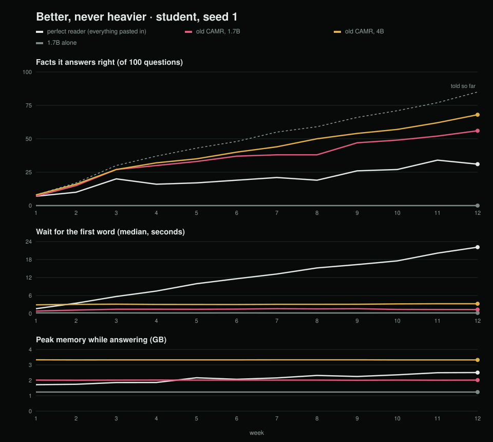
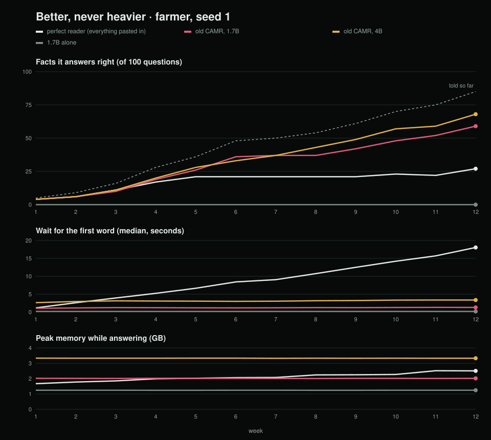
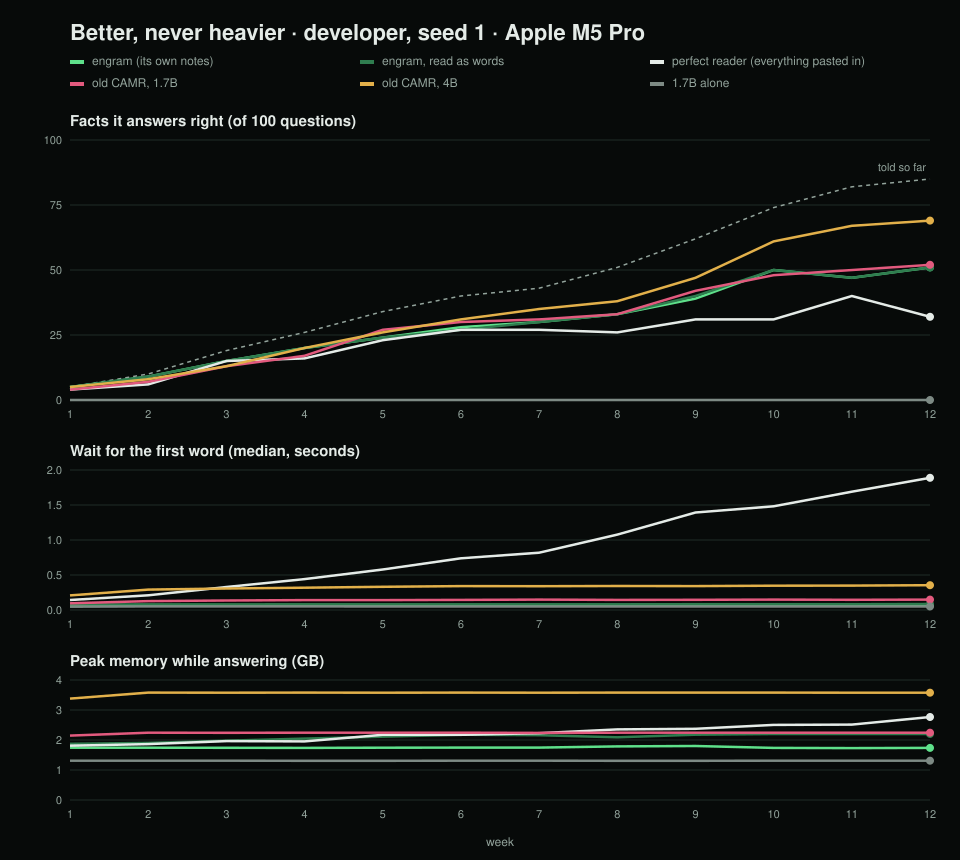

# Chapter 5: CAMR v2 additions (insertion blocks)

> **How to use this file.** Each block is headed with the section of `Chapter5_CAMR.docx` it goes into. The v1 text stays as it is. Tables and figures are numbered "Table 5.v2-N" and "Figure 5.v2-N" so they can be renumbered. The Python package and the contender in the test records are called `engram`. That is an internal code name; the text calls the system CAMR v2. The sources are `DECISIONS.md` in the CAMR v2 repository (E-nn), the test records in `records/`, and `docs/FINDINGS.md` in the CAMR v1 repository (Fnn). The state described is CAMR v2 at commit `b651b7a` on 3 November 2026, with the uncommitted changes listed in the 5.5 block. Points to check before inserting are at the end.

---

## Insert into 5.2 Implementation Environment

**In plain words.** CAMR v2 runs on one Apple-silicon Mac. The model, the memory and the app stay on that Mac, and the internet is used once, to download two models.

CAMR v2 is a local prototype: a private repository, a one-command installer, and a page served on the loopback address. Nothing was deployed for public access. Development began on a MacBook Air M4 with 16 GB, the laptop class of the proposal's scope (Section 1.6). From 3 November every contender was re-run on a MacBook Pro M5 Pro, and later work used that machine only (E-17). The Air's twelve baseline records are kept as history (`records/2026-11-02/`).

Table 5.v2-1: CAMR v2 environment and minimum requirements

| Item | Minimum tested specification or version | Purpose and justification | Evidence |
|---|---|---|---|
| Evaluation and app machine | MacBook Pro Mac17,9, Apple M5 Pro, 24 GB unified memory, internal SSD, macOS 27.2. Reads text at about 6,600 tokens/s, writes about 240 tokens/s, SSD about 12 GB/s with the cache bypassed | Every proof-life run, the errands, the speed bench, the app | `environment` field of the records in `records/2026-11-03/`; E-17 |
| First development machine | MacBook Air M4 (Mac16,12), 16 GB, fanless. About 800 tokens/s reading, 73–90 writing, SSD 3.4–5 GB/s | Step 0 baselines; design measurements E-14 to E-16 | `records/2026-11-02/`; E-17 |
| Minimum to run | An Apple-silicon Mac (MLX needs one). M1 to M3 Macs and 8 GB Macs were not tested | The installer refuses other machines | `scripts/install.sh`; `docs/USER_GUIDE.md` |
| Resources used | At most 1.83 GB of memory at week 12, as MLX's peak counter reports it (not resident memory); 930–984 MB of notes on the SSD per 84-day life; 1.3 GB of models | A 16 GB Mac keeps room to spare; notes take 114,688 bytes per token (Equation 4.4) | `peak_ram_gb` and `disk_mb` in the records |
| Network | Downloads the models once; afterwards they load with `HF_HUB_OFFLINE=1` | Private, offline use (NFR-13) | `engram/app/__main__.py` |
| Specialised hardware | None dedicated. MLX uses the chip's integrated GPU | The reader's key–value cache is read and written inside the process | Table 4.9 |

The 18 proof-life records and the speed bench were made on battery power, and the errand records on AC power (`environment.power`). The one-minute load when each proof run started was 1.4 to 5.7, with a median of 1.8 (E-20). Continuous integration runs on GitHub Actions `ubuntu-latest` without MLX (`.github/workflows/tests.yml`).

Table 5.v2-2: CAMR v2 software and models (versions as tested)

| Component | Version | Role |
|---|---|---|
| Python; NumPy | 3.12.12; 2.5.4 | Engine, app and ruler; vectors and layout |
| MLX / mlx-lm | 0.32.4 / 0.32.2 | Run both models on the GPU and expose the key–value cache (Hannun et al., 2023) |
| Reader (frozen) | `mlx-community/Qwen3-1.7B-4bit` (A. Yang et al., 2025) | Every contender except two baselines |
| Larger readers | `Qwen3-4B-Instruct-2507-4bit`; `Qwen3.8-27B-4bit` | The CAMR v1 on 4B baseline; the large comparison (E-26) |
| Embedder (frozen) | `mlx-community/Qwen3-Embedding-0.6B-4bit-DWQ` (Zhang et al., 2025) | Every contender |
| CAMR v1 as a library | camr 0.4.0, commit `4521c53`, engine unchanged; sqlite-vec 0.1.9 | The CAMR v1 contender (E-03, E-04) |
| huggingface_hub; transformers | 2.4.0; 5.22.1 | Model download; tokenizer |
| uv; pytest | 0.10.4; 9.2.0 | Installer; the 52 tests |

The first five versions come from each record's `environment` and `contender` fields; the rest come from the project environment on 3 November. Settings are constants in the code, not a configuration file: rooms of at most 512 tokens, a join threshold of 0.80, four closest moments, a 256 MiB read allowance per question, and at most 40 answer tokens with Qwen3's thinking off. CAMR v2 uses no cloud service, key or password, and no Docker.

### CAMR v2: deployment and reproducibility

`sh scripts/install.sh` takes six steps:
1. It checks for macOS on arm64.
2. It installs uv if uv is missing.
3. It creates a Python 3.12 environment.
4. It installs CAMR v2.
5. It runs the health check.
6. It opens the app at `http://127.0.0.1:8765`.

The health check, `python -m engram.app --check`, loads both models (downloading them the first time) and teaches a throwaway memory two dated facts. It then asks "Where does my sister live?" and prints `PASS` only if the answer names Nakuru, with the time to the first word. On 3 November a fresh clone of the private repository (https://github.com/Satasdin/CAMR-v2) was installed with uv and passed: "First word after 115 ms … PASS" (Figure 5.v2-1).

Figure 5.v2-1: The health check on a fresh clone (screenshot to add)

The evaluation is re-run with `scripts/step1.sh` (every contender on the proof lives, then the speed bench) and `scripts/errands.sh`, with CAMR v1 installed beside CAMR v2 as a library. Every record names its machine, its library versions, its commit and `engram_source_sha`, a hash of the engine code (E-12). Three limits apply:
1. The design and tuning measurements (E-14 to E-18, E-21) were run from `work/experiments/`, which `.gitignore` excludes.
2. Answers differ slightly between chips: 158 facts on the Air and 164 on the Pro (E-17).
3. No proof run was repeated on the same machine.

---

## Insert into 5.3: dataset description and system implementation

*The first subsection goes into "Dataset Description"; the rest into "System Implementation".*

### CAMR v2 data: scripted lives

**In plain words.** A memory that grows over weeks cannot be tested on a public question set, so CAMR v2 was tested on three invented twelve-week lives, each of which knows its right answers on every day. One draw of each life was used to build the system; a second was held back for the final test.

`engram/ruler/life.py` generates each life from a persona and a seed (E-05). There are three personas: a university student, a dairy-cooperative manager ("farmer" in file names) and a software developer. A life covers 84 days, from 5 January to 29 March 2026, including 10 quiet days. A quiz is held at the end of each week. The notes are deliberately messy: typos, Swahili asides, changed minds, relative dates, and Kenyan names and places. Time words are never misspelt, because a typo in "yesterday" made the date ambiguous (E-06). No personal data is used.

Table 5.v2-3: The scripted lives

| | Development lives (seed 0) | Proof lives, held out (seed 1) |
|---|---|---|
| Used for | CAMR v1's threshold (E-04); design and tuning (E-15, E-16, E-18, E-21); errand wording (E-23); the speed bench | Only after the pass marks were written (E-19): the quiz (E-20), the errands (E-25), the Simulation demonstration |
| Notes (student / farmer / developer) | 339 / 332 / 329 | 338 / 337 / 323 |
| Questions per life | 100: 45 single facts, 15 updated, 10 told across two notes, 15 dates, 15 never told | The same |
| Told by week 12 | 85 per life (255 in all); 15 never told (45 in all) | The same |

Table 5.v2-4: One question of each kind (farmer, seed 1; verbatim)

| Kind | Question | Right answer (day told) |
|---|---|---|
| Single fact | Which football team does my brother support? | Tusker FC (28) |
| Updated | What car does my vet drive? | Toyota Probox (49), then Toyota Vitz (56) |
| Date | What date was it when I fenced the east paddock? | 25 February (51) |
| Two notes | What does my driver's roommate do for work? | lab technician (60) |
| Never told | What is the name of my cousin's dog? | None; declining is right |

A typical messy day (day 20) reads: "[2026-01-25] Diseel for the generator cost KES 120." followed by "[2026-01-25] Deisel for the geenrator cost KES 1200."

Grading is by rule, so the same answer always gets the same verdict (E-07). There are six verdicts: right, stale (names a replaced value), missed (declines a told fact), wrong, right_abstain and false_memory. Growth is measured as facts answered right out of those told so far. False memories are reported separately, so declining cannot raise a score (E-08). The same 100 questions are asked every week (E-09).

**What is unseen.** The seed-1 lives are new draws from the same generator. For each persona, 80 or 81 of the 100 question texts appear in both seeds, but only 2 to 5 have the same answer. Also, 35 to 42 of the 289 to 302 distinct proof-life notes recur in the development life. (These counts were computed for this chapter with `build(persona, seed)`.) So the proof tests new facts under familiar wording. Nothing was tuned on seed 1.

**Synthetic-data risk.** Results on synthetic data alone cannot establish real-world performance. Each fact is told in one or two notes, the questions follow templates, and there are only three personas. The v2 results therefore compare memories fairly on such lives but do not show how CAMR v2 would serve a real user. CAMR v1's results on real public benchmarks (FINDINGS F0) are the complement. A LongMemEval loader (Wu et al., 2024) was built and tested, but CAMR v2 was not run on it.

### Implementation of CAMR v2

**In plain words.** CAMR v2 saves the notes the model writes to itself while reading each moment. It keeps them on the SSD in rooms of related moments and lays one room in front of the model when a question arrives.

The implementation follows Figures 4.5 and 4.6 (Table 5.v2-5).

Table 5.v2-5: CAMR v2 modules

| Module (lines) | What it does | Requirements | Evidence |
|---|---|---|---|
| `rooms.py` (133) | Places a moment by Equation 4.3; appends its notes to the room file; fetches a whole room in 1 MB pieces, eight at once, with `F_NOCACHE`; saves the index and vectors | FR-15, FR-16, FR-22, DR-08, DR-09, IR-12 | T-v2-04 to 06; E-14 |
| `notes.py` (101) | Turns tokens into notes and notes into a desk; refuses scaled rotary positions; `turn` moves keys | FR-14, IR-08 | T-v2-07 |
| `memory.py` (162) | Remember, choose, recall, answer; refuses rooms larger than the 256 MiB allowance | FR-14, FR-17, FR-18, NFR-04 | T-v2-15; E-16 |
| `events.py` (104) | Logs each written word's attention in layers 12, 16, 20 and 24; marks "used" at a share of 0.10 (Equation 4.5) | FR-19, NFR-05, NFR-19 | T-v2-08; E-21 |
| `models.py` (130) | Loads the models through MLX; greedy decoding, thinking off, 40 tokens; MLX peak memory | NFR-10 | T-v2-17 |
| `agent.py` (116) | Ten pretend tools as JSON-schema functions; one call per errand; graded like the quiz | FR-20, IR-11 | T-v2-09 |
| `app/` (901) | JSON API and security checks, Simulation, health check, the page | FR-21, IR-09, IR-10, IR-13, NFR-12, NFR-16 | T-v2-12, T-v2-14 |
| `view/layout.py` (78) | Plain-NumPy t-SNE for the Brain map (van der Maaten & Hinton, 2008) | FR-21 | T-v2-10 |
| `ruler/` (1,310) | Lives, grading, weekly quiz, contenders, errands, speed bench, records, charts | FR-23–FR-25, DR-06, DR-07, DR-10 | T-v2-01 to 03 |

The write and read paths are those of Figures 4.5 to 4.7; two implementation choices matter for the results. Each room is written as one continuous page (E-15). A single room is laid on the desk without turning its keys, which cut the desk from 55 ms to 15 ms at 2,000 words (E-18).

The agent and the app add three further pieces:
- **Errands.** Each quiz question becomes an errand whose tool needs that exact fact. For example, "Where does my vet live?" becomes "Book me a ride to my vet's home", which calls `book_ride(destination)`. One of the ten tools is `ask_user` (E-23).
- **The four tabs** (IR-13; Figures 5.v2-2 to 5.v2-5). Simulation plays a held-out life in its own memory and asks 25 sampled questions each week. Chat remembers statements and answers questions. Errands shows each tool call. Brain replays a logged answer word by word.
- **The server.** It answers an API request only if the request names `127.0.0.1` or `localhost` with its port (a guard against DNS rebinding) and carries the key made at that launch. A POST must also be JSON from the page's own origin. Any other request receives a JSON 403.

Figure 5.v2-2: The Simulation tab during the held-out farmer life (screenshot to add)

Figure 5.v2-3: The Chat tab: a fact remembered, a question answered, "Look inside" (screenshot to add)

Figure 5.v2-4: The Errands tab: a task and the tool call filled from memory (screenshot to add)

Figure 5.v2-5: The Brain tab replaying an answer: moments leaned on glow green, moments only picked up are ringed white, and the traces strip runs below (screenshot to add)

**Contenders.** Every contender uses the same embedder, and all but two baselines use the same 1.7B reader, so differences between them are differences between memories (E-02; Table 5.v2-6).

Table 5.v2-6: Contenders (code names in the records)

| Contender | Memory | Role |
|---|---|---|
| 1.7B alone (`bare`) | None | Floor |
| Perfect reader (`perfect`) | Every note so far pasted in | Reading everything |
| CAMR v1, 1.7B (`camr`) | CAMR v1 as CAMR Personal shipped it, threshold 0.65 | Main baseline |
| CAMR v1, 4B (`camr-4b`) | The same, on Qwen3-4B | A reader twice the size or more |
| CAMR v2 (`engram`) | One room of notes plus four closest moments as words | The system |
| CAMR v2 as words (`engram-words`) | The same desk read as words | Ablation (NFR-07) |
| 27B, three ways | None; CAMR v1; CAMR v2's memory as words | Large comparison, in progress (E-26) |

**What was chosen, and on what.** No weights were trained. The reader and embedder are frozen, and the trained translation layer was not built (E-22). The choices that were made, all on the development lives or in advance, are listed in Table 5.v2-7.

Table 5.v2-7: Settings chosen for CAMR v2 and its baseline

| Setting | Value | Rule and result | Evidence |
|---|---|---|---|
| CAMR v1 threshold | 0.65 | Middle of a plateau: 0.55–0.75 tie at 229 of 300; 0.80 gives 196 | `records/calibration/camr-min-similarity.json`; E-04 |
| Room size, join, moments re-read | 512 tokens, 0.80, 4 | Most facts known (164 of 255); 4 ties with 8 and gives fewer false memories (22 against 23) | E-18; `work/experiments/tune.log` |
| Layers watched | 12, 16, 20, 24 | Within the 5% cost limit; same top moment as other layer bands (98–100%) | E-21 |
| Errand wording | Plain | A stricter wording did no better (41 against 41, and 41 against 40, of 85) | E-23 |
| Decoding | Greedy, thinking off, 40 tokens | Fixed in advance | E-10 |

---

## Insert into 5.4 Testing

**In plain words.** Automated tests checked each part. Runs on the held-out lives checked the whole system against pass marks written beforehand. A fresh install checked deployment, and negative requests checked that only the app's own page can use it. One test currently fails and two requirements are not met; both are kept.

Testing used five levels:
1. **Unit and integration tests.** There are 52 white-box pytest tests in ten files (Table 5.v2-8). None loads a model. On the MacBook Pro on 3 November (pytest 9.2.0, caches off), 51 passed and one failed, in 1.09 s. GitHub Actions runs every test that needs no MLX on every push.
2. **System tests.** The runs on the proof lives were judged against the three pass marks of E-19, which were written before any seed-1 run. Comparisons without a mark are shown as "Recorded".
3. **Deployment test.** The health check was run on a fresh clone.
4. **Security tests.** Negative requests were sent to the local server.
5. **Demonstration.** The tabs were run on a held-out life.

User acceptance testing and an accessibility audit were not done.

Table 5.v2-8: CAMR v2 automated tests by file (52)

| File (tests) | Tests (parameter cases) | Requirements |
|---|---|---|
| `test_grade.py` (19) | an update question over time (7 verdicts); a date in any usual form (5); a near date is wrong; ways of declining (5); a guess about something never told is a false memory | FR-24, NFR-08 |
| `test_life.py` (12) | a life is the same every time and differs by seed (3); the quiz has the planned kinds and weekly days (3); every right answer is told in that day's notes (3); time answers are the day of the note or the day before; knowledge grows through the twelve weeks; names do not match inside other words | FR-23, DR-06 |
| `test_rooms.py` (6) | close moments share a room and far ones start their own; a full room sends the moment to a new room; a fetch returns each room byte for byte; the index is saved beside the rooms; a saved memory opens where it left off; notes written after the last save are dropped on reopening | FR-15, FR-16, FR-22, DR-08, DR-09 |
| `test_agent.py` (3) | every question in every life becomes an errand; a tool call is read from the reply; errands are graded like the quiz | FR-20, IR-11 |
| `test_events.py` (3) | events are appended one line each and read back; a node is used when it draws its share of the desk; no looks means nothing used | FR-19, NFR-19 |
| `test_harness.py` (3) | a run records every week and the oracle knows all it was told; the chart draws both contenders from their records; axis tops are round | FR-24, FR-25 |
| `test_notes.py` (2) | turning keys moves them exactly as far as the model would; each token can move its own distance (needs MLX) | FR-14 |
| `test_layout.py` (2) | two kinds of moment land in two places; tiny memories still get positions | FR-21 |
| `test_app_security.py` (1) | only the served page can use the API (seven checks) | NFR-12 |
| `test_longmemeval.py` (1) | sessions become dated notes, oldest first | Section 4.2.3 |

Table 5.v2-9: CAMR v2 test cases and results

| Test ID | Traceability | Scenario and conditions | Expected result | Actual result and evidence | Verdict |
|---|---|---|---|---|---|
| T-v2-01 | FR-23, DR-06 | `test_life.py` | Lives fixed by seed, of the planned shape | 12/12 | Pass |
| T-v2-02 | FR-24, NFR-08 | `test_grade.py` | Each answer gets its stated verdict | 19/19 | Pass |
| T-v2-03 | FR-24, FR-25 | `test_harness.py`, oracle contender | A record per week; a chart from records | 3/3 | Pass |
| T-v2-04 | FR-15, FR-16, DR-08 | `test_rooms.py`: placement, full room, fetch, index | Equation 4.3 respected; exact bytes | 4/4 | Pass |
| T-v2-05 | FR-22 | Reopen a saved memory | Same moments, vectors and notes | 1/1 | Pass |
| T-v2-06 | FR-22, DR-09 | Crash between append and save, reopen, add a moment | Unsaved notes dropped; the new moment's own bytes returned | Failed on the committed `rooms.py` (wrong bytes from byte 48). Fix in `work/rooms-recovery.patch` (E-27) | Fail; retest after commit (D-v2-04) |
| T-v2-07 | FR-14 | `test_notes.py` | Turned keys match keys written at the new position (below 1e-3) | 2/2 on the Mac; skipped in CI | Pass (Mac) |
| T-v2-08 | FR-19, NFR-19 | `test_events.py` | One line per event; "used" at a share of 0.10 or more | 3/3 | Pass |
| T-v2-09 | FR-20, IR-11 | `test_agent.py` | 100 errands per life; `ask_user` counts as declining | 3/3 | Pass |
| T-v2-10 | FR-21 | `test_layout.py` | Clusters separate; tiny inputs handled | 2/2 | Pass |
| T-v2-11 | Section 4.2.3 | `test_longmemeval.py` | Dated notes, oldest first | 1/1 | Pass |
| T-v2-12 | NFR-12 | `test_app_security.py`: no key, foreign Host, non-JSON POST, foreign Origin | 200 only for the served page with its key | All seven checks as expected (file not yet committed) | Pass |
| T-v2-13 | NFR-17 | CI, `ubuntu-latest`, commit `b651b7a` | Every test that needs no MLX passes | Run 41698256830: 48 passed, 1 skipped | Pass |
| T-v2-14 | NFR-16 | Fresh clone, uv, `--check` | `PASS` with the time to the first word | "First word after 115 ms … PASS" | Pass (demonstration) |
| T-v2-15 | NFR-04 | Inspection of `memory.py` | Refuses a room over 256 MiB; a full room is 58.7 MB | Raises `ValueError` | Pass (inspection) |
| T-v2-16 | NFR-13 | Inspection | No outside connection after the download | Offline loading; binds 127.0.0.1. No network-blocking test | Pass (inspection) |
| T-v2-17 | NFR-10 | Inspection of `models.py` | Greedy decoding, thinking off, 40 tokens | As specified; a same-machine re-run was not measured | Pass (inspection) |
| T-v2-18 | NFR-01 (E-19 mark 1) | `ruler speed`, 2,000 words, cache bypassed, 5 tries | Median under 0.5 s | 0.233 s (`records/speed/2026-11-03-student.json`) | Pass |
| T-v2-19 | NFR-07 (mark 2) | Proof lives × 12 weeks, CAMR v2 against its desk as words | At least 95% of the facts; at most 3 extra false memories | 164 against 163; 25 against 24 (E-20) | Pass |
| T-v2-20 | NFR-02 (mark 3) | Speed bench, 2,000 words | At least 10× sooner | 4.6× | Fail (kept) |
| T-v2-21 | NFR-03 | Proof lives × 12 weeks | Wait and peak RAM do not climb as notes grow | Wait 0.064–0.072 s; RAM 1.65–1.83 GB per life; notes 82 → 963 MB | Pass for the wait; RAM rose up to 0.18 GB, with no tolerance stated |
| T-v2-22 | NFR-05 | Writing speed, log on and off | At most 5% slower | 0.6% (4 layers); a whole life 0.8% (E-21) | Pass |
| T-v2-23 | NFR-19 | 47 right single-fact answers | The most-attended moment holds the answer | 47 of 47; chance 12% (E-21) | Pass |
| T-v2-24 | FR-20 | 100 errands × 3 proof lives | One graded call per errand | 122 of 255 right; 8 replies with no call (E-25) | Recorded |
| T-v2-25 | FR-20, NFR-08 | The 45 never-told errands | Ask or decline | 0 asked; 42 made up | Not met (D-v2-05) |
| T-v2-26 | FR-25, DR-07, DR-10, NFR-15 | Inspection of all 45 records | Seed, machine, versions, commit and code hash | All present on the Pro. The Air's records lack the load and the commit, which did not yet exist; their code hash is present (E-12) | Pass |
| T-v2-27 | IR-13, FR-21 | Simulation, farmer seed 1 | Facts known climb while the wait and memory stay flat | 14 of 21 at week 12; wait 0.064–0.069 s (`work/simulations/sim-farmer-s1/events.jsonl`); about 1.78 GB | Pass (demonstration) |
| T-v2-28 | IR-13 (U), NFR-18 | User acceptance; accessibility audit | | Not run | Not tested |
| T-v2-29 | Section 5.7 | 27B three ways (E-26) | | Running | Pending |

Table 5.v2-10: CAMR v2 defects and retests

| ID | Defect and how it was found | Correction | Retest |
|---|---|---|---|
| D-v2-01 | A typo in "yesterday" made the date ambiguous | Time words exempt from typos (E-06) | Pass |
| D-v2-02 | The end of a Claude session killed the first baseline run in week 4 | Partial record set aside; `baselines.sh` made resumable and run detached (E-13) | Pass |
| D-v2-03 | Notes written one moment at a time lost the thread side by side (E-15) | Rooms written as one page; one room on the desk (E-16) | Pass (E-20) |
| D-v2-04 | Crash window: notes appended before the index was saved could misplace later moments; found while documenting | Opening a memory cuts each room file to its indexed length (E-27) | Fails until the fix is committed |
| D-v2-05 | The 1.7B agent never calls `ask_user` and guesses instead (E-23, E-25) | None yet | Open |
| D-v2-06 | The 10× mark (NFR-02) failed on the faster machine | Kept as written (E-19) | Open |

---

## Insert into 5.5 Version Control and Implementation Evidence

**Project repository (CAMR v2):** https://github.com/Satasdin/CAMR-v2. It is private, so the supervisor and examiners must be given access. It holds:
- the README, the user guide and `DECISIONS.md`;
- `pyproject.toml`, the scripts and the tests;
- every test record, and the charts drawn from them.

`.gitignore` excludes the virtual environment, model weights and `work/`, where contenders' working memories are rebuilt on every run.

The 14 commits on `main` (2 November 07:17 to 3 November 21:54) follow the build order. Step 0, the ruler, is `776fecf`. Step 1, rooms and notes re-run on the Pro, is `cc0b7b9`. Step 2, the event log, is `88b4629`. They are followed by the app and errands (`d94025d`–`0c27183`), the installer (`64481ad`), the documentation, and the 27B contender (`b651b7a`). One developer committed directly to `main`. GitHub Actions ran the tests on each of the six pushes to this repository, all on 3 November, and all passed (T-v2-13).

Some work was not committed at the time of writing: `tests/test_app_security.py`, the crash-window fix and its test, the edits to `DECISIONS.md` (E-26, E-27), the first 27B records and `docs/thesis/`.

Figure 5.v2-6: The CAMR v2 repository and its Actions runs (screenshot to add)

---

## Insert into 5.6 Author Oversight and Use of AI-Assisted Tools

Claude (Anthropic), used through Claude Code, also assisted with CAMR v2. Under the student's direction it wrote and revised the engine, the app, the ruler and their tests; ran the experiments; and drafted the documentation, including `DECISIONS.md`, the README, the user guide and drafts of Chapters 4 to 6. The student set the problem, objectives and scope. He made the calls recorded as his own in the plan, such as scripted lives only and stopping the build at step 2 (E-22). The output was checked by running the automated tests, by the test records, which name the machine and code behind every number, and by reading the outputs themselves. The pass marks were written before the runs they judged, and the failed mark is reported as measured. The student made the final decisions and takes full responsibility for the work. *[Student to confirm, and add the model versions used.]*

---

## Insert into 5.7 Evaluation Results, Discussion and Limitations

**In plain words.** CAMR v2's notes answer as well as the words they came from. CAMR v2 is as fast and as light in week 12 as in week 1, and it does errands three times as well as CAMR v1. It is not as good as a larger model, it makes things up about what it was never told, and its notes take about 1 GB of SSD per life.

The results are organised by objective as they apply to CAMR v2. Objective i is answered in Chapter 2 and by CAMR v1. All the results below are from the three proof lives on the MacBook Pro, added together. In Table 5.v2-16, peak RAM is the highest of the three lives' week-12 peaks.

Table 5.v2-11: CAMR v2 against objectives ii to v

| Objective | Output | Acceptance criterion | Observed result | What it allows the study to conclude |
|---|---|---|---|---|
| ii. Design | Rooms of saved notes; one room plus four moments on the desk; the event log | E-19 mark 2 (NFR-07); NFR-05; NFR-19 | 164 against 163 facts; 25 against 24 false memories; logging cost 0.6%; 47 of 47 | For one room on a 1.7B reader, saved notes faithfully replace the words. The log identifies what an answer used |
| iii. On the device | The app, installer and health check on an Apple-silicon Mac | E-19 marks 1 and 3 (NFR-01, NFR-02); NFR-03; NFR-16 | 0.233 s (met); 4.6× (not met); wait flat at 0.064–0.072 s, RAM 1.65–1.83 GB; `PASS` | Memory can grow nearly twelvefold on the SSD without slowing the model. The 10× speed-up was not achieved on this machine |
| iv. Evaluation | Quiz and errands against five baselines | No pass mark (E-19 left the bar to the later proof run) | Quiz 164, level with CAMR v1 (166), below the 4B (208); errands 122 against 40; 42 of 45 never-told errands made up | Level with CAMR v1 on facts, ahead on errands, not yet as good as a larger reader, and not honest when untold |
| v. Token budget | Room size and moments re-read | Most facts on the development lives | 512-token rooms (mean 208), 4 moments: 164; larger rooms knew fewer | A small, fixed desk is best for a 1.7B reader |

### Objective ii: the design

The first finding was negative. Notes written one moment at a time, then laid side by side, lost the thread. With 30 unrelated moments beside the right one, the reader found 2 of 46 facts from such notes, against 32 from the words. Three training-free fixes did not rescue it: a neutral lead-in, sharpened attention, and moving the date prefix (E-15). Writing each room as one continuous page fixed this within a room. Rooms written apart still failed together: three rooms of notes knew 96 of 255 facts against 144 for their words (E-16). The desk that won is shown in Table 5.v2-12.

Table 5.v2-12: Desks compared, development lives at day 83, MacBook Air (E-16)

| Desk | Knows (of 255) | First word |
|---|---|---|
| Words, 3 rooms | 144 | 1.65 s |
| Notes, 3 rooms, plus 4 closest moments | 142 | 0.35 s |
| 4 closest moments as words, no room | 135 | 0.45 s |
| Notes, 1 room | 120 | 0.17 s |
| **Notes, 1 room, plus 4 closest moments** | **158** | **0.36 s** |

On the proof lives the design met its accuracy mark. Notes gave the same answer as the words on 3,483 of 3,600 questions (E-20). The result covers one room only; combining rooms remains unsolved. The event log makes each answer inspectable. The top moment's share of attention is lower for answers given without knowledge, but not for wrong ones (Table 5.v2-13). It is therefore a possible signal for asking when unsure, untested as such.

Table 5.v2-13: Median attention share of the top moment, by outcome (development lives; E-21)

| Right | Wrong | False memory | Missed | "I don't know" |
|---|---|---|---|---|
| 0.46 | 0.52 | 0.34 | 0.19 | 0.20 |

### Objective iii: on the device

Notes met the 0.5 s mark at 2,000 words, but were 4.6× sooner than words rather than 10× (Table 5.v2-14). The 10× came from the Air, which read text eight times more slowly (E-17, E-19). Notes skip the reading but still pay for the SSD read and the copy into GPU memory, so their head start grows with the size of the room on the desk. The bench used a development life and room sizes above the deployed 512-token cap. On the quiz, where rooms averaged about 210 tokens, notes saved only 0.02 s (0.070 against 0.090 s). Their gain there was in RAM, 1.82 against 2.20 GB (E-20).

Table 5.v2-14: Time to the first word by memory on the desk (`records/speed/2026-11-03-student.json`; median of 5)

| Words in the room | Notes read | Notes | Words | Notes sooner by |
|---|---|---|---|---|
| 253 | 75 MB | 0.078 s | 0.148 s | 1.9× |
| 1,002 | 294 MB | 0.116 s | 0.431 s | 3.7× |
| 2,006 | 588 MB | 0.233 s | 1.080 s | 4.6× |
| 3,007 | 894 MB | 0.278 s | 1.605 s | 5.8× |

Over twelve weeks the wait stayed flat while the memory grew (Table 5.v2-15; Figures 5.v2-7 to 5.v2-9). The perfect reader's wait climbed past 1.8 s. CAMR v2's stayed at 0.064–0.072 s, because the desk is always one room plus four moments. Peak RAM per life ranged from 1.65 to 1.83 GB, rising by at most 0.18 GB, while the notes grew by about 880 MB. The cost moved to the SSD: 930–984 MB per life, against 6.1 MB for CAMR v1. In the Simulation tab the held-out farmer life showed the same shape: 14 of 21 told facts known at week 12, a wait of about 66 ms, and about 1.78 GB in use. CAMR v2 meets objective iii's hardware intent on an Apple-silicon laptop. It replaces the embedded database with files for the reasons given in Table 4.9. It was not re-run on the 16 GB Air.

Table 5.v2-15: Twelve weeks on the proof lives (three lives added; the wait is the range of the lives' medians; RAM and SSD are means; from `records/2026-11-03/`)

| Week | Told | CAMR v2 knows | CAMR v1 knows | CAMR v2 wait (s) | Perfect reader wait (s) | CAMR v2 RAM (GB) | Notes (MB) |
|---|---|---|---|---|---|---|---|
| 1 | 18 | 16 | 14 | 0.064–0.067 | 0.143–0.178 | 1.71 | 82 |
| 4 | 91 | 71 | 65 | 0.068–0.069 | 0.441–0.557 | 1.74 | 324 |
| 8 | 164 | 113 | 110 | 0.069–0.072 | 1.077–1.144 | 1.80 | 613 |
| 12 | 255 | 164 | 166 | 0.070 | 1.814–1.992 | 1.77 | 963 |

Figure 5.v2-7: Facts known, wait and peak memory over twelve weeks: student, seed 1 (`records/charts/growth-student-s1.svg`)

Figure 5.v2-8: The same, dairy-cooperative manager (`records/charts/growth-farmer-s1.svg`)

Figure 5.v2-9: The same, developer (`records/charts/growth-developer-s1.svg`)

### Objective iv: evaluation against the baselines

CAMR v2 has no cloud model, so v1's gap closed (Equation 3.1) is not computed. Its references are local (Table 5.v2-16).

Table 5.v2-16: The proof lives at week 12 (E-20; tokens in context from the records)

| Contender | Knows (of 255) | False memories (of 45) | First word | Peak RAM | Tokens in context |
|---|---|---|---|---|---|
| 1.7B alone | 0 | 0 | 0.05 s | 1.31 GB | 93 |
| Perfect reader | 90 | 17 | 1.90 s, climbing | 2.77 GB | 8,198–8,667 |
| CAMR v1, 1.7B | 166 | 29 | 0.15 s | 2.24 GB | 743–759 |
| CAMR v1, 4B | 208 | 10 | 0.35 s | 3.58 GB | 739–755 |
| **CAMR v2, 1.7B** | **164** | **25** | **0.07 s** | **1.82 GB** | **336–420** |
| CAMR v2 as words | 163 | 24 | 0.09 s | 2.20 GB | 336–420 |

CAMR v2 is level with CAMR v1 on the same reader, at half the wait and 0.4 GB less RAM, and without v1's hand-written rules. The two-fact gap means little. Paired over the 255 told facts, 138 were known by both, 26 by CAMR v2 alone and 28 by CAMR v1 alone. The 4B reader with CAMR v1 knew 54 facts that CAMR v2 missed, while missing only 10 that it knew. (The paired counts were computed from the week-12 answers.)

Table 5.v2-17: Right answers by kind of question, week 12 (three lives; from the records)

| Kind (questions) | CAMR v2 | CAMR v2 as words | CAMR v1, 1.7B | CAMR v1, 4B | Perfect reader |
|---|---|---|---|---|---|
| Single facts (135) | 104 | 104 | 96 | 122 | 53 |
| Updated (45) | 35 | 35 | 39 | 45 | 23 |
| Dates (45) | 23 | 24 | 28 | 35 | 9 |
| Two notes (30) | 2 | 0 | 3 | 6 | 5 |
| Never told, declined (45) | 20 | 21 | 16 | 35 | 28 |

Table 5.v2-17 separates knowledge-bound questions from those that need combining, and the pattern repeats CAMR v1's real-benchmark finding (F8): memory recovers facts, not reasoning. CAMR v2 knew 104 of 135 single facts but only 2 of 30 facts told across two notes. One room seldom holds both notes, and the 1.7B reader does not join them. On updates, 6 answers named the replaced value, because a changed fact is held as two moments. The perfect reader knew the fewest: pasting everything in gives a small reader more to get lost in.

The errands separated the memories most (Table 5.v2-18). CAMR v2 did three times as many right as CAMR v1, although the two are level on the quiz. CAMR v1's gates were tuned for questions, and a request falls past them, whereas CAMR v2 opens the closest room however the task is worded (E-25). No contender ever asked. CAMR v2 made up 42 of the 45 never-told errands, and 25 of the 45 never-told quiz questions. That is the clearest weakness found (Figure 5.v2-10).

Table 5.v2-18: Errands on the proof lives, last day, 1.7B reader (E-25; errand records)

| Memory | Right (of 255) | Old value | Made up (of 45) | Asked | No call | First word |
|---|---|---|---|---|---|---|
| None | 1 | 0 | 44 | 0 | 7 | 0.15 s |
| CAMR v1 | 40 | 6 | 45 | 0 | 2 | 0.16 s |
| **CAMR v2** | **122** | 16 | 42 | 0 | 8 | 0.19 s |

Figure 5.v2-10: Brain, "Went wrong": a made-up errand replayed (screenshot to add)

#### A model sixteen times larger on the same Mac

<!-- 27B: filled in when the runs finish -->

Qwen3.8-27B-4bit (16 GB) is being run on the same Mac three ways on the proof lives: alone, with CAMR v1, and reading CAMR v2's memory as words (E-26). Its hybrid layers cannot use saved notes. It is quizzed at week 12 only, then given the errands. The runs had not finished, so no result is reported.

Table 5.v2-19: The 27B on the proof lives (to be completed)

| Contender | Quiz: knows (of 255) | Quiz: made up (of 45) | Quiz: first word | Quiz: peak RAM | Errands: right (of 255) | Errands: made up (of 45) | Errands: first word | Errands: peak RAM |
|---|---|---|---|---|---|---|---|---|
| 27B alone | | | | | | | | |
| 27B + CAMR v1 | | | | | | | | |
| 27B + CAMR v2's memory as words | | | | | | | | |
| CAMR v2, 1.7B (Tables 5.v2-16, 5.v2-18) | 164 | 25 | 0.07 s | 1.82 GB | 122 | 42 | 0.19 s | not recorded |

### Objective v: the token budget

In CAMR v2 the budget is the room size and the number of moments re-read. It was tuned on the development lives for the most facts known (Table 5.v2-20). Larger rooms knew fewer facts at every setting, which agrees with CAMR v1, where 128 tokens was best for a 0.5B reader on facts (F8). The chosen desk kept the median context at 336–420 tokens at week 12, against 743–759 for CAMR v1 and over 8,000 for the perfect reader. The tuning was done once, without repeats.

Table 5.v2-20: Room size and moments re-read, development lives, day 83 (knows, of 255; E-18)

| Rooms (mean tokens) | 4 moments | 8 moments |
|---|---|---|
| Up to 512, join 0.80 (208) | **164** | 164 |
| Up to 512, join 0.75 (393) | 153 | 163 |
| Up to 1,024, join 0.75 (588) | 143 | 158 |
| Up to 1,024, join 0.70 (953) | 139 | 152 |
| Up to 2,048, join 0.70 (1,482) | 131 | 146 |

### Limitations of the CAMR v2 evaluation

- **Synthetic lives.** Three personas, template wording shared between seeds; no real users. The CAMR v1 benchmarks are the real-data complement.
- **One machine, one run.** No same-machine repeats or confidence intervals. Answers differ between chips (E-17), so small differences, such as 164 against 166, read as level.
- **No cloud ceiling.** Gap closed is not comparable with v1's; the 4B and the pending 27B are the larger references.
- **One room per question.** Facts told across two notes are almost never joined.
- **SSD cost.** About 1 GB per 84-day life. The shrinking planned for sleep was not built.
- **Honesty.** The agent never asks.
- **Measurement scope.**
  - The speed bench exceeded the deployed room size.
  - Peak RAM is MLX's counter.
  - NFR-03 had no tolerance.
  - The experiment scripts are outside the repository.
- **Crash window.** D-v2-04 was found after the runs. It did not affect them, because every run starts from an empty memory (E-27), but it could affect a user whose app is killed between an append and a save.
- **No user testing or accessibility audit.**

---

## Points to check before inserting

1. **Peak RAM.** E-20, the README and Chapter 4 (§4.4.7) give 1.74–1.83 GB. The student life's records show 1.65 GB in week 1 and 1.69 GB in week 3, so this file uses 1.65–1.83 GB. Align them.
2. **Uncommitted work.** Commit `tests/test_app_security.py`, the rooms fix (`work/rooms-recovery.patch`) with its test, and the `DECISIONS.md` edits. Then re-run `pytest`: T-v2-06 should pass, giving 52 of 52.
3. **Health check.** "115 ms" is from the fresh-clone console and is in no file. Take the screenshot, and say whether `install.sh` itself or the uv steps were run.
4. **Simulation.** The 1.78 GB figure was read off the tab. The verdicts and waits are in the gitignored `work/simulations/sim-farmer-s1/events.jsonl`, which the next simulation overwrites. Take the screenshot first.
5. **Charts.** The SVG legends say "engram" and "old CAMR". Re-draw them with "CAMR v2" and "CAMR v1" (`engram/ruler/chart.py`) before inserting.
6. **Reproducibility.** Consider committing `work/experiments/` (E-14 to E-18, E-21).
7. **Computed counts.** The seed overlap, the per-kind table, the paired counts and the weekly means were computed for this chapter with read-only scripts over `engram/ruler/life.py` and the records. For example, the paired counts compare `verdict == "right"` per `qid` in `weeks[-1]` between the `engram` and `camr` records, over questions with an `expected` value.
8. **27B.** Fill in Table 5.v2-19 and the `<!-- 27B -->` subsection when `scripts/big27b.sh` finishes, and add an E-26 result entry.
9. **References.** E-15 and E-16 name APE and EPIC. This text describes the fixes without naming them; add references if they are named.
10. **Section 4.2.3.** The LongMemEval loader has no requirement ID, so T-v2-11 traces to Section 4.2.3.
