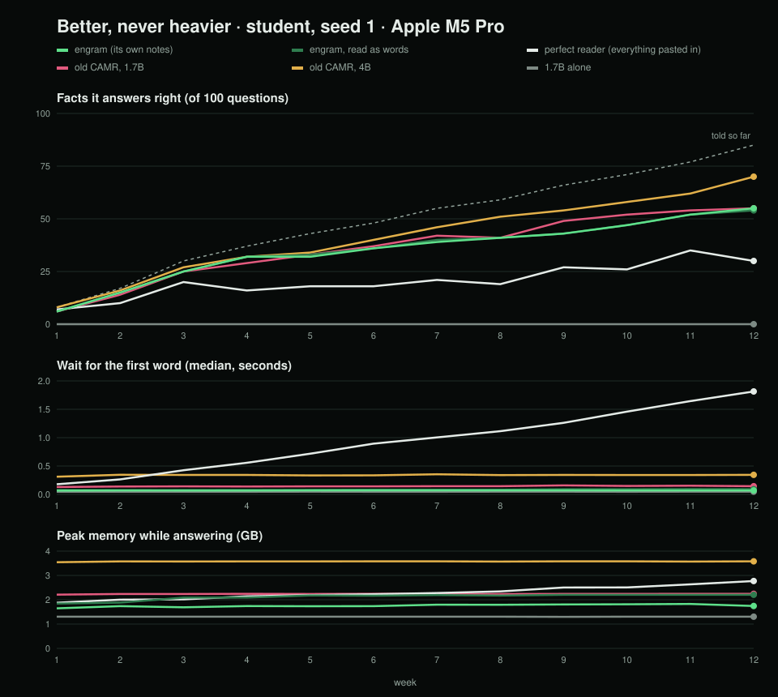
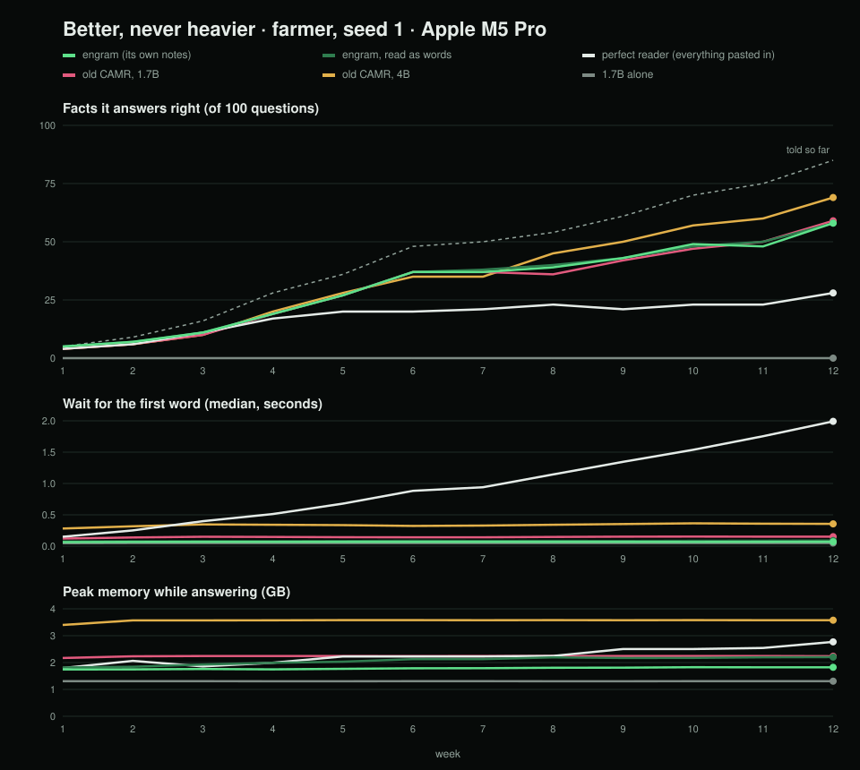
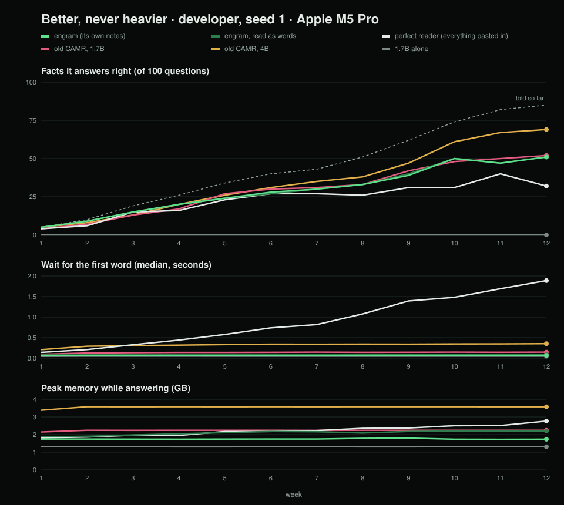

# The lightweight memory engine (code name `engram`; the name is still to be picked)

**Memory a local model reads like its own weights.** A small model on a Mac keeps a memory that lives on the SSD and
grows past any context window, without getting slower or heavier. It is not a vector database. The memory is the
model's own keys and values, saved once and read straight back onto its desk. People browse the same memory as a
vault of linked notes.

This is the thesis project "A Lightweight External Memory Engine to Bridge the Capability Gap Between On-Device and
Cloud Language Models". Technical calls are logged in [DECISIONS.md](DECISIONS.md) (E-29 onward for the engine as it
stands). The overnight summary of 4 November is in [../MORNING.md](../MORNING.md).

## Three layers, swapped by what the task needs

| Layer | Lives in | What it holds | Module |
|---|---|---|---|
| Subconscious | RAM, always on | a small core of facts every answer starts from | `engram/core.py` |
| Conscious | SSD, burst-read into RAM | rooms of saved notes (keys and values); hot rooms stay in RAM, cold ones sleep under a disk budget | `engram/rooms.py`, `engram/swap.py` |
| Archive | SSD, as text | every moment as a linked note, browsable like an Obsidian vault | `engram/vault.py` |

**Reach** decides who shares a memory: one session, a project, an agent, or everyone (`engram/reach.py`). Every
answer records its speed, retrieval time and SSD bandwidth (`engram/metrics.py`).

## The app

`python -m engram.app --open` serves one local page with six screens. Screenshots are in [docs/screens](docs/screens).

| Screen | What it does |
|---|---|
| Models | what fits this Mac, from measured speeds; Hugging Face search and download; MLX and Ollama models side by side |
| Chat | memory on or off per session, a reach picker, and the stage: SSD → RAM → desk as each answer is made |
| Code | a coding agent on a local model: personas, tools, MCP servers, skills, and a shell that asks first |
| Swarm | one to eight agents, each with its own memory, sharing one RAM budget |
| Memory | every room drawn as a tensor tile, the bus, the RAM ruler and the vault; any answer replayed |
| Bench | every benchmark record, live, against Claude alone |

## Pairing with Ollama

Ollama cannot load saved keys and values, so the engine gives it memory as words through a proxy that speaks
Ollama's API:

```sh
python -m engram.pair.ollama --port 11435 --memory ~/.engram/ollama
```

Then run `OLLAMA_HOST=127.0.0.1:11435 ollama run qwen3:1.7b`. See [docs/site/ollama.md](docs/site/ollama.md).

## The proof

Run on the MacBook Pro M5 Pro, 4 November 2026:
- [docs/site/benchmarks.md](docs/site/benchmarks.md) explains how;
- `records/bench/` holds the records;
- [../MORNING.md](../MORNING.md) has the numbers.

The main test is the **Long Haul**: one scripted project of 110 working days and 2.01M tokens, cut at 64K, 256K, 1M
and 2M, with 216 questions graded by rule. Claude Haiku, Sonnet and Opus 5.5 answer the same questions alone, with
no memory, as the yardstick.

| Right answers | 64K (34) | 256K (40) | 1M (69) | 2M (73) | 3M (73) | 4M (73) | First word |
|---|---|---|---|---|---|---|---|
| **Engine, Qwen3 4B** | 25 | 26 | 25 | **29** | **29** | **29** | 0.2–0.31 s |
| The same 4B, bare | 18 | 14 | 20 | 11 | 12 | 13 | 0.32–0.38 s |
| Engine, Qwen3 1.7B | 19 | 20 | 21 | 21 | | | 0.10–0.14 s |
| The same 1.7B, bare | 7 | 7 | 14 | 9 | | | 0.13 s |
| Claude Haiku 5.5, alone | 22 | 21 | 17 | 10 | 10 | 10 | 13–43 s |
| Claude Sonnet 5.5, alone | 28 | 35 | 43 | 32 | 13 | 10 | 13–53 s |

From 112K to 2.01M tokens of history, the engine's first word stays at 0.08–0.15 s, retrieval at 17–24 ms and peak
RAM at about 4.3 GB.

## Docs for agents

[llms.txt](llms.txt) and [llms-full.txt](llms-full.txt) describe the engine for coding agents. The pages they come
from are in [docs/site](docs/site).

## Install and run (Apple-silicon Mac)

```sh
sh scripts/install.sh
```

After that, `.venv/bin/python -m engram.app --open` starts it again.

# History: CAMR v2 before the rethink (2–3 November 2026)

## The agent use case: errands (3 November 2026)

Every quiz question becomes an errand whose tool needs that fact. "Where does my vet live?" becomes "Book me a ride
to my vet's home", which calls `book_ride(destination)`. These are the three proof lives, last day, the same 1.7B
reader and tools for each contender:

| Memory behind the agent | Right (of 255) | Made up (of 45 never told) | First word |
|---|---|---|---|
| none (1.7B alone) | 1 | 44 | 0.15 s |
| CAMR v1 | 40 | 45 | 0.16 s |
| **CAMR v2** | **122** | 42 | 0.19 s |

CAMR v2 does three times as many errands right as CAMR v1, which only matches it at answering questions.
None of them ever asks when it doesn't know (DECISIONS.md E-25).

## Results on the MacBook Pro M5 Pro (3 November 2026)

Week 12 of the three proof lives (seed 1), added together. By then each life has told 85 facts and asked 15
questions about things it never told.

| Contender | Knows (of 255) | False memories (of 45) | Wait for first word | Peak RAM |
|---|---|---|---|---|
| 1.7B alone | 0 | 0 | 0.05 s | 1.31 GB |
| Perfect reader (everything pasted in) | 90 | 17 | 1.90 s, climbing | 2.77 GB |
| Old CAMR, 1.7B | 166 | 29 | 0.15 s | 2.24 GB |
| Old CAMR, 4B | 208 | 10 | 0.35 s | 3.58 GB |
| **CAMR v2, 1.7B** | **164** | **25** | **0.07 s** | **1.82 GB** |
| CAMR v2, same memory read as words | 163 | 24 | 0.09 s | 2.20 GB |

- **Never heavier, so far.** CAMR v2's wait stayed between 0.064 and 0.072 s in every week of every life, and its RAM between
  1.65 and 1.83 GB, while its notes on the SSD grew from 82 MB to 963 MB.
- **As good as the CAMR v1 on the same model,** at half the wait and 0.4 GB less RAM, with none of its
  hand-written rules.
- **Notes answer like words:** the same answer 96.8% of the time, and 164 facts against 163.
- **Not yet the 4B.** Knowing more and inventing less is the work of steps 3 to 6.

How the wait grows with memory on the desk (`python -m engram.ruler speed`, the SSD read with the cache bypassed):

| Words in the room | Notes | Reading the words | Notes sooner by |
|---|---|---|---|
| 250 | 0.078 s | 0.148 s | 1.9× |
| 1,000 | 0.116 s | 0.431 s | 3.7× |
| 2,000 | 0.233 s | 1.080 s | 4.6× |
| 3,000 | 0.278 s | 1.605 s | 5.8× |

The plan expected 10× from measurements on a MacBook Air, which read text eight times slower than this Mac. The
first baselines, measured on that Air, are in commit 776fecf.





## The ruler

Three scripted 12-week lives (a student, a dairy-cooperative manager, a developer) and the same 100-question quiz
every week. Every run writes a dated test record to `records/`, naming the machine and the code that made it.

```sh
uv venv --python 3.12 && uv pip install -e ".[dev,baseline]"
uv pip install --no-deps -e ~/Desktop/camr-repo           # the CAMR v1, for its contender
python -m engram.ruler life --persona farmer --seed 0     # read a life and its quiz
python -m engram.ruler run --persona student --seed 1 --contender engram
python -m engram.ruler chart --persona student --seed 1   # records/charts/growth-student-s1.svg
python -m engram.ruler speed --persona student            # first word by memory on the desk
python -m engram.ruler errands --persona farmer --seed 1 --contender engram   # the agent use case
scripts/errands.sh                                         # errands for every contender and life
scripts/step1.sh                                           # every contender through the three proof lives
pytest
```

Contenders:
- `bare`: the model alone.
- `perfect`: every note pasted in.
- `camr`: the CAMR v1 on the same models.
- `camr-4b`: the CAMR v1 with a model more than twice the size.
- `engram`: CAMR v2, rooms and notes (the contender's code name).
- `engram-words`: CAMR v2's memory read as words.

Models (MLX, downloaded once): Qwen3-1.7B-4bit, Qwen3-4B-Instruct-2507-4bit, Qwen3-Embedding-0.6B-4bit-DWQ.

## Licence

MIT. See [LICENSE](LICENSE).
